# Informe técnico — Práctica 4. Caja de los Enigmas

**SIS-234 · Ingeniería de Sistemas.** Integrantes: Santiago Torres, Adrián Mercado, Mateo Rojas y Lucía Escobar. Entrega: 24/11/2026.

Esta práctica amplía la [Práctica 3](INFORME.md), cuyo informe se conserva sin cambios. La consigna está en [docs/consigna/Práctica_4.md](docs/consigna/Práctica_4.md) y el contrato entre componentes en [docs/contratos.md](docs/contratos.md).

**Contenido:**
1. [Caso de uso y requerimientos](#1-caso-de-uso-y-requerimientos)
2. [Análisis y diseño](#2-análisis-y-diseño)
3. [Desarrollo e implementación](#3-desarrollo-e-implementación)
4. [Pruebas y validaciones](#4-pruebas-y-validaciones)
5. [Resultados](#5-resultados)
6. [Conclusiones](#6-conclusiones)
7. [Recomendaciones](#7-recomendaciones)
8. [Anexos](#8-anexos)

**Reparto del trabajo** (el historial de commits de cada integrante respalda su parte):

| Integrante | Responsabilidad | Carpetas principales |
|---|---|---|
| Santiago Torres | Montaje, circuito, clases de sensores y actuadores, y los tres desafíos. | `firmware/src/Desafio*`, `Sensor*`, `Pulsador`, `IndicadorLeds`, `CerraduraServo`; `docs/diagramas/`; `docs/GUIA_MONTAJE.md` |
| Adrián Mercado | Firmware de integración, Shadow v2, AWS IoT, lógica de la Nube (vigilancia) y mediciones de los no funcionales. | `firmware/src/` (partida, Shadow, cola, conexión); `lambda-vigilancia/`; `config/aws/` |
| Mateo Rojas | Reglas de IoT, Lambda de almacenamiento, tabla de histórico y backend de la skill. | `lambda/`, `lambda-almacenamiento/` |
| Lucía Escobar | Modelo de interacción, pistas, mockups, plan de pruebas de voz y coordinación del informe. | `config/alexa/`, `lambda/pistas.py`, `docs/mockups/` |

## 1. Caso de uso y requerimientos

### 1.1 Caso de uso ampliado

**Contexto.** Un escape room tiene varias salas con cajas cerradas que los jugadores deben abrir resolviendo acertijos. Un operador (*game master*) vigila varias salas a la vez, da pistas cuando un grupo se traba y prepara las cajas entre sesiones. La Caja de los Enigmas automatiza uno de esos módulos:
- propone tres desafíos físicos y se abre sola cuando se superan;
- Alexa hace de *game master*: inicia la partida, da pistas progresivas e informa el progreso;
- el operador cambia el modo, la dificultad y la calibración por voz, y revisa un panel con el histórico para decidir qué desafío ajustar.

**Actores:**
- **Jugador:** resuelve los desafíos con las manos y pide pistas o su progreso por voz.
- **Operador:** vincula su caja, cambia el modo y los parámetros, abre la caja en modo manual y revisa los reportes.

**Partida en modo juego:**
1. El jugador presiona el pulsador de inicio, o pide a Alexa que inicie una partida. La caja cierra el servo.
2. **Memoria:** los LEDs muestran una secuencia de colores (3, 4 o 6 según la dificultad) y el jugador la repite con los pulsadores. Si se equivoca, la secuencia se repite.
3. **Distancia:** el jugador mantiene la mano a la distancia objetivo (20 cm por defecto), con la tolerancia de la dificultad (6, 4 o 2 cm), durante 2 s.
4. **Luz:** el jugador ilumina la LDR por encima del umbral (70 % por defecto) durante 1 s.
5. La caja abre el servo. Cada paso queda en el histórico con su duración y sus intentos.

**Ampliación respecto de la Práctica 3:**

| Aspecto | Práctica 3 | Práctica 4 | Motivo |
|---|---|---|---|
| Función | Cerradura controlada por voz | Módulo de escape room con tres desafíos y apertura automática | Agrega la lógica de control en el Edge (RF13). |
| Sensores | Reed switch de la tapa | HC-SR04, LDR y 4 pulsadores | Cada desafío necesita su sensor. El reed se quitó porque no aportaba al juego ([planificación](docs/planificacion/p4-00-resumen.md)). |
| Actuadores | Servo SG90 | Servo SG90 y 3 LEDs | Los LEDs muestran la secuencia y el resultado de cada desafío. |
| Shadow | `cerradura`, `tapa`, `codigoVinculacion` | Se agregan modo, dificultad, parámetros, partida y lecturas; se quita `tapa` | RF14: modo y parámetros consultables y modificables por voz. |
| Nube | Lambda de la skill y tabla de vinculaciones | Además, 2 reglas de IoT, Lambda de almacenamiento, Lambda de vigilancia, regla programada y tabla de histórico | RF10 a RF13 y RF15. |
| Skill | 6 intents propios | 14 intents propios | Alexa pasa a ser el *game master*. |

### 1.2 Sensores y actuadores: cantidad, tipo y justificación

| Componente | Cant. | Función | Justificación | GPIO |
|---|---|---|---|---|
| HC-SR04 (ultrasónico) | 1 | Desafío de distancia. | **Uso justificado, como pide la consigna:** el desafío necesita medir **sin contacto** la distancia de la mano a la caja entre 10 y 40 cm, con resolución de 1 cm y un objetivo que el operador cambia por voz. Un sensor IR de proximidad solo dice "cerca o lejos", y la LDR o un pulsador no miden distancia. | TRIG 23; ECHO 19 con divisor de 5 V a 3,3 V |
| LDR con divisor de 10 kΩ | 1 | Desafío de luz. | Es analógica y cubre desde la oscuridad hasta una linterna (de 15 a 94 % medido en la sección 4.5). | 34, en el ADC1, porque el ADC2 no funciona con el WiFi activo |
| Pulsadores | 4 | Tres de colores para repetir la secuencia y uno de inicio. | Un pulsador por LED hace directa la respuesta. El de inicio permite jugar sin voz y sin red. | 13, 14, 16 y 17, con `INPUT_PULLUP` |
| LEDs rojo, amarillo y verde, con 220 Ω | 3 | Secuencia de memoria y señales de cada desafío. | Tres colores bastan para una secuencia no trivial. No son el único actuador. | 25, 26 y 27 |
| Servo SG90 | 1 | **Actuador que no es un LED:** la cerradura. Cierra al iniciar y abre al resolver, o por voz en modo manual. | Heredado de la P3. Mueve el pestillo con 5 V. | 18 |

**Restricciones de la consigna:** hay un actuador que no es LED (el servo). Todo funciona con los 5 V DC del USB, por debajo de 12 V, sin cargas de 220 V. El uso del ultrasónico está justificado arriba.

**Extensibilidad:** la partida recibe los desafíos por la interfaz `Desafio` (sección 2.4). Agregar un cuarto desafío, por ejemplo con un sensor de temperatura, es escribir una clase nueva sin tocar la partida, el Shadow ni la nube.

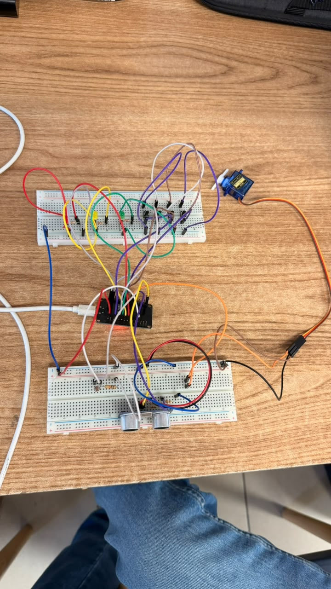

*Montaje del prototipo el 24/11/2026. Las fotos de cada parte están en el [anexo 8.1](#81-fotografías-del-montaje).*

### 1.3 Requerimientos funcionales

RF1 a RF9 son los de la Práctica 3, aplicados a todos los sensores y actuadores nuevos. La última columna indica la prueba que verifica cada uno (sección 4).

| ID | Requerimiento | Diseño | Implementación | Prueba |
|---|---|---|---|---|
| RF1 | Medir la distancia y la luz, y detectar los 4 pulsadores. | 1.2, 2.1 | `SensorDistancia`, `SensorLuz`, `Pulsador` | P-01, RNF-2 |
| RF2 | Reportar en `reported` las lecturas válidas y el estado: en cada cambio y cada 60 s. | 2.8 | `EstadoShadow`, `main.cpp` | RNF-5 |
| RF3 | Aplicar las órdenes válidas del `delta` y confirmarlas en `reported`. | 2.6, 2.8 | `EstadoShadow::leerOrdenesDelta`, `aplicarOrdenes()` | P-06, P-08, P-09 |
| RF4 | Consultar por voz la distancia y la luz de la caja vinculada, e informar las lecturas que falten. | 2.6 a, 2.11 | `consultar_sensores.py` | P-15 |
| RF5 | Abrir y cerrar por voz en modo manual. En modo juego, rechazar la orden. | 2.6 b, 2.7 | `controlar_cerradura.py`, `main.cpp` | P-08 |
| RF6 | Informar por voz el estado reportado de la cerradura. | 2.11 | `consultar_cerradura.py` | P-11 |
| RF7 | Vincular una caja con su código y mantener el vínculo entre sesiones. | 2.9, 2.11 | `vincular_caja.py`, `RepositorioVinculaciones` | P-12 |
| RF8 | Resolver la caja por el `userId` de Alexa. Si no hay vínculo, explicar cómo crearlo. | 2.5 | `IntentCajaHandler` | P-12 |
| RF9 | Validar la existencia y el código antes de vincular, y permitir reemplazar o eliminar el vínculo. | 2.11 | `vincular_caja.py`, `desvincular_caja.py` | P-12 |
| RF10 | Disparar el almacenamiento con reglas de AWS IoT, para las lecturas y para los eventos. | 2.10 | `CajaEnigmasLecturas`, `CajaEnigmasEventos` | P-14 |
| RF11 | Validar tipos y rangos, descartar los mensajes inválidos, agregar `thingName` y la marca de tiempo, y guardar las lecturas. | 2.9, 2.10 | `validacion.py`, `enriquecimiento.py` | P-13, P-14 |
| RF12 | Guardar los eventos de la cerradura con su origen (`voz`, `edge` o `nube`). | 2.9 | `EventoJson`, Lambda de almacenamiento | P-14, sección 5.1 |
| RF13 | Ejecutar el juego y la apertura en el Edge, y detectar en la Nube las cajas que dejan de reportar. | 2.7 | `PartidaEnigmas`, `vigilancia.py` | P-02 a P-05, RNF-3, RNF-8 |
| RF14 | Reportar el modo y los parámetros en `reported`, y consultarlos y cambiarlos por voz a través de `desired`. | 2.8, 2.11 | `cambiar_*.py`, `consultar_*.py`, `ConfiguracionJuego` | P-06, P-07 |
| RF15 | Diseñar los mockups de reportes e indicar la consulta de DynamoDB de cada dato. | 2.12 | [docs/mockups/](docs/mockups/README.md) | P-17, sección 5.1 |

### 1.4 Requerimientos no funcionales

| ID | Atributo | Valor declarado | Verificación |
|---|---|---|---|
| RNF-1 | Estabilidad | Al menos 2 h seguidas con partidas, sin reinicios no provocados. | Registro serial con `millis()`. |
| RNF-2 | Exactitud de medición | HC-SR04: error ≤ 1 cm a 10, 20 y 30 cm, menor que la tolerancia más estricta del juego (2 cm). LDR: distinguir oscuridad, luz ambiente y linterna. | Regla y lecturas del comando `sensores`. |
| RNF-3 | Respuesta de la regla del Edge | ≤ 100 ms desde que se supera el último desafío hasta la orden de abrir el servo. | `tsObjeto` de los eventos. |
| RNF-4 | Respuesta de una orden por voz | ≤ 2 s desde que la Lambda recibe la orden hasta que el servo se mueve. | Logs de la Lambda y registro serial. |
| RNF-5 | Frecuencia de reporte | Cada cambio se reporta en ≤ 1 s, y hay un reporte completo de respaldo cada 60 ± 5 s. | Registro serial. |
| RNF-6 | Integridad del almacenamiento | ≥ 99 % de los mensajes publicados queda en DynamoDB, y el 100 % de los inválidos se descarta. | Registro serial frente a DynamoDB. |
| RNF-7 | Latencia del almacenamiento | ≤ 5 s desde que el objeto genera el dato hasta que queda guardado. | `tsObjeto`, `tsRegla` y `tsGuardado` de cada ítem. |
| RNF-8 | Respuesta de la regla de la Nube | ≤ 20 min (umbral de 15 min más el período de 5 min) desde la última lectura hasta la alerta, sin alertas falsas por cortes menores a 15 min. | GSI `alertas-por-fecha`. |
| RNF-9 | Operación sin conexión | El juego y el servo siguen funcionando. Hasta 20 eventos se guardan en una cola y se publican en orden al volver la red. Las lecturas tomadas sin red no se guardan. | Corte del WiFi durante una partida. |
| RNF-10 | Reconexión y sincronización | La caja se reconecta sola y aplica el `desired` pendiente en ≤ 5 s después de conectarse. | Registro serial y del Shadow. |
| RNF-11 | Costo | Una caja encendida todo el mes entra en la capa gratuita, y fuera de ella cuesta menos de USD 1. | Métricas de CloudWatch. |

**Frecuencia de reporte, justificada** ([contrato §3.3](docs/contratos.md#33-frecuencia-de-reporte)):
- **Por evento:** cada cambio de cerradura, partida, modo o parámetros se reporta en ≤ 1 s, y cada evento del juego se publica en el momento. El juego produce hechos discretos que el operador y la skill necesitan ver enseguida.
- **Respaldo cada 60 s:** un reporte completo con las lecturas. Mantiene el Shadow vigente para las consultas por voz y deja una serie de lecturas para la vigilancia, con unos 1 440 mensajes por día y por caja. Un período más corto multiplica los mensajes sin cambiar ninguna decisión, y uno más largo atrasaría la detección de una caja caída.

## 2. Análisis y diseño

### 2.1 Diagrama de bloques del objeto inteligente

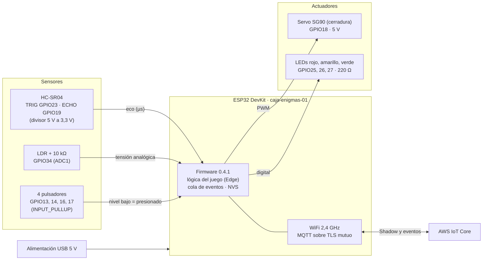

El ESP32 concentra la lógica del juego. Los sensores entran por pines de entrada y los actuadores salen por pines digitales y PWM. La única salida a la red es la conexión MQTT con AWS IoT Core, por donde viajan el Shadow y los eventos.

### 2.2 Diagrama de arquitectura del sistema


- **Un dispositivo, tres funciones Lambda y una responsabilidad cada una:**
  - la skill atiende la voz;
  - la de almacenamiento valida y guarda;
  - la de vigilancia ejecuta la regla de la Nube.

  Así cada rol tiene solo los permisos que usa: la de almacenamiento solo escribe, y la de vigilancia no puede tocar los Shadows. Además, cada función se invoca con su propia frecuencia: la de almacenamiento con cada mensaje y la de vigilancia cada 5 min.
- **Alexa y la Nube nunca hablan directo con el ESP32.** La voz cambia `desired` y el ESP32 lo recibe en el `delta`. Lo único que publica fuera del Shadow es el tema de eventos.
- **Dos temas de entrada para el histórico:**
  - las lecturas viajan en el reporte del Shadow (regla `CajaEnigmasLecturas`);
  - los eventos discretos van en un tema propio (regla `CajaEnigmasEventos`), porque no son estado sino cosas que pasaron, como "se superó la memoria en 18 s con 2 intentos".

### 2.3 Diagrama de circuito

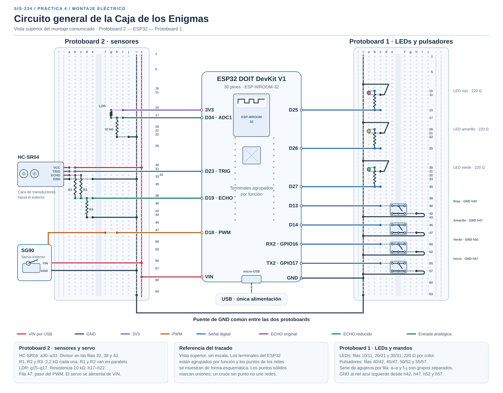

El [diagrama general del circuito](docs/diagramas/circuito-general-p4.svg) muestra la disposición real: protoboard 2 de sensores, ESP32 y protoboard 1 de LEDs y pulsadores. El SG90 está fuera de las protoboards. El circuito recibe alimentación por micro-USB, con VIN compartido por el HC-SR04 y el SG90, y 3V3 independiente para la LDR.

Los esquemas por componente detallan el cableado: [LEDs](docs/diagramas/circuito-leds.svg), [pulsadores](docs/diagramas/circuito-pulsadores.svg), [HC-SR04 y divisor de ECHO](docs/diagramas/circuito-ultrasonico.svg), [LDR](docs/diagramas/circuito-ldr.svg) y [servomotor SG90](docs/diagramas/circuito-servo.svg). La [guía de montaje](docs/GUIA_MONTAJE.md#montaje-de-la-práctica-4) registra las coordenadas y las diferencias de alimentación y resistencias respecto del diseño de referencia.

### 2.4 Diagrama de clases del objeto inteligente

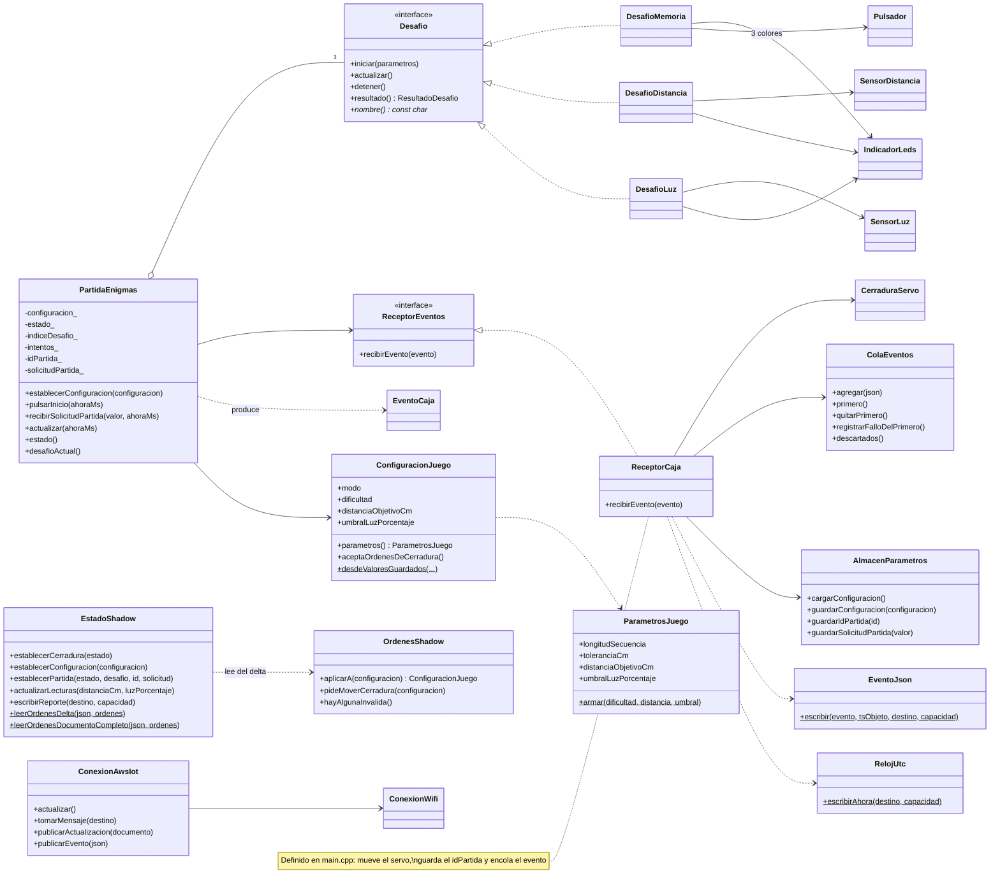

- **Clases de Santiago (hardware):** `Desafio*`, `IndicadorLeds`, `Pulsador`, `SensorDistancia`, `SensorLuz` y `CerraduraServo`.
- **Clases de Adrián:** la partida, el Shadow, la persistencia, los eventos y la conexión.
- `main.cpp` arma todos los objetos y los une en `loop()`, sin lógica de negocio propia.
- **Lógica pura, sin Arduino:** `PartidaEnigmas`, `EstadoShadow`, `ParametrosJuego`/`ConfiguracionJuego`, `EventoJson`, `ColaEventos` y `RelojUtc`. Por eso se prueban en la PC (sección 4).
- **La partida no conoce el hardware:**
  - recibe los tres desafíos como `Desafio&`;
  - avisa lo que pasa a un `ReceptorEventos`, incluido cuándo cerrar o abrir la cerradura;
  - en las pruebas, el receptor es un doble que anota los eventos.

### 2.5 Diagramas de clases de las funciones Lambda

Las tres funciones separan la lógica, que se prueba sin AWS, de los adaptadores que usan `boto3`.

**Backend de la skill (`caja-enigmas-skill`).** Cada intent tiene su manejador. Los que actúan sobre una caja heredan de `IntentCajaHandler`, que primero resuelve la vinculación del `userId` (RF8) y después llama a `mensaje_para_caja()`.

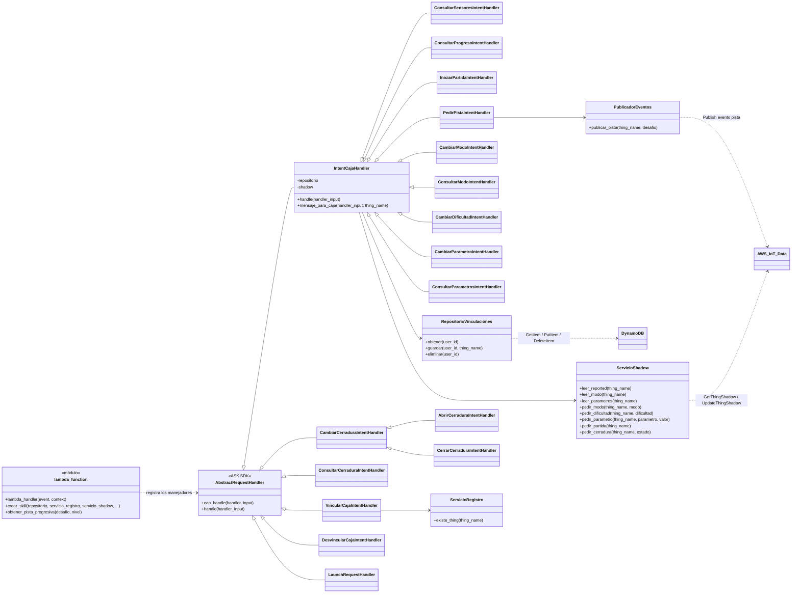

**Almacenamiento (`caja-enigmas-almacenamiento`).** Funciones puras de validación y armado del ítem, y un repositorio con la tabla inyectada.

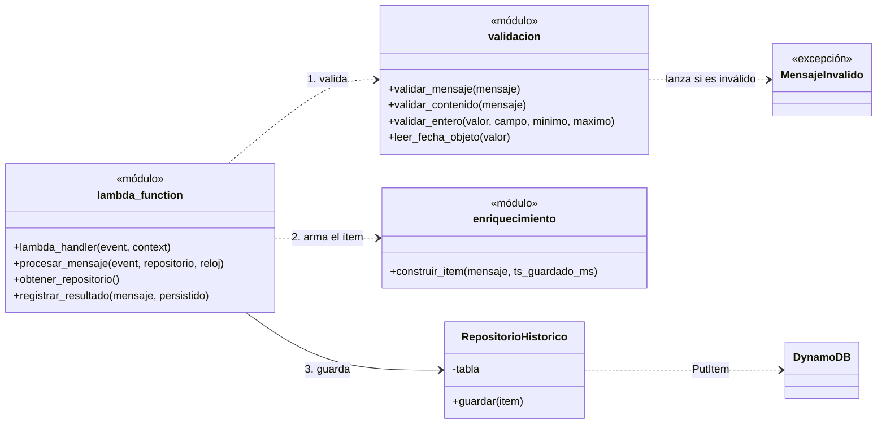

**Vigilancia (`caja-enigmas-vigilancia`).**

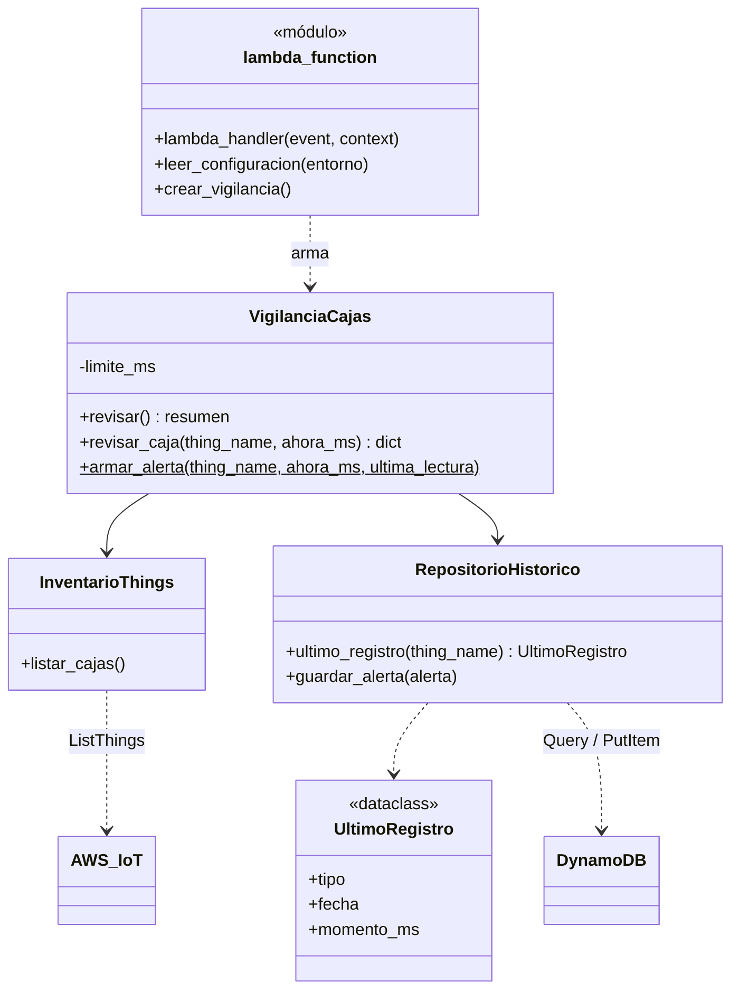

`vigilancia.py` tiene la regla y no importa `boto3`: recibe el inventario, el histórico y el reloj ya armados. `lambda_function.py` solo lee las variables de entorno y crea los clientes de AWS.

### 2.6 Diagramas de secuencia

#### a) Consulta de un sensor, desde el usuario hasta el objeto

La caja publica sus lecturas en el Shadow. La skill nunca habla con el ESP32: lee el último `reported`.

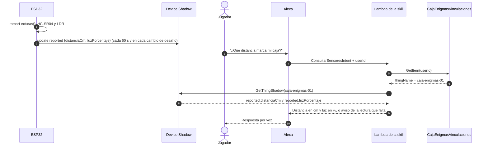

#### b) Comando sobre el actuador: «abre la cerradura»

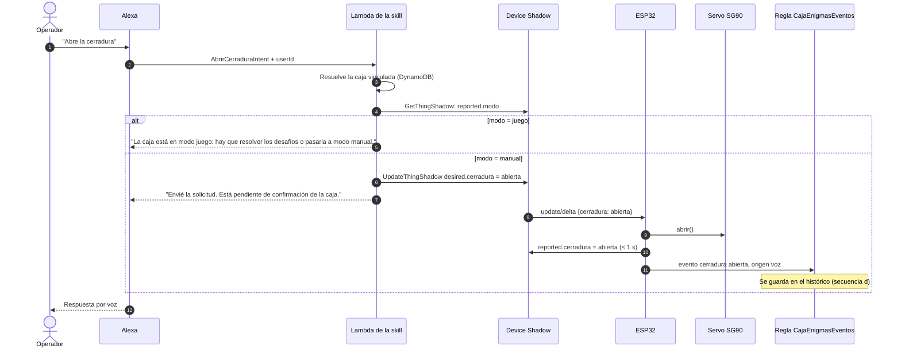

#### c) Consulta del progreso y cambio de un parámetro por voz

**Consulta «¿cómo voy?»**

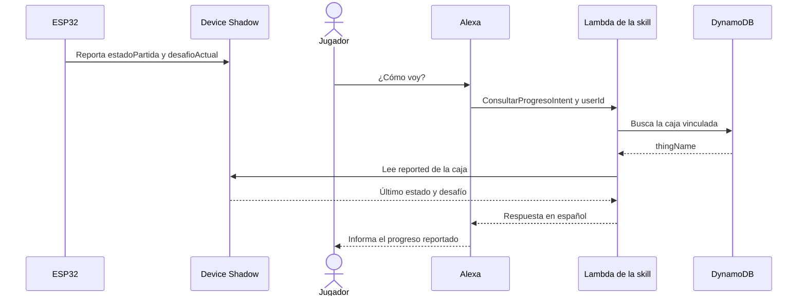

**Comando «pon la dificultad en difícil»**

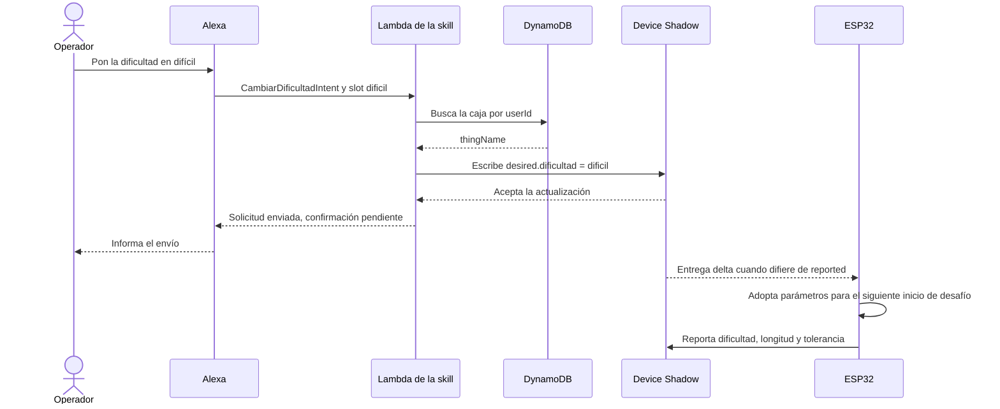

#### d) Almacenamiento de un dato: objeto, regla de IoT, Lambda y DynamoDB

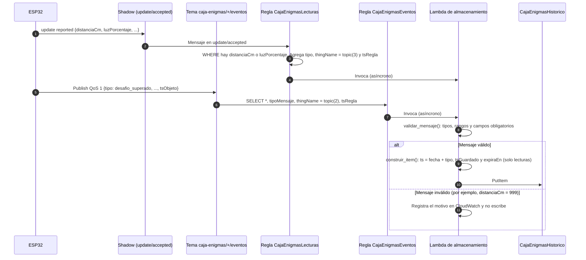

#### e) Reglas automáticas del Edge y de la Nube, inicio por voz y operación sin conexión

**Regla del Edge: superar el último desafío abre la caja.**

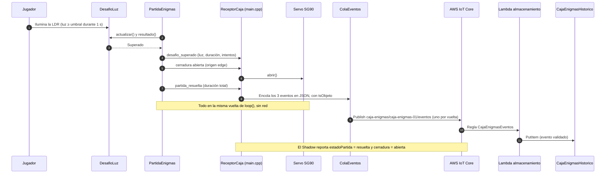

**Regla de la Nube: caja sin reportar.**

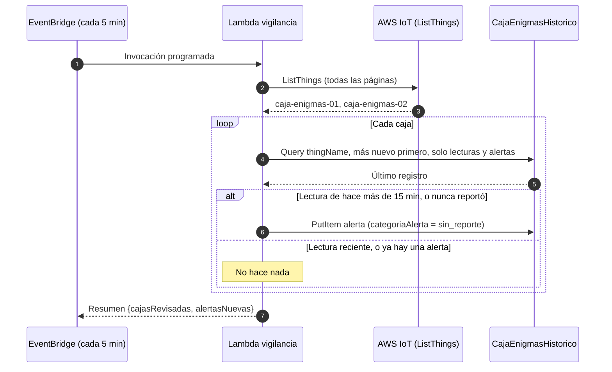

**Inicio de partida por voz: la orden repetida no inicia dos partidas.**

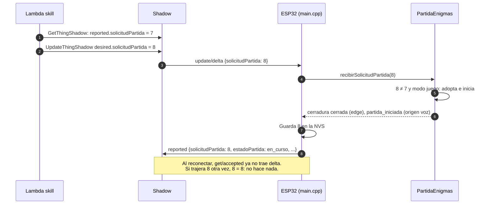

**Operación sin conexión.**

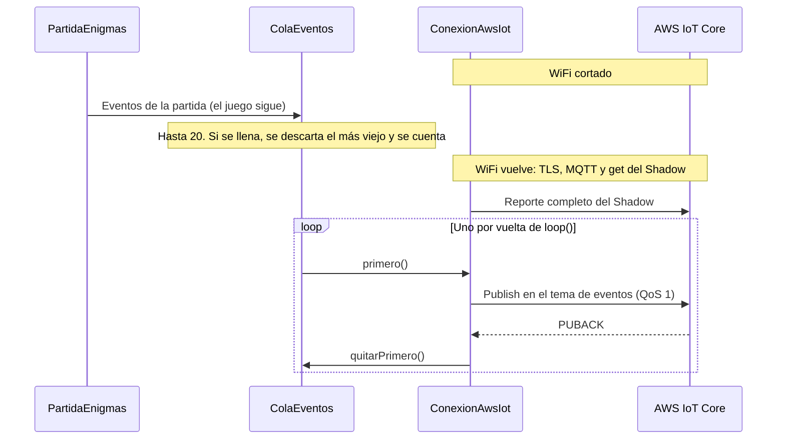

### 2.7 Lógica de control: modos, estados y ubicación de cada regla

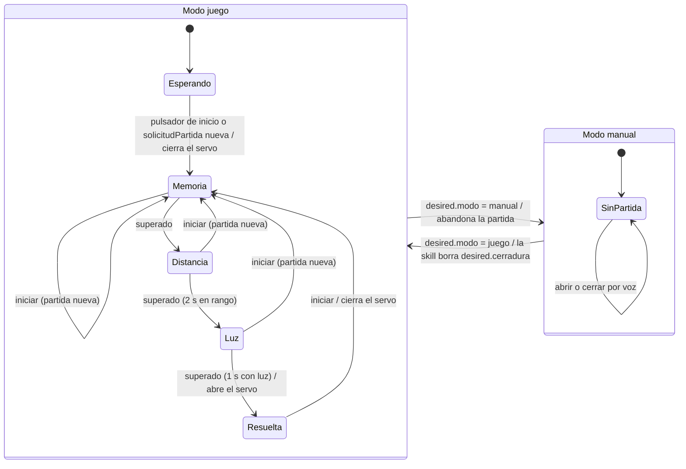

**Convivencia de la voz con la lógica automática:**

| | Modo `juego` (por defecto) | Modo `manual` (operador) |
|---|---|---|
| Quién mueve la cerradura | Solo el juego: cierra al iniciar una partida y abre al resolverla. | Solo la voz. |
| "Abre / cierra la caja" | La skill lo rechaza con una explicación, y el ESP32 también ignora `cerradura` en el `delta`. | Se aplica. |
| "Inicia una partida" y pulsador de inicio | Inician una partida. | Se rechaza por voz; el pulsador no hace nada. |

La regla está implementada en los dos lados:
- la skill rechaza la orden;
- el ESP32 ignora `cerradura` en modo juego.

Así, una orden vieja de "abrir" que hubiera quedado en `desired` no puede abrir la caja en medio de una partida. Además, al pasar a modo juego la skill pone `desired.cerradura` en `null`.

**Ubicación de cada regla:**

| Regla | Dónde | Latencia | Sin conexión | Histórico | Costo de mensajes | Mantenimiento |
|---|---|---|---|---|---|---|
| Partida: validar cada desafío, avanzar y abrir el servo | **Edge** | Inmediata: la apertura ocurre en la misma vuelta de `loop()` en que se cumple la condición. | Sigue funcionando: los eventos se encolan. | No lo necesita: depende solo de los sensores locales. | No genera mensajes para decidir. | Los parámetros se cambian por voz sin reprogramar. |
| Caja sin reportar (más de 15 min sin lecturas) | **Nube** | Hasta 15 + 5 = 20 min, suficiente para un aviso de mantenimiento. | Es justamente lo que detecta: el objeto no puede avisar de su propia desconexión. | La necesita: busca la última lectura de cada caja. | 288 invocaciones por día, sin mensajes del objeto. | El límite se cambia con una variable de entorno. |

**Por qué la regla de la Nube no escribe en `desired`:** la consigna pide que la lógica de la Nube actúe sobre el objeto solo a través de `desired`. Esta regla no actúa sobre el objeto, porque el objeto está apagado o sin red. Su acción es dejar una alerta en el histórico para el operador, que la ve en el panel de reportes (patrón de acceso 6). Es el ejemplo que da la consigna: *"Si el Thing no reporta durante 15 min… se implementaría con otra Lambda ejecutada de forma programada"*.

### 2.8 Especificación del documento Shadow

Shadow clásico, sin nombre. La especificación completa, con ejemplos, está en [contratos.md, sección 2](docs/contratos.md#2-documento-shadow-shadow-clásico-sin-nombre).

| Atributo | Sección | Tipo | Valores válidos | Por defecto |
|---|---|---|---|---|
| `cerradura` | `desired` / `reported` | string | `abierta`, `cerrada` | `cerrada` |
| `modo` | `desired` / `reported` | string | `juego`, `manual` | `juego` |
| `dificultad` | `desired` / `reported` | string | `facil`, `normal`, `dificil` | `normal` |
| `distanciaObjetivoCm` | `desired` / `reported` | entero | 10–40 | 20 |
| `umbralLuzPorcentaje` | `desired` / `reported` | entero | 10–95 | 70 |
| `solicitudPartida` | `desired` / `reported` | entero | ≥ 0 | 0 |
| `longitudSecuencia` | `reported` | entero | 3, 4 o 6 (según la dificultad) | 4 |
| `toleranciaCm` | `reported` | entero | 6, 4 o 2 (según la dificultad) | 4 |
| `estadoPartida` | `reported` | string | `esperando`, `en_curso`, `resuelta` | `esperando` |
| `desafioActual` | `reported` | string | `memoria`, `distancia`, `luz`, `ninguno` | `ninguno` |
| `idPartida` | `reported` | entero | ≥ 0 | 0 |
| `distanciaCm` | `reported` | entero | 2–400; se omite sin lectura válida | — |
| `luzPorcentaje` | `reported` | entero | 0–100 | — |
| `codigoVinculacion` | `reported` | string | 4 dígitos | generado en el primer arranque |
| `firmware` | `reported` | string | versión, p. ej. `0.4.0` | — |

**Uso de cada sección:**
- **`desired`** lo escribe solo la Lambda de la skill: la cerradura (en modo manual), el modo, la dificultad, los dos parámetros de calibración y `solicitudPartida`.
- **`reported`** lo escribe solo el ESP32:
  - en cada cambio, en menos de 1 s;
  - cada 60 s como respaldo, con las lecturas de los sensores;
  - en cada cambio de desafío.
- **`delta`** lo calcula AWS. El ESP32 lo recibe por `update/delta` y, al reconectar, en el `get/accepted`. Lee cada atributo por separado, ignora los desconocidos y descarta los valores inválidos, por ejemplo `"20"`, `70.5`, `-1` o `276`. Después reporta su estado real, y así el `delta` desaparece.

**Decisiones de diseño:**
- **`solicitudPartida` es un contador y no un texto como `"iniciar"`.** La skill escribe el valor reportado + 1. El ESP32 inicia una partida solo si recibe un valor distinto del suyo, así que la misma orden repetida (por ejemplo, en el `get` de cada reconexión) no inicia dos partidas.
- **La dificultad fija `longitudSecuencia` y `toleranciaCm`, que solo se reportan.** La distancia objetivo y el umbral de luz son de calibración y se cambian por separado, así no se pisan.
- **El modo, la dificultad, los parámetros y los contadores se guardan en la NVS.** Después de un reinicio sin red, la caja sigue configurada igual y no repite un `idPartida`.

**Documento real de `caja-enigmas-01` al final de las pruebas** (código de vinculación ocultado):

```json
{
  "desired": { "modo": "juego", "dificultad": "facil", "distanciaObjetivoCm": 20, "solicitudPartida": 4 },
  "reported": {
    "cerradura": "abierta", "modo": "juego", "dificultad": "facil",
    "distanciaObjetivoCm": 20, "umbralLuzPorcentaje": 70, "solicitudPartida": 4,
    "longitudSecuencia": 3, "toleranciaCm": 6,
    "estadoPartida": "resuelta", "desafioActual": "ninguno", "idPartida": 14,
    "distanciaCm": 17, "luzPorcentaje": 76,
    "codigoVinculacion": "****", "firmware": "0.4.1"
  }
}
```

`desired` y `reported` coinciden en los atributos que tienen en común, así que no hay `delta`: la caja aplicó todas las órdenes.

### 2.9 Modelo de datos de DynamoDB

El modelo parte de los **patrones de acceso** de los mockups y de la lógica de la Nube, no de la forma de los mensajes. Hay dos tablas: la de vinculaciones de la P3, que no cambia, y una tabla única de histórico para las lecturas, los eventos y las alertas de todas las cajas.

**`CajaEnigmasVinculaciones`** (P3, [config/aws/tabla-vinculaciones.json](config/aws/tabla-vinculaciones.json)):

| Atributo | Tipo | Clave | Descripción |
|---|---|---|---|
| `userId` | S | Partición | `context.System.user.userId` de Alexa. |
| `thingName` | S | — | Caja vinculada, `caja-enigmas-NN`. |
| `fechaVinculacion` | S | — | ISO-8601 UTC. |

**`CajaEnigmasHistorico`** (P4, *on-demand*, [config/aws/tabla-historico.json](config/aws/tabla-historico.json)):

| Atributo | Tipo | Clave o índice | Descripción |
|---|---|---|---|
| `thingName` | S | Partición | Caja. Separa los datos de cada *Thing* y de cada usuario. |
| `ts` | S | Ordenamiento | `<ISO-8601 UTC con ms>#<tipo o evento>`, por ejemplo `2026-11-24T18:00:12.621Z#desafio_superado`. La fecha permite consultar por rango, y el sufijo evita que dos ítems de distinto tipo del mismo milisegundo se pisen. |
| `tipo` | S | — | `lectura`, `evento` o `alerta`. |
| `evento` | S | — | Solo en los eventos: `partida_iniciada`, `desafio_superado`, `desafio_fallado`, `partida_resuelta`, `cerradura` o `pista`. |
| `distanciaCm`, `luzPorcentaje` | N | — | Solo en las lecturas. |
| `idPartida`, `desafio`, `duracionMs`, `intentos`, `dificultad`, `cerradura`, `origen` | N o S | — | Campos del evento, según su tipo ([contrato §3.2](docs/contratos.md#32-eventos-nuevo)). |
| `tsObjeto` | S | — | Hora del ESP32 (NTP), si vino en el mensaje. |
| `tsRegla` | N | — | Epoch en ms, de `timestamp()` en la regla. |
| `tsGuardado` | N | — | Epoch en ms, justo antes del `PutItem`. Sirve para medir la latencia. |
| `expiraEn` | N | **TTL** | Epoch en s, a 30 días. **Solo en las lecturas**: los eventos se conservan porque alimentan las estadísticas. |
| `categoriaAlerta` | S | Partición del GSI | Solo en las alertas: `sin_reporte`. |
| GSI `alertas-por-fecha` | — | `categoriaAlerta` y `ts` | **Disperso:** solo contiene las alertas. Proyección `ALL`. |

**Patrones de acceso que satisface:**

| # | Patrón | Operación | Quién lo usa |
|---|---|---|---|
| 1 | Eventos de una caja en un rango de fechas | `Query` por `thingName` con `ts BETWEEN`, filtrando `tipo = evento` | Historial del panel |
| 2 | Partidas iniciadas y resueltas de una caja en el día | Igual que el 1, con el rango del día | Indicadores del panel |
| 3 | Duración, intentos y fallos por desafío | Igual que el 1, con `desafio_superado` y `desafio_fallado`, agrupando por `desafio` | Panel |
| 4 | Pistas pedidas por desafío | Igual que el 1, con `evento = pista` | Panel |
| 5 | Última lectura de una caja | `Query` por `thingName` con `ScanIndexForward = false` | Lambda de vigilancia |
| 6 | Alertas recientes de todas las cajas | `Query` sobre el GSI con `categoriaAlerta = sin_reporte`, `ScanIndexForward = false` | Panel |

**Por qué este diseño:**
- **`thingName` como clave de partición:** todas las consultas son por caja, excepto la 6, y así los datos de cada usuario quedan separados.
- **Una sola tabla de histórico:** los patrones 1 a 5 son por caja y por rango de fechas, así que una sola `Query` trae lecturas y eventos juntos. Tablas separadas obligarían a hacer dos consultas.
- **GSI disperso:** la única consulta entre cajas es la de alertas. Como solo las alertas tienen `categoriaAlerta`, el índice es pequeño y no se paga por indexar las lecturas.
- **TTL solo en las lecturas:** son el 68 % de los ítems y solo sirven unos días. Los eventos son pocos y sostienen las estadísticas.
- ***On-demand*:** el tráfico es bajo y llega en ráfagas durante las partidas, así que no conviene reservar capacidad.

**Ítems reales del 24/11** ([muestra completa](docs/evidencias/p4/datos/muestra-historico.json)):

| `thingName` | `ts` | `tipo` | Datos | `origen` |
|---|---|---|---|---|
| `caja-enigmas-01` | `2026-11-24T16:52:01.192Z#lectura` | `lectura` | `distanciaCm` y `luzPorcentaje`, con `expiraEn` | — |
| `caja-enigmas-01` | `2026-11-24T17:59:44.939Z#desafio_superado` | `evento` | `idPartida: 4`, `desafio: memoria`, `duracionMs: 5844`, `intentos: 1` | — |
| `caja-enigmas-01` | `2026-11-24T17:59:50.071Z#cerradura` | `evento` | `cerradura: abierta` | `edge` |
| `caja-enigmas-01` | `2026-11-24T17:27:00.868Z#cerradura` | `evento` | `cerradura: abierta` | `voz` |
| `caja-enigmas-01` | `2026-11-24T19:48:15.467Z#alerta` | `alerta` | `categoriaAlerta: sin_reporte`, `ultimaLectura: 2026-11-24T19:29:20.603Z`, `minutosSinReporte: 18` | — |
| `caja-enigmas-02` | `2026-11-23T14:23:23.053Z#alerta` | `alerta` | `categoriaAlerta: sin_reporte`, `ultimaLectura`, `minutosSinReporte: 1048` | — |

### 2.10 Reglas de AWS IoT y funciones Lambda de la Nube

**Reglas de AWS IoT** (SQL versión `2016-03-23`, exportadas en [config/aws/reglas/](config/aws/reglas/)):

| Regla | Tema de entrada | Filtro | Acción |
|---|---|---|---|
| `CajaEnigmasLecturas` | `$aws/things/+/shadow/update/accepted` | Solo los reportes que traen `distanciaCm` o `luzPorcentaje`. Los cambios de `desired` que hace la skill también pasan por ese tema, pero no tienen lecturas. | Invocar `caja-enigmas-almacenamiento` |
| `CajaEnigmasEventos` | `caja-enigmas/+/eventos` | Todos los mensajes: cada uno es un evento. | Invocar `caja-enigmas-almacenamiento` |

```sql
-- CajaEnigmasLecturas
SELECT state.reported.distanciaCm AS distanciaCm,
       state.reported.luzPorcentaje AS luzPorcentaje,
       'lectura' AS tipo,
       topic(3) AS thingName,
       timestamp() AS tsRegla
FROM '$aws/things/+/shadow/update/accepted'
WHERE NOT isUndefined(state.reported.distanciaCm)
   OR NOT isUndefined(state.reported.luzPorcentaje)

-- CajaEnigmasEventos
SELECT *, 'evento' AS tipoMensaje,
       topic(2) AS thingName,
       timestamp() AS tsRegla
FROM 'caja-enigmas/+/eventos'
```

- **El `thingName` sale del tema, no del payload.** La política de IoT impide que una caja publique en el tema de otra, así que el dato no se puede falsificar.
- La regla de eventos agrega `tipoMensaje` y no `tipo`, porque `tipo` ya trae el nombre del evento.

**Funciones Lambda:**

| Función | Responsabilidad | Disparador | Recursos a los que accede | Frecuencia |
|---|---|---|---|---|
| `caja-enigmas-skill` | Backend de la skill. | Alexa Skills Kit, con verificación del Skill ID | Shadow (lee `reported` y escribe `desired`), `CajaEnigmasVinculaciones` y el tema de eventos (pistas) | Una vez por frase |
| `caja-enigmas-almacenamiento` | Validar, enriquecer y guardar. | Las dos reglas de IoT | `PutItem` en `CajaEnigmasHistorico` | Una vez por mensaje válido de la regla (unas 1 660 por día y por caja) |
| `caja-enigmas-vigilancia` | Lógica de la Nube: caja sin reportar. | EventBridge, `rate(5 minutes)` | `ListThings`, y `Query` y `PutItem` en `CajaEnigmasHistorico` | 288 por día, sin importar cuántas cajas haya |

**Por qué tres funciones y no una:**
- **Responsabilidad única:** guardar el histórico y decidir si una caja está caída son tareas distintas. Además, la vigilancia no puede depender de un mensaje de la caja, porque detecta justamente que la caja no manda nada.
- **Frecuencia de invocación:** el almacenamiento corre con cada mensaje y debe ser rápido (98 ms en promedio). La vigilancia corre cada 5 min y puede tardar más (805 ms), porque recorre todas las cajas.
- **Permisos mínimos:** el almacenamiento solo escribe; la vigilancia no puede tocar los Shadows; la skill no puede leer el histórico.
- **Costo:** separarlas no agrega invocaciones. Cada mensaje dispara una sola función.
- **Una sola Lambda de almacenamiento para las dos reglas:** las dos fuentes necesitan la misma validación y el mismo permiso. Las reglas son dos porque sus temas y su SQL son distintos.

### 2.11 Diseño de la skill de Alexa

| Elemento | Valor |
|---|---|
| Idioma | Español (EE. UU.), `es-US` |
| Nombre de invocación | **caja de enigmas** |
| Etapa | *Development*, probada con el simulador de la Developer Console y con `ask smapi simulate-skill` |
| Modelo | [config/alexa/modelo-interaccion.es-US.json](config/alexa/modelo-interaccion.es-US.json): 14 intents propios, 5 integrados y 3 tipos de slot propios |
| Endpoint | ARN de `caja-enigmas-skill` en us-east-1, con el disparador de Alexa restringido al Skill ID |

| Intent | Slots | Frases de ejemplo | Efecto |
|---|---|---|---|
| `VincularCajaIntent` | `numeroCaja` (`AMAZON.NUMBER`), `codigo` (`AMAZON.FOUR_DIGIT_NUMBER`) | "vincula mi caja dos con el código cero cuatro ocho uno", "registra mi caja" | Valida que exista el Thing y que el código coincida con `reported.codigoVinculacion`. Si faltan datos, los pide con un diálogo. |
| `DesvincularCajaIntent` | — | "desvincula mi caja", "olvida mi caja" | Borra el vínculo. |
| `ConsultarCerraduraIntent` | — | "cómo está la cerradura" | Lee `reported.cerradura` y avisa si hay una orden pendiente. |
| `AbrirCerraduraIntent` y `CerrarCerraduraIntent` | — | "abre la cerradura", "traba la caja" | En modo manual, escriben `desired.cerradura`. En modo juego, se rechazan con una explicación. |
| `IniciarPartidaIntent` | — | "inicia una partida", "quiero jugar" | Escribe `desired.solicitudPartida` = valor reportado + 1. En modo manual, se rechaza. |
| `PedirPistaIntent` | — | "dame una pista" | Lee `desafioActual` y entrega la pista 1, 2 o 3 de ese desafío. Publica un evento `pista`. |
| `ConsultarProgresoIntent` | — | "cómo voy", "en qué desafío voy" | Lee `estadoPartida` y `desafioActual`. |
| `ConsultarSensoresIntent` | — | "qué distancia marca mi caja", "dime la distancia y la luz" | Lee `distanciaCm` y `luzPorcentaje` (RF4). |
| `CambiarModoIntent` | `modo` (`TipoModo`) | "pon la caja en modo manual", "activa el modo juego" | Escribe `desired.modo`. Al pasar a juego, borra `desired.cerradura`. |
| `ConsultarModoIntent` | — | "en qué modo está la caja" | Lee `reported.modo`. |
| `CambiarDificultadIntent` | `dificultad` (`TipoDificultad`) | "pon la dificultad en difícil" | Escribe `desired.dificultad`. |
| `CambiarParametroIntent` | `parametro` (`TipoParametro`), `valor` (`AMAZON.NUMBER`) | "cambia la distancia objetivo a veinte", "ajusta el umbral de luz a setenta" | Valida el rango (de 10 a 40 cm, o de 10 a 95 %). Si es válido, escribe en `desired`; si no, explica el rango y no escribe. |
| `ConsultarParametrosIntent` | — | "cuáles son los parámetros del juego" | Lee la dificultad, la longitud de la secuencia, la tolerancia, la distancia objetivo y el umbral. |
| Integrados | — | "ayuda", "para", "cancela", "ve al inicio" | `HelpIntent`, `StopIntent`, `CancelIntent`, `NavigateHomeIntent` y `FallbackIntent`. |

**Tipos de slot propios:** el backend usa el **ID** de la resolución de entidades, que coincide con el valor del Shadow, y nunca el texto que dijo el usuario.

| Tipo | ID | Sinónimos |
|---|---|---|
| `TipoModo` | `juego` / `manual` | jugar, automático / operador |
| `TipoDificultad` | `facil` / `normal` / `dificil` | sencillo / medio / complicado |
| `TipoParametro` | `distanciaObjetivoCm` / `umbralLuzPorcentaje` | distancia objetivo, distancia / umbral de luz, luz |

**Reglas de diálogo:**
- Las consultas leen `reported`, que es el estado real de la caja.
- Las órdenes escriben `desired` y responden que la solicitud está pendiente de confirmación, porque la caja puede estar sin red. En ese caso la orden se aplica al reconectar (RNF-10).

### 2.12 Diseño de reportes (mockups)

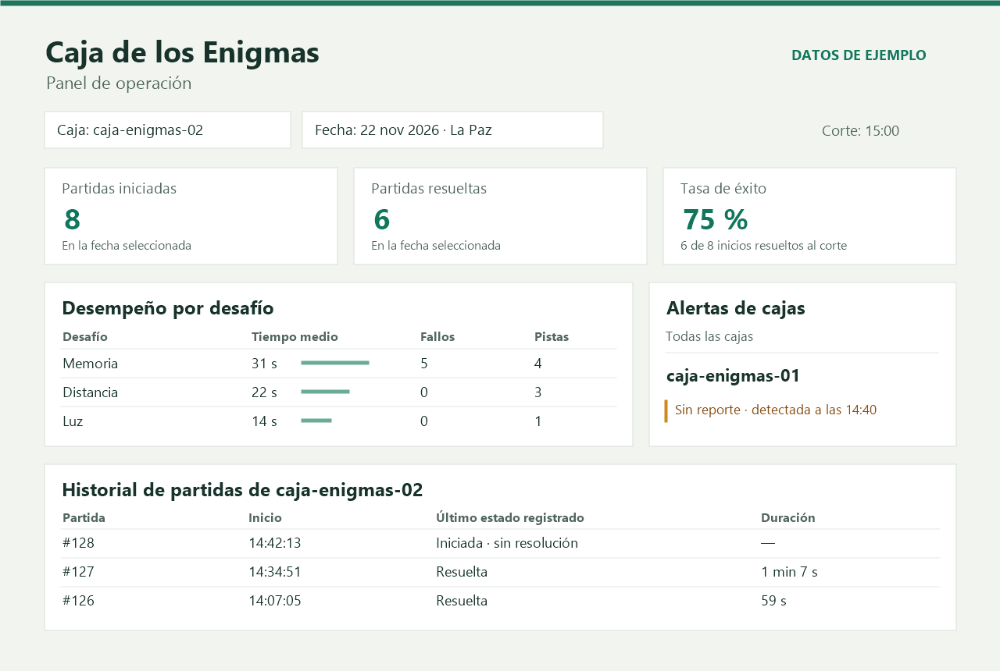

*Mockup del panel del operador, con cifras ilustrativas. La [guía del mockup](docs/mockups/README.md) detalla cada consulta. En la sección 5.1 se calculan los mismos indicadores con los datos reales del 24/11.*

| Elemento del panel | Patrón (2.9) | Consulta y cálculo | Decisión que permite |
|---|---|---|---|
| Partidas del día y tasa de éxito | 2 | `Query` del día por `thingName`. Contar `partida_iniciada` y `partida_resuelta`, y emparejarlas por `idPartida`. | Bajar la dificultad si se inician partidas y pocas se resuelven. |
| Tiempo medio y fallos por desafío | 3 | Promediar `duracionMs` de `desafio_superado` y contar `desafio_fallado`, por `desafio`. | Recalibrar el desafío más lento o el que más falla. |
| Pistas por desafío | 4 | Contar `evento = pista` por `desafio`. | Reescribir las instrucciones del desafío que más pistas necesita. |
| Historial de partidas | 1 | Eventos agrupados por `idPartida`, con la duración de `partida_resuelta`. | Revisar una partida concreta. |
| Alertas de cajas | 6 | `Query` del GSI `alertas-por-fecha`, de la más nueva a la más vieja. | Revisar una caja antes de la siguiente sesión. |

## 3. Desarrollo e implementación

### 3.1 Estructura del repositorio

```text
firmware/                 Objeto inteligente (PlatformIO, C++ orientado a objetos)
  src/, include/          Clases de la sección 2.4
  test/                   89 pruebas nativas (pio test -e pruebas)
lambda/                   Backend de la skill (Python 3.12)
  manejadores/            Un manejador por intent
  servicios/              Shadow, vinculaciones, registro de Things y eventos
  pistas.py, textos.py    Catálogo de pistas y respuestas
lambda-almacenamiento/    Validación, enriquecimiento y PutItem
lambda-vigilancia/        Regla de la Nube (caja sin reportar)
config/aws/               Política de IoT, reglas, tablas, roles y regla programada
config/alexa/             Modelo de interacción
docs/                     Contratos, diagramas, mockups, guías y evidencias
```

### 3.2 Código del objeto inteligente

| Módulo | Responsabilidad | Autor |
|---|---|---|
| [main.cpp](firmware/src/main.cpp) | Arma los objetos y los une en `loop()`. Define `ReceptorCaja`. | Adrián |
| [PartidaEnigmas](firmware/src/PartidaEnigmas.cpp) | Máquina de estados de la partida (regla del Edge). | Adrián |
| [EstadoShadow](firmware/src/EstadoShadow.cpp) | Lee el `delta` y arma el `reported`. | Adrián |
| [ParametrosJuego / ConfiguracionJuego](firmware/src/ParametrosJuego.cpp) | Tabla de dificultades, rangos y configuración por voz. | Adrián |
| [AlmacenParametros](firmware/src/AlmacenParametros.cpp) | Persistencia en la NVS. | Adrián |
| [EventoJson](firmware/src/EventoJson.cpp), [ColaEventos](firmware/src/ColaEventos.cpp), [RelojUtc](firmware/src/RelojUtc.cpp) | Formato, cola sin conexión y hora de los eventos. | Adrián |
| [ConexionWifi](firmware/src/ConexionWifi.cpp), [ConexionAwsIot](firmware/src/ConexionAwsIot.cpp) | Red, TLS mutuo y MQTT. | Adrián |
| `Desafio*`, `IndicadorLeds`, `Pulsador`, `SensorDistancia`, `SensorLuz`, `CerraduraServo` | Hardware y los tres desafíos. | Santiago |

**Fragmentos clave:**
- **`loop()` nunca se bloquea.** Los desafíos miden el tiempo con `millis()`, y `pulseIn` tiene un límite de 25 ms. Además, la cola publica un solo evento por vuelta, porque cada publicación QoS 1 espera el PUBACK.
- **`aplicarOrdenes()` aplica primero la configuración y después la cerradura y la solicitud.** Si un mismo `delta` trae `modo: manual` y `cerradura: abierta`, el modo nuevo es el que decide si se obedece la cerradura.
- **`tomarLecturas()` no mide la distancia mientras corre ese desafío.** `SensorDistancia::actualizar()` entrega cada medición nueva una sola vez, así que otra llamada se la quitaría al desafío.
- **Cada evento se convierte a JSON en el momento en que ocurre.** Así `tsObjeto` es la hora del evento y no la de la publicación, que puede ser minutos después si no había red.
- **`EventoJson` escribe solo los campos de cada tipo.** La Lambda de almacenamiento valida todos los campos que llegan, y un campo de más con un valor fuera de rango (por ejemplo, `intentos: 0`) haría descartar el evento entero.

- **Configuración sin secretos:** el endpoint, el certificado, la clave privada y el WiFi viven en `firmware/include/ConfiguracionAws.h` y `ConfiguracionWifi.h`, que están en `.gitignore`. El repositorio solo tiene las plantillas [ConfiguracionAws.ejemplo.h](firmware/include/ConfiguracionAws.ejemplo.h) y [ConfiguracionWifi.ejemplo.h](firmware/include/ConfiguracionWifi.ejemplo.h).
- **Firmware 0.4.1:** agrega a la consola serial el comando `sensores`, que imprime cada segundo la distancia, la luz y el estado de los pulsadores. Se usó para calibrar (sección 4.5) y para encontrar el error de cableado de los pulsadores (sección 4.6).

### 3.3 Código de las funciones Lambda

Las tres funciones son *serverless*, en Python 3.12, y siguen PEP 8 con nombres en español. Cada una separa la lógica pura de los clientes de AWS, así que las pruebas usan dobles y no necesitan credenciales.

**Backend de la skill** ([lambda/](lambda/README.md), Mateo):
- [lambda_function.py](lambda/lambda_function.py) arma los clientes y registra los manejadores en `crear_skill()`.
- [juego_comun.py](lambda/manejadores/juego_comun.py) define `IntentCajaHandler`. Su `handle()` resuelve la vinculación y luego llama a `mensaje_para_caja()`, así ningún intent puede actuar sobre una caja ajena (RF8).
- [controlar_cerradura.py](lambda/manejadores/controlar_cerradura.py) lee `reported.modo` y, en modo juego, rechaza la orden sin escribir `desired` (convivencia de la sección 2.7).
- [cambiar_parametro.py](lambda/manejadores/cambiar_parametro.py) valida el rango antes de escribir. Un valor fuera de rango no llega nunca al Shadow.
- [servicio_shadow.py](lambda/servicios/servicio_shadow.py) concentra las lecturas y escrituras del Shadow. `pedir_partida()` escribe el valor reportado + 1, para que la orden sea idempotente.
- [pedir_pista.py](lambda/manejadores/pedir_pista.py) guarda el nivel de pista en la sesión y lo reinicia al cambiar de partida o de desafío. Publica el evento con [publicador_eventos.py](lambda/servicios/publicador_eventos.py).

**Almacenamiento** ([lambda-almacenamiento/](lambda-almacenamiento/README.md), Mateo):
- [validacion.py](lambda-almacenamiento/validacion.py) reconoce las dos salidas de las reglas y valida tipos, rangos, fechas y los campos obligatorios de cada evento. Rechaza los booleanos disfrazados de enteros y omite los campos desconocidos.
- [enriquecimiento.py](lambda-almacenamiento/enriquecimiento.py) arma la clave `ts`, agrega `tsGuardado` y, solo en las lecturas, `expiraEn`.
- [lambda_function.py](lambda-almacenamiento/lambda_function.py) solo crea el cliente de `boto3` al guardar un mensaje válido. Los logs registran el resultado y el motivo del descarte, pero nunca el payload.

**Vigilancia** ([lambda-vigilancia/](lambda-vigilancia/README.md), Adrián):
- [vigilancia.py](lambda-vigilancia/vigilancia.py) tiene la regla y no importa `boto3`. Recibe el inventario, el histórico y el reloj ya armados.
- No repite una alerta: si el último registro de la caja ya es una alerta, no hace nada.

### 3.4 Configuración de AWS IoT Core

| Elemento | Valor |
|---|---|
| Things | `caja-enigmas-01` (la caja) y `caja-enigmas-02` (sin placa, para probar varios usuarios y la alerta). |
| Certificado | X.509 por Thing, emitido por AWS IoT. La clave privada vive solo en `firmware/include/ConfiguracionAws.h`, que está en `.gitignore`. |
| Política | `CajaEnigmasPolitica` v2 ([config/aws/politica-iot.json](config/aws/politica-iot.json)). |

**Permisos de la política, cada uno limitado al Thing de la conexión** con `${iot:Connection.Thing.ThingName}`:

| Sentencia | Permiso | Por qué |
|---|---|---|
| `ConectarSoloComoSuThing` | `iot:Connect` como `client/<su Thing>`, solo si el certificado está asociado al Thing. | Ningún certificado puede conectarse como otra caja. |
| `PublicarYRecibirEnSuShadow` | `iot:Publish` e `iot:Receive` en `$aws/things/<su Thing>/shadow/*`. | Reportar y recibir el `delta` de su propio Shadow. |
| `PublicarSusEventos` | `iot:Publish` en `caja-enigmas/<su Thing>/eventos`. | Nuevo en la v2. Por eso la regla de eventos puede tomar el `thingName` del tema sin confiar en el payload. |
| `SuscribirseASuShadow` | `iot:Subscribe` en `$aws/things/<su Thing>/shadow/*`. | Suscribirse a `update/delta` y `get/accepted`. |

Ya es la política mínima: no usa comodines entre Things, y el objeto no puede suscribirse al tema de eventos ni leerlo.

### 3.5 Configuración de las reglas de AWS IoT

| Elemento | Valor |
|---|---|
| Reglas | `CajaEnigmasLecturas` y `CajaEnigmasEventos`, habilitadas y con el SQL de la sección 2.10 ([exportación](config/aws/reglas/)). |
| Acción | Invocar `caja-enigmas-almacenamiento`, de forma asíncrona. |
| Permiso | Las reglas **no usan un rol IAM**. AWS IoT invoca la Lambda con el permiso basado en recursos de la función, que la consola agregó al crear cada acción. Cada sentencia exige que el origen sea esa regla (`AWS:SourceArn`), así que ninguna otra regla puede invocar la función ([exportación](config/aws/permiso-invocacion-almacenamiento.json)). |

Este es el mínimo privilegio que pide la consigna para una regla (`lambda:InvokeFunction` sobre su Lambda).

### 3.6 Funciones Lambda y roles IAM

| Función | Runtime y recursos | Variables de entorno | Rol |
|---|---|---|---|
| `caja-enigmas-skill` | Python 3.12, 128 MB, 10 s | `TABLA_VINCULACIONES`, `PREFIJO_THING`, `IOT_ENDPOINT` | `caja-enigmas-lambda-rol` |
| `caja-enigmas-almacenamiento` | Python 3.12, 128 MB, 15 s | `TABLA_HISTORICO` | `caja-enigmas-almacenamiento-role-…`, creado por la consola |
| `caja-enigmas-vigilancia` | Python 3.12, 128 MB, 30 s | `TABLA_HISTORICO`, `PREFIJO_THING`, `MINUTOS_SIN_REPORTE=15` | `caja-enigmas-vigilancia-rol` |

Ningún código tiene access keys: cada función usa las credenciales temporales de su rol.

**Permisos asignados y justificación:**

| Rol | Permiso | Recurso | Por qué | Mínimo para producción |
|---|---|---|---|---|
| Skill ([política](config/aws/politica-rol-lambda.json)) | `iot:GetThingShadow`, `iot:UpdateThingShadow`, `iot:DescribeThing` | `thing/caja-enigmas-*` | Leer `reported`, escribir `desired` y comprobar que la caja existe al vincular. El comodín cubre todas las cajas, porque cada usuario tiene la suya. | Ya es el mínimo. |
| Skill | `dynamodb:GetItem`, `PutItem`, `DeleteItem` | `CajaEnigmasVinculaciones` | Resolver, crear y borrar el vínculo. | Ya es el mínimo. |
| Skill | `iot:Publish` | `topic/caja-enigmas/caja-enigmas-*/eventos` | Publicar los eventos `pista`. | Ya es el mínimo. |
| Skill | Política administrada `AWSLambdaBasicExecutionRole` | Logs | Escribir en CloudWatch. | **Más amplia de lo necesario:** permite escribir en cualquier grupo de logs. En producción conviene limitarla a `/aws/lambda/caja-enigmas-skill`, como ya lo hace la consola en las otras dos funciones. |
| Almacenamiento ([política](config/aws/politica-rol-almacenamiento.json)) | `dynamodb:PutItem` | `CajaEnigmasHistorico` | Guardar el ítem. | Ya es el mínimo. |
| Almacenamiento | `dynamodb:DescribeTable` | `CajaEnigmasHistorico` | Se agregó al crear la política, pero el código no lo usa. | **Sobra:** se puede quitar. |
| Almacenamiento | `logs:CreateLogGroup`, `CreateLogStream`, `PutLogEvents` | Solo su grupo de logs | Registrar cada mensaje procesado. | Ya es el mínimo. |
| Vigilancia | Ver la sección 3.8. | | | |

### 3.7 Tablas de DynamoDB

| Tabla | Capacidad | Claves | Índices y TTL | Exportación |
|---|---|---|---|---|
| `CajaEnigmasVinculaciones` | *On-demand* | `userId` | — | [tabla-vinculaciones.json](config/aws/tabla-vinculaciones.json) |
| `CajaEnigmasHistorico` | *On-demand*, clase Standard | `thingName` y `ts` | GSI `alertas-por-fecha` (`categoriaAlerta`, `ts`, proyección `ALL`). TTL activo sobre `expiraEn`. | [tabla-historico.json](config/aws/tabla-historico.json) |

El 24/11 a las 15:30, `CajaEnigmasHistorico` tenía 288 ítems (45 KB), y el GSI tenía 2 alertas. Al terminar las pruebas, el GSI tenía 3.

### 3.8 Lambda de vigilancia y regla programada

| Elemento | Valor |
|---|---|
| Función | `caja-enigmas-vigilancia`, Python 3.12, 128 MB, *timeout* de 30 s. Código en [lambda-vigilancia/](lambda-vigilancia/README.md). |
| Disparador | Regla de EventBridge `caja-enigmas-vigilancia-cada-5-min`, `rate(5 minutes)` ([config/aws/regla-vigilancia.json](config/aws/regla-vigilancia.json)). |
| Variables | `TABLA_HISTORICO=CajaEnigmasHistorico`, `PREFIJO_THING=caja-enigmas-`, `MINUTOS_SIN_REPORTE=15`. |
| Rol | `caja-enigmas-vigilancia-rol` ([config/aws/politica-rol-vigilancia.json](config/aws/politica-rol-vigilancia.json)). |

**Permisos del rol:**

| Permiso | Recurso | Por qué |
|---|---|---|
| `logs:CreateLogGroup`, `CreateLogStream`, `PutLogEvents` | Su propio grupo de logs | Registrar cada revisión. |
| `iot:ListThings` | `*` | Revisar también las cajas que nunca reportaron. Esta acción no admite permisos por recurso. |
| `dynamodb:Query`, `dynamodb:PutItem` | Solo la tabla `CajaEnigmasHistorico` | Leer la última lectura y guardar la alerta. No puede borrar ni modificar ítems. |

- La regla de EventBridge **no usa un rol IAM**: invoca la función con el permiso basado en recursos que la consola agrega al crear el disparador.
- A diferencia del ejemplo de la consigna, esta Lambda **no necesita `iot:UpdateThingShadow`**, porque no actúa sobre el objeto.
- Los permisos asignados **ya son los mínimos de producción**. La única mejora posible sería reemplazar `ListThings` por un grupo de Things, si hubiera muchas cajas.

### 3.9 Configuración de Alexa

- **Modelo de interacción:** se importó desde [config/alexa/modelo-interaccion.es-US.json](config/alexa/modelo-interaccion.es-US.json) en la Developer Console y se compiló sin errores el 24/11. La [guía de Alexa](config/alexa/README.md) describe la importación y la evaluación de frases.
- **Vinculación con la Lambda:** el endpoint por defecto es el ARN de `caja-enigmas-skill` en us-east-1. La función tiene el disparador de Alexa Skills Kit con la verificación del Skill ID, así que solo esta skill puede invocarla. El código desplegado el 24/11 a las 09:33 coincide con `main`.
- **Pistas:** [lambda/pistas.py](lambda/pistas.py) tiene tres textos por desafío, ordenados de menor a mayor ayuda.
- **Vinculación usuario ↔ caja:** se mantiene la de la P3, con el número de caja y el código de 4 dígitos que la caja reporta en el Shadow. No se usa *account linking*.

## 4. Pruebas y validaciones

### 4.1 Plan y entorno de pruebas

| Nivel | Qué verifica | Dónde |
|---|---|---|
| Automatizadas | La lógica del firmware y de las tres Lambdas, sin hardware ni AWS. | 4.2 |
| Frases de la skill | Que cada frase active el intent y los slots esperados. | 4.3 |
| Funcionales | RF1 a RF15 en la caja real, de punta a punta. | 4.4 |
| No funcionales | Los valores declarados en la sección 1.4. | 4.5 |

**Sesión de pruebas:** martes 24/11/2026, de 13:05 a 16:06 (hora de La Paz, UTC−4), con `caja-enigmas-01`, el firmware 0.4.1 y el hotspot de un celular en 2,4 GHz.

**Instrumentos:**
- **Registro serial** de la caja, con la hora de la PC en cada línea: 8 700 líneas ([registro](docs/evidencias/p4/pruebas/registro-serial.log)).
- **Registro de cambios del Shadow**, consultado cada pocos segundos ([registro](docs/evidencias/p4/pruebas/registro-shadow.log)).
- **Simulador de Alexa:** la Developer Console y `ask smapi simulate-skill` ([registro](docs/evidencias/p4/pruebas/pruebas-voz.log)).
- **DynamoDB:** `Query` de todo el día para `caja-enigmas-01` ([datos](docs/evidencias/p4/datos/historico-caja-enigmas-01-24-11.json)) y del GSI de alertas.
- **CloudWatch:** invocaciones, errores y duración de las Lambdas, y mensajes y fallos de las reglas.

**Relojes:** los eventos traen `tsObjeto`, que es la hora NTP del ESP32. El reloj de la PC iba 1,68 s adelantado y se corrigió con la mediana de las diferencias entre cada evento impreso y su `tsObjeto`.

### 4.2 Pruebas automatizadas

| Conjunto | Cómo se corre | Casos | Resultado |
|---|---|---|---|
| Firmware, lógica pura (Unity, en la PC) | `pio test -e pruebas`, desde `firmware/` | 89: `EstadoShadow` 32, `ParametrosJuego` 18, `PartidaEnigmas` 20, `EventoJson` y `RelojUtc` 11, `ColaEventos` 8 | Aprobadas |
| Backend de la skill | `python -m unittest discover -s tests`, desde `lambda/`, con [requirements.txt](lambda/requirements.txt) | 155 | Aprobadas el 24/11 |
| Almacenamiento | Igual, desde `lambda-almacenamiento/` | 27 | Aprobadas el 24/11 |
| Vigilancia | Igual, desde `lambda-vigilancia/` | 20 | Aprobadas el 24/11 |

Cubren, entre otros casos:
- la partida completa, con la secuencia de eventos del contrato, el fallo y el reintento;
- el modo manual y la solicitud de partida repetida;
- los valores inválidos del `delta` y el formato exacto de `tsObjeto`;
- la cola llena y los eventos rechazados;
- cada intent, con vínculo y sin vínculo, y los rechazos por modo y por rango;
- los mensajes inválidos de las dos reglas y los campos desconocidos;
- las alertas que no se repiten.

### 4.3 Reconocimiento de frases de la skill

Se probaron 114 frases y 6 diálogos con Utterance Profiler, sobre el modelo compilado el 24/11. **Las 114 frases activaron el intent esperado**, y los 6 diálogos de vinculación incompletos pidieron los datos que faltaban. La matriz completa, con los slots reconocidos, está en el [anexo 8.3](#83-matriz-de-frases-de-la-skill).

| Intent | Frases | Correctas | Intent | Frases | Correctas |
|---|---|---|---|---|---|
| `VincularCajaIntent` | 8 | 8 | `ConsultarProgresoIntent` | 16 | 16 |
| `DesvincularCajaIntent` | 8 | 8 | `CambiarModoIntent` | 6 | 6 |
| `ConsultarCerraduraIntent` | 8 | 8 | `ConsultarModoIntent` | 6 | 6 |
| `AbrirCerraduraIntent` | 8 | 8 | `CambiarDificultadIntent` | 6 | 6 |
| `CerrarCerraduraIntent` | 8 | 8 | `CambiarParametroIntent` | 6 | 6 |
| `IniciarPartidaIntent` | 6 | 6 | `ConsultarParametrosIntent` | 6 | 6 |
| `PedirPistaIntent` | 6 | 6 | `ConsultarSensoresIntent` | 16 | 16 |

**Evolución:** en la primera compilación del 23/11, 82 de 88 frases acertaron. Seis consultas caían en `AMAZON.FallbackIntent`, y "cuánta luz tiene mi caja" activaba `DesvincularCajaIntent`. Se agregaron y reemplazaron frases hasta llegar a 114 de 114.

### 4.4 Pruebas funcionales en la caja real

Cada caso indica el requerimiento que verifica. Las horas son de La Paz, del registro serial, del simulador o de DynamoDB.

| ID | RF | Procedimiento | Resultado esperado | Resultado observado el 24/11 | Estado |
|---|---|---|---|---|---|
| P-01 | RF1 | Comando `sensores` mientras se presiona cada pulsador; jugar la memoria. | Cada pulsador figura como presionado solo mientras se aprieta, y los LEDs muestran la secuencia. | Al principio los 4 figuraban siempre presionados por un error de cableado (sección 4.6). Corregido, los 4 responden y los 3 LEDs muestran la secuencia. | Cumple |
| P-02 | RF13 | Desafío de memoria en fácil (3 colores), en 12 partidas. | Se supera con la secuencia correcta. Un error genera `desafio_fallado` y repite la secuencia. | 12 superados. En las partidas 5 y 6 hubo un error, se repitió la secuencia y se superó en el segundo intento (`intentos: 2`). | Cumple |
| P-03 | RF13 | Desafío de distancia: mano o cuaderno a 20 ± 6 cm durante 2 s. | Se supera tras 2 s seguidos en el rango. | 12 de 12, entre 3,2 y 18,8 s. La primera vez tardó 147,5 s (sección 4.6). | Cumple |
| P-04 | RF13 | Desafío de luz: linterna sobre la LDR durante 1 s. | Se supera con luz ≥ umbral durante 1 s. | 12 de 12, con una mediana de 1,6 s. | Cumple, con el umbral bajo (sección 4.6) |
| P-05 | RF13, RF12 | Resolver una partida completa. | El servo abre solo, y se registran `cerradura abierta` con `origen: edge` y `partida_resuelta`. | 12 partidas resueltas, una de ellas sin red, con 12 aperturas `edge` en DynamoDB. El servo abrió en cada una. | Cumple |
| P-06 | RF14, RF3 | "Cambia la distancia objetivo a treinta" y después "a veinte". También "a cincuenta" y "cambia el umbral de luz a cinco". | Los valores válidos llegan a `desired`, y la caja los aplica y los reporta. Los inválidos se rechazan explicando el rango, sin escribir. | 30 cm se pidió a las 14:17:15 con la caja sin red y se aplicó al reconectar, a las 14:20:16. La caja aplicó 20 cm a las 14:21:52. "Cincuenta" (14:16:57) y "cinco" (15:39:15) se rechazaron explicando el rango, sin escribir nada en `desired`. | Cumple |
| P-07 | RF14 | "En qué modo está la caja" y "cuáles son los parámetros del juego". | Alexa lee `reported`. | 14:16:12: modo juego. 14:17:36: dificultad fácil, secuencia de 3, tolerancia de 6 cm, distancia de 20 cm y umbral del 70 %. | Cumple |
| P-08 | RF5, RF3 | En modo manual: "abre la cerradura" y "cierra la cerradura". En modo juego: "abre la cerradura". | En manual, el servo se mueve y se registra `origen: voz`. En juego, Alexa rechaza la orden sin escribir `desired`. | En manual, abrió a las 13:27:00 y cerró a las 13:27:08, las dos veces con `origen: voz`. En juego (14:16:30), Alexa respondió "La caja está en modo juego: hay que resolver los desafíos o pasarla a modo manual", y `desired.cerradura` no cambió. | Cumple |
| P-09 | RF3, RF14 | "Inicia una partida", en modo juego. | `desired.solicitudPartida` sube en 1 y la caja inicia una partida con `origen: voz`. | Las partidas 1, 8, 9 y 10 se iniciaron por voz. | Cumple |
| P-10 | Pistas | "Dame una pista" tres veces durante la memoria, y otra vez sin partida en curso. | Pistas 1, 2 y 3 de memoria, con un evento `pista` por cada una. Sin partida, Alexa lo explica y no hay evento. | 13:32: tres pistas progresivas, y 4 eventos `pista` en DynamoDB. 15:40:26: "No hay una partida en curso para pedir una pista", sin evento. | Cumple |
| P-11 | RF6 | "Cómo está la cerradura". | Alexa lee `reported.cerradura`. | 14:19:10: "La cerradura de tu caja está abierta", igual que en el Shadow. | Cumple |
| P-12 | RF7, RF8, RF9 | Vincular con un código incorrecto y con una caja que no existe; abrir otra sesión. | Alexa rechaza los dos casos y el vínculo anterior se mantiene. | 14:18:14: "El código de vinculación es incorrecto". 14:18:32: "La caja indicada no existe en AWS IoT Core". 14:18:52: la sesión nueva sigue con `caja-enigmas-01`. | Cumple |
| P-13 | RF11 | Reportar en el Shadow de `caja-enigmas-02` `distanciaCm = 999`, fuera del rango de 2 a 400. | La regla invoca la Lambda, que descarta el mensaje y no escribe. | 14:14: el mensaje se descartó y no se creó ningún ítem. | Cumple |
| P-14 | RF10, RF11, RF12 | Comparar el registro serial con DynamoDB. | Cada reporte con lecturas y cada evento quedan guardados, con `thingName` y `ts`. | 94 de 94 eventos y 182 de 182 lecturas. Todas las lecturas tienen `expiraEn`. | Cumple |
| P-15 | RF4 | "Qué distancia marca mi caja" y "dime la distancia y la luz". | Alexa lee `distanciaCm` y `luzPorcentaje` de `reported`. | 15:39:33: "La distancia es de 17 centímetros. La luz es de 76 por ciento", igual que en el Shadow. Los casos con lecturas que faltan los cubren 11 pruebas automatizadas. | Cumple |
| P-16 | RF8 | Varias cajas: cada cuenta usa su propia caja. | Cada usuario actúa solo sobre su caja. | La cuenta de Adrián resuelve `caja-enigmas-01`, y Mateo probó la skill con `caja-enigmas-02` ([capturas](docs/evidencias/mateo-lambda/para-informe/)). Cada dato del histórico se guarda con su `thingName`. | Cumple |
| P-17 | RF15 | Calcular los indicadores del mockup con los datos reales. | Cada cifra del panel sale de un `Query` por caja y fecha, o del GSI. | Sección 5.1. | Cumple |
| P-18 | Intents integrados | "Ayuda", una pregunta fuera de tema y "para". | Ayuda explica las operaciones, Fallback reconduce la conversación y Stop la cierra. | 15:40:44: "Ayuda" explicó las operaciones disponibles. 15:44:02 y 15:44:20: dos preguntas fuera de tema activaron `AMAZON.FallbackIntent`, que responde "No entendí esa petición" y explica qué se puede pedir. 15:44:38: "para" activó `AMAZON.StopIntent`, que respondió "Hasta luego". | Cumple |

**Casos no ejecutados en el simulador:** iniciar una partida en modo manual, usar una cuenta sin vínculo, usar dos cuentas a la vez y responder con un reporte parcial. Los cubren las pruebas automatizadas de la skill (sección 4.2). La partida completa sin red y el tiempo de la alerta se tratan en la sección 4.5.

### 4.5 Pruebas de los requerimientos no funcionales

| ID | Valor declarado | Procedimiento | Resultado medido | ¿Cumple? |
|---|---|---|---|---|
| RNF-1 Estabilidad | 2 h sin reinicios no provocados | Registro serial continuo; un retroceso de `millis()` indica un reinicio. | **3 h** (13:05 a 16:06), con 15 partidas y 8 cortes de red. Un solo reinicio: la carga del firmware 0.4.1, hecha a propósito. | Sí |
| RNF-2 Exactitud del HC-SR04 | Error ≤ 1 cm | Cuaderno a 10, 20 y 30 cm medidos con regla; comando `sensores`, una lectura por segundo. | **10 cm:** 10 de 10 lecturas en 10 cm. **20 cm:** 16 de 16 en 20 cm. **30 cm:** 7 de 7 en 30 cm. Error de 0 cm y dispersión de 0 cm con el cuaderno quieto. Mientras se acomodaba, aparecieron lecturas sueltas de 49, 62 y 79 cm. | Sí |
| RNF-2 Exactitud de la LDR | Distinguir tres niveles | La LDR tapada con la mano, con luz ambiente y con la linterna de un celular. | **Tapada:** de 15 a 16 % (ADC de 638 a 666). **Ambiente:** de 72 a 76 % (ADC de 2 960 a 3 108). **Linterna:** de 79 a 94 % (ADC de 3 271 a 3 873). | Sí, con una observación (sección 4.6) |
| RNF-3 Respuesta del Edge | ≤ 100 ms | Diferencia de `tsObjeto` entre `desafio_superado` (luz) y `cerradura abierta`, en las 12 partidas resueltas. | **De 11 a 12 ms** en las 12 partidas, incluida la que se jugó sin red. | Sí |
| RNF-4 Respuesta por voz | ≤ 2 s | Inicio de la Lambda en CloudWatch frente al movimiento del servo (`tsObjeto` del evento). | **Abrir:** 0,23 s. **Cerrar:** menos de 1 s (`desired` a las 13:27:08 y `reported` a las 13:27:09). | Sí, con 2 muestras |
| RNF-5 Frecuencia de reporte | Cambio en ≤ 1 s; respaldo cada 60 ± 5 s | Tiempo entre cada cambio impreso por la caja y su "Shadow: reportado". | **Cambio a reporte:** promedio de 0,35 s y máximo de 0,78 s (34 de 34 en ≤ 1 s). **Respaldo:** mediana de 60,3 s, entre 58,96 y 62,61 s (115 intervalos). Los 6 intervalos más largos (de 92 a 379 s) coinciden con los cortes de red. | Sí |
| RNF-6 Integridad | ≥ 99 %; 100 % de los inválidos descartados | Cada evento y cada reporte del registro serial, contra los ítems de DynamoDB. | **Eventos:** 94 de 94 guardados (100 %), incluidos los 7 de la partida sin red. **Lecturas:** 182 de 182 reportes con su ítem (100 %), hasta la consulta de las 16:06. Ningún fallo en las reglas ni errores en la Lambda (CloudWatch). El mensaje inválido de la prueba P-13 se descartó. | Sí |
| RNF-7 Latencia del almacenamiento | ≤ 5 s | `tsGuardado − tsObjeto` en los eventos y `tsGuardado − tsRegla` en todos los ítems. | **Eventos publicados con conexión:** promedio de 1,05 s y máximo de 4,45 s (87 de 87 en ≤ 5 s). **Regla a guardado:** mediana de 0,12 s. **12 de 298 ítems (4 %)** tardaron entre 6,4 y 7,5 s, en 4 arranques en frío de la Lambda: el primer mensaje del día, uno a las 14:58 y los primeros mensajes después de los dos cortes largos. Los 7 eventos de la partida sin red se guardaron entre 17 y 27 s después de ocurrir, porque esperaron en la cola; eso es lo esperado sin red. | Parcial: 96 % de los ítems (sección 4.6) |
| RNF-8 Regla de la Nube | ≤ 20 min, sin alertas falsas | Caja prendida y sin red durante más de 15 min (corte 7). La regla corre cada 5 min. | Última lectura a las **15:29:20,6**. La condición (15 min sin lecturas) se cumplió a las 15:44:20,6, y la alerta se guardó a las **15:48:15,5**, con `minutosSinReporte: 18`. Eso da **18 min 55 s** desde la última lectura y 3 min 55 s desde que se cumplió la condición. Los otros 7 cortes, todos menores a 15 min 30 s, **no dieron alertas falsas**. | Sí |
| RNF-9 Operación sin conexión | El juego sigue y los eventos se encolan | Corte del WiFi durante una partida. | Corte 8: el WiFi se perdió a las 15:49:25 y se jugó la **partida 15 completa sin red**, de 16:04:28 a 16:04:38. El servo cerró al iniciar y abrió al resolver, con 12 ms de respuesta. Los **7 eventos** quedaron en la cola. Al volver la red, se publicaron **en orden** en 2,2 s (de 16:04:49,3 a 16:04:51,5), y los 7 están en DynamoDB con su `tsObjeto` original. La partida usó la dificultad fácil guardada en la caja, porque la orden de pasar a normal todavía no había llegado. | Sí |
| RNF-10 Reconexión | Reconexión sola y `desired` pendiente aplicado en ≤ 5 s | Con la caja sin red, cambiar por voz la distancia objetivo (corte 2) y la dificultad (corte 8), y volver a conectar. | **8 de 8 reconexiones automáticas** (tabla siguiente). Dos órdenes dadas por voz con la caja sin red se aplicaron al reconectar: **30 cm**, 0,8 s después de conectarse (14:20:16,4), y la **dificultad normal**, 0,6 s después de conectarse (16:04:49,3). La caja reportó la longitud de secuencia de 4 y la tolerancia de 4 cm que corresponden a normal. | Sí (2 ensayos con orden pendiente) |
| RNF-11 Costo | Dentro de la capa gratuita; < USD 1 por mes | Métricas de CloudWatch del 24/11, llevadas a un mes de uso. | Unos USD 0,25 por mes y por caja sin capa gratuita (sección 5.3). | Sí |

**Cortes de red del 24/11** (del registro serial):

| # | Pérdida | AWS conectado | Duración | Qué pasó |
|---|---|---|---|---|
| 1 | 14:10:46, WiFi | 14:10:55,7 | 9 s | Microcorte del hotspot. |
| 2 | 14:14:54, WiFi apagado | 14:20:15,6 | 5 min 21 s | El WiFi volvió a las 14:20:10. Se aplicó la orden pendiente de 30 cm a las 14:20:16,4. Una publicación falló a las 14:20:19 y la caja volvió a conectarse sola a las 14:20:28. |
| 3 | 15:09:30, sin Internet | 15:10:16,7 | 46 s | Fallo de TLS. La caja reintentó cada 5 s. |
| 4 | 15:11:21, fallo de publicación | 15:11:50,1 | 29 s | La caja cerró la conexión y volvió a conectarse. |
| 5 | 15:19:58, sin Internet | 15:22:04,3 | 2 min 6 s | El DNS no resolvía el endpoint. |
| 6 | 15:25:08, fallo de publicación | 15:26:20,3 | 1 min 12 s | Fallos de TLS hasta que volvió la red. |
| 7 | 15:29:57, WiFi apagado | 15:48:46,0 | 18 min 49 s | La nube generó la alerta de caja sin reportar a las 15:48:15 (RNF-8). |
| 8 | 15:49:25, WiFi apagado | 16:04:48,7 | 15 min 23 s | Partida completa sin red, con 7 eventos en cola, y orden pendiente de dificultad normal (RNF-9 y RNF-10). |

En total, la caja estuvo unos **44 min sin nube**, el 25 % de la sesión. Nunca se perdió un evento.

### 4.6 Análisis de errores y problemas encontrados

| Problema | Causa | Solución | Estado |
|---|---|---|---|
| Los 4 pulsadores leían "presionado" todo el tiempo, y el LED rojo marcaba error sin parar en la memoria. | La señal y GND estaban en la misma fila del pulsador, y esas patas están unidas por dentro. | Se movió GND a la fila del otro lado de cada pulsador. Se encontró con el comando `sensores`. | Resuelto. La [guía de montaje](docs/GUIA_MONTAJE.md#montaje-de-la-práctica-4) y el diagrama se actualizaron en el commit `dd179b7`. |
| La primera vez, el desafío de distancia tardó 147,5 s. | El HC-SR04 devolvía "sin eco" con la mano inclinada o muy cerca del borde del cono. | Usar una superficie plana y paralela al sensor. Después se resolvió en 3 a 19 s. | Resuelto en el uso. Se recomienda un filtro (sección 7). |
| Lecturas sueltas de 49, 62 y 79 cm mientras se movía el objeto. | Rebotes del ultrasonido. | No afectan al juego, que exige 2 s seguidos en rango. | Aceptado |
| La luz ambiente de la sala (72 a 76 %) supera el umbral por defecto (70 %), así que el desafío de luz se supera casi al instante (mediana de 1,6 s). | El umbral se fijó sin medir la sala. | Subir el umbral a 85 % por voz ("ajusta el umbral de luz a ochenta y cinco"), entre la luz ambiente y la linterna. | Detectado con los datos; se aplica con RF14. |
| Tras reconectar, una publicación QoS 1 falló (14:20:19). | La red del hotspot recién arrancaba. | El firmware cierra la conexión y vuelve a conectarse; el reporte se reenvió en 9 s. | Resuelto por diseño |
| Fallos de DNS y TLS en el hotspot (cortes 2 a 5). | Internet del celular inestable. | Reintentos cada 5 s. Sin pérdida de eventos. | Resuelto por diseño |
| 12 de 298 ítems (4 %) tardaron entre 6,4 y 7,5 s en guardarse, por encima de los 5 s declarados. | Arranques en frío de la Lambda de almacenamiento con 128 MB: el primer mensaje del día, uno a las 14:58 y los primeros mensajes después de cada corte largo. Tras el corte 8 llegaron 9 mensajes juntos y cada invocación concurrente arrancó su propio contenedor. | Subir la memoria a 256 MB, que da más CPU al iniciar `boto3`, y medir otra vez. | Pendiente (sección 7) |
| "cambia la distancia objetivo a veinte centímetros" reconoce el intent, pero no el valor. | La frase con unidad no está en el modelo. | Agregar frases con "centímetros" y "por ciento". | Pendiente |
| El rechazo del umbral dice "La umbral de luz en porcentaje debe ser…". | El texto usa el mismo artículo para los dos parámetros. | Usar "El" para el umbral. | Pendiente, menor |
| Alexa confundía "cuánta luz tiene mi caja" con desvincular. | Frases parecidas entre intents. | Se agregaron frases al modelo. | Resuelto |
| Riesgo: dos ítems del mismo tipo en el mismo milisegundo se pisarían, porque `PutItem` reemplaza. | Clave `ts` = fecha con ms + tipo. | No ocurrió (94 de 94 eventos guardados). Se recomienda una escritura condicional. | Aceptado |

## 5. Resultados

### 5.1 Indicadores del juego obtenidos de DynamoDB

Se consultó `CajaEnigmasHistorico` con los patrones 1 a 4 del mockup (`Query` por `thingName = caja-enigmas-01` y el día 24/11, todas las páginas, a las 16:06): **299 ítems**, 200 lecturas, 98 eventos y 1 alerta. Son los mismos cálculos que mostraría el panel del operador, así que el modelo de datos entrega la información de los mockups.

| Indicador del panel | Valor del 24/11 |
|---|---|
| Partidas iniciadas | 15: 11 con el pulsador (`edge`) y 4 por voz |
| Partidas resueltas | 12 (tasa de éxito del 80 %), una de ellas sin red. Las 3 sin resolver se reiniciaron a propósito a los pocos segundos. |
| Duración de una partida resuelta | Mediana de 16,3 s; promedio de 30,4 s; de 9,0 a 155,4 s |
| Memoria (fácil, 3 colores) | 12 superados, mediana de 6,0 s, **2 fallos**, 1,17 intentos en promedio |
| Distancia (20 ± 6 cm) | 12 superados, mediana de 6,0 s, máximo de 147,5 s, 0 fallos |
| Luz (umbral del 70 %) | 12 superados, mediana de 1,6 s, máximo de 13,9 s, 0 fallos |
| Pistas pedidas | 4, todas en memoria |
| Eventos de la cerradura | 29: 15 cierres y 12 aperturas por el juego (`edge`), y 1 apertura y 1 cierre por voz (`voz`) |
| Alertas de cajas sin reportar | 3 en el GSI `alertas-por-fecha`: las 2 del 23/11 y la de `caja-enigmas-01` del 24/11 a las 15:48, con 18 min sin reportar |

**Decisiones que surgen de estos datos:**
- La **memoria** es el único desafío que tuvo fallos y concentra todas las pistas: sus instrucciones son las que más conviene aclarar.
- La **luz** no es un desafío en esta sala: se supera en 1,6 s porque el ambiente ya pasa el umbral. Hay que subirlo (sección 4.6).
- La **distancia** tiene la mayor variación (de 3,2 a 147,5 s). Es la más sensible a cómo se presenta la mano.
- Con una tasa de éxito del 80 % en fácil, la sala puede pasar a la dificultad normal.

### 5.2 Requerimientos no funcionales: declarado frente a medido

| ID | Declarado | Medido | Estado |
|---|---|---|---|
| RNF-1 | 2 h sin reinicios | 3 h, 0 reinicios no provocados | Cumple |
| RNF-2 | Error ≤ 1 cm | 0 cm a 10, 20 y 30 cm | Cumple |
| RNF-3 | ≤ 100 ms | 11 a 12 ms | Cumple |
| RNF-4 | ≤ 2 s | 0,23 s y < 1 s | Cumple |
| RNF-5 | ≤ 1 s y 60 ± 5 s | 0,35 s y 60,3 s | Cumple |
| RNF-6 | ≥ 99 % | 100 % (94 eventos y 182 lecturas) | Cumple |
| RNF-7 | ≤ 5 s | Con conexión, eventos en 1,05 s de promedio y 4,45 s de máximo. El 96 % de todos los ítems en ≤ 5 s | Parcial: 4 arranques en frío de 6,4 a 7,5 s |
| RNF-8 | ≤ 20 min | 18 min 55 s, sin alertas falsas | Cumple |
| RNF-9 | El juego sigue sin red | Partida completa sin red; 7 eventos publicados en orden al volver | Cumple |
| RNF-10 | ≤ 5 s tras conectar | 0,6 y 0,8 s; 8 de 8 reconexiones | Cumple |
| RNF-11 | < USD 1 por mes | ≈ USD 0,25 por mes | Cumple |

### 5.3 Costo mensual estimado a partir de las mediciones

**Consumo medido el 24/11** en CloudWatch (desde las 00:00 hasta las 15:31):

| Recurso | Medición |
|---|---|
| `caja-enigmas-almacenamiento` | 288 invocaciones, 0 errores, 98 ms en promedio |
| `caja-enigmas-vigilancia` | 186 invocaciones (una cada 5 min), 0 errores, 805 ms en promedio |
| `caja-enigmas-skill` | 37 invocaciones, 0 errores, 186 ms en promedio |
| Regla `CajaEnigmasLecturas` | 208 mensajes recibidos y 0 fallos de la acción |
| Regla `CajaEnigmasEventos` | 91 mensajes recibidos y 0 fallos de la acción |

**Escenario de un mes** para una caja encendida todo el día, con 20 partidas diarias: 1 440 reportes periódicos más unos 11 eventos por partida dan unos **1 660 mensajes por día y 49 800 por mes**.

| Servicio | Escenario mensual para una caja | Comparación |
|---|---|---|
| AWS IoT Core | 49 800 publicaciones de la caja y 43 200 minutos si está conectada todo el mes. Con una regla y una acción por mensaje admitido, aproximadamente 49 800 ejecuciones y acciones. | Las publicaciones equivalen al 10 % de la referencia de 500 000 mensajes. La conexión y las reglas quedan por debajo de las referencias de 2 250 000 minutos y 250 000 reglas y acciones. El total facturable incluye las entregas de mensajes, las operaciones de Shadow y el uso de otras cajas. [Precios de AWS IoT Core](https://aws.amazon.com/iot-core/pricing/) |
| AWS Lambda | Unas 49 800 invocaciones de almacenamiento, suponiendo que cada publicación pasa una de las reglas. La vigilancia suma 8 640. En conjunto, 58 440 invocaciones, más la skill, pistas y reintentos. | Son el 5,84 % de la referencia mensual de un millón de solicitudes. El límite de cómputo es 400 000 GB-s y requiere medir duración y memoria. [Precios de AWS Lambda](https://aws.amazon.com/lambda/pricing/) |
| Amazon DynamoDB | Unas 49 800 escrituras de mensajes válidos más alertas, y al menos 8 640 consultas de vigilancia si se supervisa una caja. A eso se suman las vinculaciones, los reportes y la paginación. | En modo bajo demanda, los 25 RCU y 25 WCU de la capa gratuita se refieren a capacidad aprovisionada. Como referencia, 49 800 escrituras de hasta 1 KB representan unos USD 0,031 a la tarifa de USD 0,625 por millón de unidades de escritura. DynamoDB Standard publica una referencia de 25 GB gratuitos de almacenamiento. [Precios de DynamoDB](https://aws.amazon.com/dynamodb/pricing/) |

Esta estimación refleja el escenario de una caja. Para confirmar el costo real, falta revisar el consumo agregado, las operaciones de Shadow, los ítems y las páginas leídas, y la elegibilidad de la cuenta. AWS publica un programa de créditos para clientes nuevos desde el 15/07/2025. [Programa AWS Free Tier](https://aws.amazon.com/free/)

**Con las duraciones medidas,** el cómputo de Lambda sería de unos 1 500 GB-s por mes (49 800 × 0,098 s × 0,125 GB, más 8 640 × 0,805 s × 0,125 GB de la vigilancia). Es el 0,4 % de los 400 000 GB-s gratuitos. Sin capa gratuita, la suma de IoT Core, Lambda y DynamoDB a los precios de lista de us-east-1 queda en **unos USD 0,25 por mes y por caja**. La vigilancia cuesta lo mismo con 1 o con 50 cajas, porque se invoca por tiempo y no por mensaje.

### 5.4 Análisis crítico de la decisión Edge / Nube

- **La lógica del juego tenía que estar en el Edge.** La apertura tarda 12 ms en el ESP32. Por la nube, una orden tarda entre 0,2 y 1 s, y hasta 7 s con un arranque en frío. Además, durante la sesión la caja estuvo 44 min sin nube (8 cortes) y en uno de ellos se jugó una partida completa: con la lógica en la Nube, el juego se habría congelado en cada corte.
- **La vigilancia solo puede estar en la Nube.** Una caja apagada no puede avisar que está apagada. La regla necesita el histórico (la última lectura), cubre todas las cajas y no gasta mensajes del objeto. Su costo es fijo: 288 invocaciones por día.
- **La desventaja del Edge es la calibración.** Los umbrales dependen de la sala, como mostró la luz. Por eso los parámetros se cambian por voz (RF14) sin reprogramar la caja. Un paso siguiente sería que una regla de la Nube los ajuste sola con el histórico (sección 7).
- **El Shadow como única interfaz evitó los conflictos:** la voz y la lógica automática nunca movieron el servo a la vez. En modo juego, la orden de abrir se rechazó en la skill y el ESP32 tampoco la habría obedecido.

## 6. Conclusiones

1. **Se cumplen RF1 a RF15 sobre la caja real.** El juego, la voz, el Shadow, las reglas, las tres Lambdas y las dos tablas funcionaron juntos en una sesión de 3 h, con 15 partidas.
2. **El almacenamiento es íntegro y rápido:** se guardó el 100 % de los mensajes (94 eventos y 182 lecturas). Con conexión, los eventos tardaron 1,05 s en promedio en guardarse. La validación descartó el mensaje inválido sin escribirlo. El punto débil son los arranques en frío de la Lambda, que llevaron el 4 % de los ítems por encima de los 5 s.
3. **El modelo de datos responde a los patrones de acceso.** Con una sola `Query` por caja y por día se calcularon todos los indicadores del panel (sección 5.1). El GSI disperso resuelve la única consulta entre cajas, y el TTL limita el volumen de lecturas.
4. **La decisión Edge / Nube quedó justificada con mediciones:** 12 ms de respuesta en el Edge, y una partida completa jugada sin red. La Nube resuelve lo que el objeto no puede: detectó la caja desconectada a los 18 min 55 s de su última lectura, dentro de los 20 min declarados, y sin alertas falsas en los cortes cortos.
5. **Separar las funciones permitió el mínimo privilegio.** El almacenamiento solo escribe en su tabla y la vigilancia no puede tocar los Shadows. Solo sobran `DescribeTable` y los logs amplios de la skill.
6. **La reconexión es robusta:** la caja se recuperó sola de 8 cortes (44 min en total). Aplicó las dos órdenes dadas sin red menos de 1 s después de conectarse, y publicó en orden los 7 eventos de la cola, sin perder ninguno.
7. **El costo es despreciable:** unos USD 0,25 por mes y por caja sin capa gratuita.
8. **Limitaciones:** hay pocas muestras de voz a servo (2) y de alertas medidas (1). Los arranques en frío superan la latencia declarada, y el umbral de luz por defecto no sirve para esta sala.

## 7. Recomendaciones

**Técnicas, para el prototipo:**
- Subir el umbral de luz a 85 % en esta sala, o calibrarlo al iniciar cada partida con la luz ambiente más un margen.
- Filtrar el HC-SR04 con la mediana de 5 muestras, para eliminar los rebotes de 49 a 79 cm.
- Guardar la cola de eventos en la NVS, para que sobreviva a un corte de energía.
- Subir la memoria de la Lambda de almacenamiento a 256 MB, para reducir el arranque en frío por debajo de 5 s.
- Usar una escritura condicional (`attribute_not_exists(ts)`) y un sufijo único, para que dos eventos del mismo milisegundo no se pisen.
- Quitar `dynamodb:DescribeTable` del rol de almacenamiento y limitar los logs de la skill a su propio grupo.
- Activar la protección contra borrado y la recuperación a un punto en el tiempo en `CajaEnigmasHistorico`, y una alerta de facturación en la cuenta.
- Agregar al modelo de la skill frases con unidades ("veinte centímetros", "ochenta por ciento").

**Extensiones hacia un uso real:**
- **Implementar el panel** con API Gateway y una Lambda que use las mismas consultas, o con Amazon QuickSight.
- **Avisar las alertas** al operador por correo o mensaje con Amazon SNS, en lugar de solo guardarlas.
- **Una regla de la Nube que actúe sobre `desired`:** si la tasa de éxito del día baja del 50 %, pasar la caja a fácil; si sube del 90 %, a difícil.
- **Muchas cajas:** grupos de Things por sala, y el índice de flota en lugar de `ListThings`.
- **Actualizaciones remotas** del firmware con AWS IoT Jobs.
- **Una caja real:** cerradura solenoide de 12 V con un MOSFET, una carcasa y una batería de respaldo.
- **Vinculación de operadores** con *account linking* (Login with Amazon), en lugar del código de 4 dígitos.

## 8. Anexos

### 8.1 Fotografías del montaje

Fotos tomadas durante la sesión de pruebas del 24/11/2026.

| | |
|---|---|
|  | 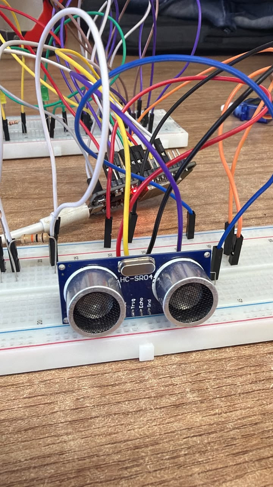 |
| **Montaje general.** Arriba, los LEDs y los pulsadores; al centro, el ESP32 alimentado por USB; abajo, el HC-SR04 y la LDR; a la derecha, el servo SG90. | **Sensor de distancia HC-SR04**, con la red de resistencias que baja el ECHO de 5 V a 3,3 V. |
| 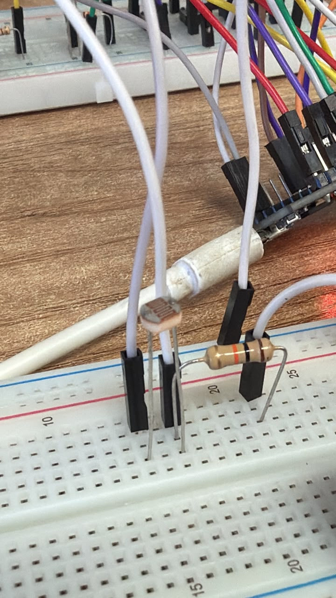 | 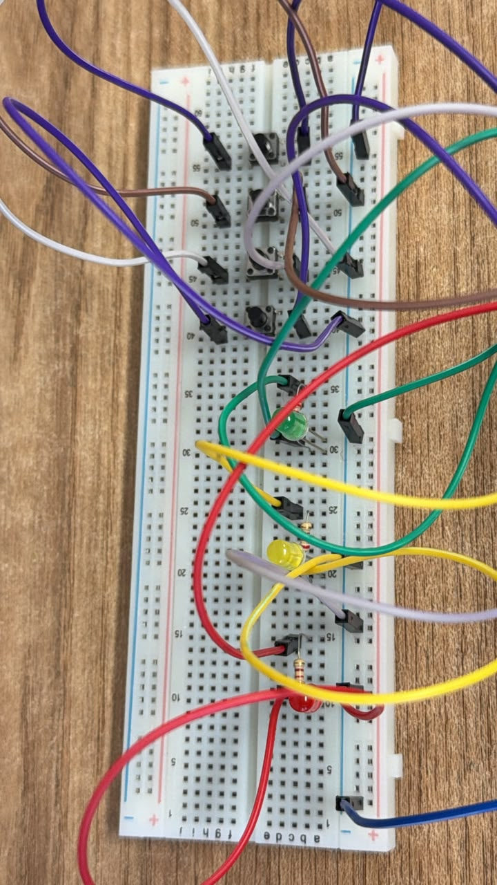 |
| **Sensor de luz (LDR)** con su resistencia de divisor, conectado al ADC1. | **LEDs rojo, amarillo y verde** con sus resistencias, y los cuatro pulsadores. |
| 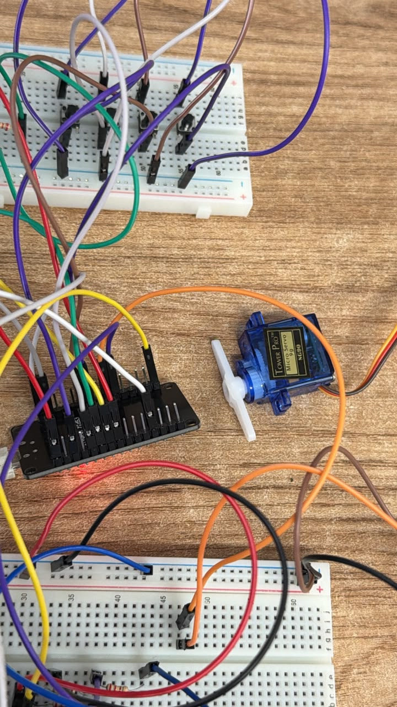 | |
| **Servo SG90 (cerradura) y ESP32.** | |

### 8.2 Configuraciones exportadas

| Configuración | Archivo |
|---|---|
| Modelo de interacción de la skill | [config/alexa/modelo-interaccion.es-US.json](config/alexa/modelo-interaccion.es-US.json) |
| Política de AWS IoT | [config/aws/politica-iot.json](config/aws/politica-iot.json) |
| Reglas de AWS IoT (SQL y acción) | [CajaEnigmasLecturas.json](config/aws/reglas/CajaEnigmasLecturas.json), [CajaEnigmasEventos.json](config/aws/reglas/CajaEnigmasEventos.json) |
| Permiso de las reglas para invocar la Lambda | [config/aws/permiso-invocacion-almacenamiento.json](config/aws/permiso-invocacion-almacenamiento.json) |
| Políticas de los roles IAM | [skill](config/aws/politica-rol-lambda.json), [almacenamiento](config/aws/politica-rol-almacenamiento.json), [vigilancia](config/aws/politica-rol-vigilancia.json) |
| Regla programada de EventBridge | [config/aws/regla-vigilancia.json](config/aws/regla-vigilancia.json) |
| Tablas de DynamoDB | [vinculaciones](config/aws/tabla-vinculaciones.json), [histórico](config/aws/tabla-historico.json) |
| Plantillas de configuración del objeto, sin secretos | [ConfiguracionAws.ejemplo.h](firmware/include/ConfiguracionAws.ejemplo.h), [ConfiguracionWifi.ejemplo.h](firmware/include/ConfiguracionWifi.ejemplo.h) |

En los archivos nuevos, el ID de la cuenta se reemplazó por `<ID_CUENTA>`.

### 8.3 Matriz de frases de la skill

El prefijo de cada caso indica el intent. En las pruebas de control de la cerradura se usó el modo manual; en las de inicio y pistas, el modo juego.

| Prefijo | Intent esperado | Respuesta o efecto esperado en el simulador |
|---|---|---|
| VIN | `VincularCajaIntent` | Valida el código y confirma que la caja quedó vinculada. |
| DES | `DesvincularCajaIntent` | Confirma la desvinculación. Volver a vincular antes de la siguiente frase. |
| CER | `ConsultarCerraduraIntent` | Informa la cerradura reportada y avisa si hay una orden pendiente. |
| ABR | `AbrirCerraduraIntent` | En modo manual, solicita abrir la cerradura. Verificar `desired.cerradura = abierta`. |
| CIE | `CerrarCerraduraIntent` | En modo manual, solicita cerrar la cerradura. Verificar `desired.cerradura = cerrada`. |
| INI | `IniciarPartidaIntent` | En modo juego, solicita iniciar la partida. Verificar que aumenta `desired.solicitudPartida`. |
| PIS | `PedirPistaIntent` | Con una partida en curso, da una pista del desafío actual y publica el evento `pista`. |
| PRO | `ConsultarProgresoIntent` | Informa el estado de la partida y el desafío actual si está en curso, según `reported`. |
| MOD | `CambiarModoIntent` | Confirma que envió la solicitud de modo. Verificar el ID indicado en `desired.modo`. |
| CMO | `ConsultarModoIntent` | Informa el modo de `reported.modo`. |
| DIF | `CambiarDificultadIntent` | Confirma que envió la solicitud. Verificar el ID indicado en `desired.dificultad`. |
| PAR | `CambiarParametroIntent` | Confirma que envió la solicitud. Verificar el valor del parámetro indicado en `desired`. |
| CPA | `ConsultarParametrosIntent` | Informa dificultad, longitud de secuencia, tolerancia, distancia objetivo y umbral de luz según `reported`. |
| SEN | `ConsultarSensoresIntent` | Informa la distancia medida en centímetros y la luz medida en porcentaje. Si falta una lectura, informa la disponible. |

| Caso | Frase | Slots esperados | Observado / evidencia |
|---|---|---|---|
| VIN-1 | vincula mi caja dos con el código cero cuatro ocho uno | `numeroCaja = 2`, `codigo = 0481` | `VincularCajaIntent`. Se mostraron `codigo:0481 numeroCaja:2`. |
| VIN-2 | registra la caja dos con el código cero cuatro ocho uno | `numeroCaja = 2`, `codigo = 0481` | `VincularCajaIntent`. Se mostraron `codigo:0481 numeroCaja:2`. |
| VIN-3 | vincula mi caja | solicita los datos faltantes | `VincularCajaIntent`. Solicitó los datos faltantes y terminó con caja 2 y código de ejemplo de cuatro dígitos. |
| VIN-4 | registra mi caja | solicita los datos faltantes | `VincularCajaIntent`. Solicitó los datos faltantes y terminó con caja 2 y código de ejemplo de cuatro dígitos. |
| VIN-5 | vincula la caja dos | `numeroCaja = 2`, solicita los datos faltantes | `VincularCajaIntent`. Solicitó los datos faltantes y terminó con caja 2 y código de ejemplo de cuatro dígitos. |
| VIN-6 | registra la caja dos | `numeroCaja = 2`, solicita los datos faltantes | `VincularCajaIntent`. Solicitó los datos faltantes y terminó con caja 2 y código de ejemplo de cuatro dígitos. |
| VIN-7 | cambia mi caja | solicita los datos faltantes | `VincularCajaIntent`. Solicitó los datos faltantes y terminó con caja 2 y código de ejemplo de cuatro dígitos. |
| VIN-8 | asocia mi caja | solicita los datos faltantes | `VincularCajaIntent`. Solicitó los datos faltantes y terminó con caja 2 y código de ejemplo de cuatro dígitos. |
| DES-1 | desvincula mi caja | — | `DesvincularCajaIntent`. |
| DES-2 | olvida mi caja | — | `DesvincularCajaIntent`. |
| DES-3 | elimina mi vinculación | — | `DesvincularCajaIntent`. |
| DES-4 | quita mi caja | — | `DesvincularCajaIntent`. |
| DES-5 | desasocia mi caja | — | `DesvincularCajaIntent`. |
| DES-6 | borra la vinculación | — | `DesvincularCajaIntent`. |
| DES-7 | quiero desvincular mi caja | — | `DesvincularCajaIntent`. |
| DES-8 | deja de usar mi caja | — | `DesvincularCajaIntent`. |
| CER-1 | cómo está la cerradura | — | `ConsultarCerraduraIntent`. |
| CER-2 | está trabada la caja | — | `ConsultarCerraduraIntent`. |
| CER-3 | está destrabada la caja | — | `ConsultarCerraduraIntent`. |
| CER-4 | la cerradura está abierta | — | `ConsultarCerraduraIntent`. |
| CER-5 | la cerradura está cerrada | — | `ConsultarCerraduraIntent`. |
| CER-6 | consulta la cerradura | — | `ConsultarCerraduraIntent`. |
| CER-7 | dime el estado de la cerradura | — | `ConsultarCerraduraIntent`. |
| CER-8 | está cerrada la cerradura | — | `ConsultarCerraduraIntent`. |
| ABR-1 | abre la cerradura | — | `AbrirCerraduraIntent`. |
| ABR-2 | destraba la caja | — | `AbrirCerraduraIntent`. |
| ABR-3 | abre mi caja | — | `AbrirCerraduraIntent`. |
| ABR-4 | desbloquea la cerradura | — | `AbrirCerraduraIntent`. |
| ABR-5 | quiero abrir la caja | — | `AbrirCerraduraIntent`. |
| ABR-6 | destraba mi caja | — | `AbrirCerraduraIntent`. |
| ABR-7 | abre la caja | — | `AbrirCerraduraIntent`. |
| ABR-8 | desbloquea mi caja | — | `AbrirCerraduraIntent`. |
| CIE-1 | cierra la cerradura | — | `CerrarCerraduraIntent`. |
| CIE-2 | traba la caja | — | `CerrarCerraduraIntent`. |
| CIE-3 | cierra mi caja | — | `CerrarCerraduraIntent`. |
| CIE-4 | bloquea la cerradura | — | `CerrarCerraduraIntent`. |
| CIE-5 | quiero cerrar la caja | — | `CerrarCerraduraIntent`. |
| CIE-6 | traba mi caja | — | `CerrarCerraduraIntent`. |
| CIE-7 | cierra la caja | — | `CerrarCerraduraIntent`. |
| CIE-8 | bloquea mi caja | — | `CerrarCerraduraIntent`. |
| INI-1 | empecemos a jugar | — | `IniciarPartidaIntent`. |
| INI-2 | inicia una partida | — | `IniciarPartidaIntent`. |
| INI-3 | comienza la partida | — | `IniciarPartidaIntent`. |
| INI-4 | quiero jugar | — | `IniciarPartidaIntent`. |
| INI-5 | inicia el juego | — | `IniciarPartidaIntent`. |
| INI-6 | arranca una partida | — | `IniciarPartidaIntent`. |
| PIS-1 | quiero una pista | — | `PedirPistaIntent`. |
| PIS-2 | dame una pista | — | `PedirPistaIntent`. |
| PIS-3 | necesito una pista | — | `PedirPistaIntent`. |
| PIS-4 | dame una sugerencia | — | `PedirPistaIntent`. |
| PIS-5 | pide una pista | — | `PedirPistaIntent`. |
| PIS-6 | dame una pista para este desafío | — | `PedirPistaIntent`. |
| PRO-1 | cómo voy | — | `ConsultarProgresoIntent`. |
| PRO-2 | consulta mi desafío actual | — | `ConsultarProgresoIntent`. |
| PRO-3 | dime mi progreso | — | `ConsultarProgresoIntent`. |
| PRO-4 | cuál es mi progreso | — | `ConsultarProgresoIntent`. |
| PRO-5 | cuál es mi desafío actual | — | `ConsultarProgresoIntent`. |
| PRO-6 | consulta mi progreso | — | `ConsultarProgresoIntent`. |
| PRO-7 | en qué desafío voy | — | `ConsultarProgresoIntent`. [Captura](docs/evidencias/alexa-p4/pro-7.jpg) |
| PRO-8 | en qué desafío va mi caja | — | `ConsultarProgresoIntent`. |
| PRO-9 | dime mi desafío actual | — | `ConsultarProgresoIntent`. |
| PRO-10 | qué desafío está activo en mi caja | — | `ConsultarProgresoIntent`. |
| PRO-11 | cómo voy en la partida | — | `ConsultarProgresoIntent`. |
| PRO-12 | cómo va mi partida | — | `ConsultarProgresoIntent`. |
| PRO-13 | muéstrame mi progreso | — | `ConsultarProgresoIntent`. |
| PRO-14 | dime mi etapa actual | — | `ConsultarProgresoIntent`. |
| PRO-15 | cuál es mi progreso actual | — | `ConsultarProgresoIntent`. |
| PRO-16 | dime el progreso de mi caja | — | `ConsultarProgresoIntent`. |
| MOD-1 | pon la caja en modo manual | `modo → manual` | `CambiarModoIntent`. Se mostraron `modo:manual`. |
| MOD-2 | activa el modo juego | `modo → juego` | `CambiarModoIntent`. Se mostraron `modo:juego`. |
| MOD-3 | cambia el modo a operador | `modo → manual` | `CambiarModoIntent`. Se mostraron `modo:operador`. |
| MOD-4 | usa el modo automático | `modo → juego` | `CambiarModoIntent`. Se mostraron `modo:automatico`. [Captura](docs/evidencias/alexa-p4/mod-4.jpg) |
| MOD-5 | cambia al modo manual | `modo → manual` | `CambiarModoIntent`. Se mostraron `modo:manual`. |
| MOD-6 | configura el modo juego | `modo → juego` | `CambiarModoIntent`. Se mostraron `modo:juego`. |
| CMO-1 | en qué modo está la caja | — | `ConsultarModoIntent`. |
| CMO-2 | cuál es el modo actual | — | `ConsultarModoIntent`. |
| CMO-3 | consulta el modo | — | `ConsultarModoIntent`. |
| CMO-4 | dime el modo de la caja | — | `ConsultarModoIntent`. |
| CMO-5 | dime el modo actual | — | `ConsultarModoIntent`. |
| CMO-6 | consulta el modo de la caja | — | `ConsultarModoIntent`. |
| DIF-1 | pon la dificultad en difícil | `dificultad → dificil` | `CambiarDificultadIntent`. Se mostraron `dificultad:dificil`. |
| DIF-2 | sube la dificultad a complicado | `dificultad → dificil` | `CambiarDificultadIntent`. Se mostraron `dificultad:complicado`. |
| DIF-3 | baja la dificultad a sencillo | `dificultad → facil` | `CambiarDificultadIntent`. Se mostraron `dificultad:sencillo`. [Captura](docs/evidencias/alexa-p4/dif-3.jpg) |
| DIF-4 | ajusta la dificultad a medio | `dificultad → normal` | `CambiarDificultadIntent`. Se mostraron `dificultad:medio`. |
| DIF-5 | configura la dificultad en fácil | `dificultad → facil` | `CambiarDificultadIntent`. Se mostraron `dificultad:facil`. |
| DIF-6 | cambia la dificultad a normal | `dificultad → normal` | `CambiarDificultadIntent`. Se mostraron `dificultad:normal`. |
| PAR-1 | cambia la distancia objetivo a veinte | `parametro → distanciaObjetivoCm`, `valor = 20` | `CambiarParametroIntent`. Se mostraron `parametro:distancia objetivo valor:20`. |
| PAR-2 | ajusta el umbral de luz a setenta | `parametro → umbralLuzPorcentaje`, `valor = 70` | `CambiarParametroIntent`. Se mostraron `parametro:umbral de luz valor:70`. [Captura](docs/evidencias/alexa-p4/par-2.jpg) |
| PAR-3 | configura distancia en veinticinco | `parametro → distanciaObjetivoCm`, `valor = 25` | `CambiarParametroIntent`. Se mostraron `parametro:distancia valor:25`. |
| PAR-4 | pon luz en ochenta | `parametro → umbralLuzPorcentaje`, `valor = 80` | `CambiarParametroIntent`. Se mostraron `parametro:luz valor:80`. |
| PAR-5 | establece distancia objetivo en treinta | `parametro → distanciaObjetivoCm`, `valor = 30` | `CambiarParametroIntent`. Se mostraron `parametro:distancia objetivo valor:30`. |
| PAR-6 | fija umbral de luz en sesenta | `parametro → umbralLuzPorcentaje`, `valor = 60` | `CambiarParametroIntent`. Se mostraron `parametro:umbral de luz valor:60`. |
| CPA-1 | cuáles son los parámetros del juego | — | `ConsultarParametrosIntent`. |
| CPA-2 | consulta los parámetros | — | `ConsultarParametrosIntent`. |
| CPA-3 | dime la configuración del juego | — | `ConsultarParametrosIntent`. |
| CPA-4 | dime los parámetros activos del juego | — | `ConsultarParametrosIntent`. |
| CPA-5 | lee los ajustes del juego | — | `ConsultarParametrosIntent`. |
| CPA-6 | consulta la configuración del juego | — | `ConsultarParametrosIntent`. |
| SEN-1 | consulta las lecturas de los sensores | — | `ConsultarSensoresIntent`. |
| SEN-2 | dime la distancia y la luz | — | `ConsultarSensoresIntent`. |
| SEN-3 | dime la distancia medida | — | `ConsultarSensoresIntent`. |
| SEN-4 | dime cuánta luz mide la caja | — | `ConsultarSensoresIntent`. |
| SEN-5 | consulta las mediciones de la caja | — | `ConsultarSensoresIntent`. |
| SEN-6 | dime las lecturas de distancia y luz | — | `ConsultarSensoresIntent`. |
| SEN-7 | cuánta luz tiene mi caja | — | `ConsultarSensoresIntent`. [Captura](docs/evidencias/alexa-p4/sen-7.jpg) |
| SEN-8 | qué distancia marca mi caja | — | `ConsultarSensoresIntent`. [Captura](docs/evidencias/alexa-p4/sen-8.jpg) |
| SEN-9 | cómo están los sensores de mi caja | — | `ConsultarSensoresIntent`. [Captura](docs/evidencias/alexa-p4/sen-9.jpg) |
| SEN-10 | cómo están los sensores | — | `ConsultarSensoresIntent`. |
| SEN-11 | cuánta luz detecta mi caja | — | `ConsultarSensoresIntent`. |
| SEN-12 | qué distancia mide mi caja | — | `ConsultarSensoresIntent`. |
| SEN-13 | dime las mediciones de mi caja | — | `ConsultarSensoresIntent`. |
| SEN-14 | dime qué marcan los sensores | — | `ConsultarSensoresIntent`. |
| SEN-15 | cuánto mide el sensor de distancia | — | `ConsultarSensoresIntent`. |
| SEN-16 | dime el porcentaje de luz de mi caja | — | `ConsultarSensoresIntent`. |

### 8.4 Evidencias de las pruebas

| Evidencia | Archivo |
|---|---|
| Registro serial de la sesión del 24/11, con la hora de la PC (código de vinculación y endpoint ocultados) | [registro-serial.log](docs/evidencias/p4/pruebas/registro-serial.log) |
| Cambios del Shadow de `caja-enigmas-01` | [registro-shadow.log](docs/evidencias/p4/pruebas/registro-shadow.log) |
| Pruebas de voz con el simulador | [pruebas-voz.log](docs/evidencias/p4/pruebas/pruebas-voz.log) |
| Ítems de DynamoDB del 24/11 y muestra de cada tipo | [historico-caja-enigmas-01-24-11.json](docs/evidencias/p4/datos/historico-caja-enigmas-01-24-11.json), [muestra-historico.json](docs/evidencias/p4/datos/muestra-historico.json) |
| Capturas de Utterance Profiler | [docs/evidencias/alexa-p4/](docs/evidencias/alexa-p4/) |
| Capturas de Lambda, DynamoDB, Shadow y CloudWatch | [docs/evidencias/mateo-lambda/para-informe/](docs/evidencias/mateo-lambda/para-informe/) |
| Fotos del montaje | [docs/evidencias/p4/montaje/](docs/evidencias/p4/montaje/) |

### 8.5 Documentos de apoyo

- [Contrato entre componentes v2](docs/contratos.md)
- [Guía de montaje](docs/GUIA_MONTAJE.md#montaje-de-la-práctica-4) y [diagramas de circuito](docs/diagramas/)
- [Planificación de la P4](docs/planificacion/p4-00-resumen.md)
- [Backend de la Lambda: auditoría y empaquetado](docs/backend-lambda.md)
- [Guía para la defensa](docs/GUIA_DEFENSA.md)
