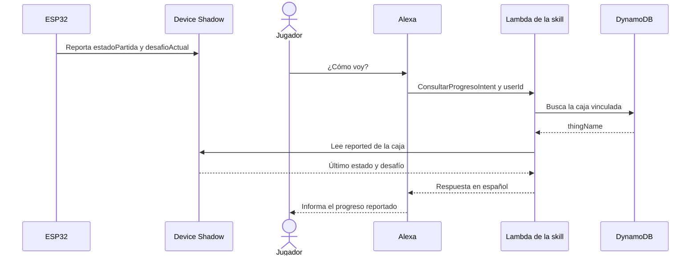
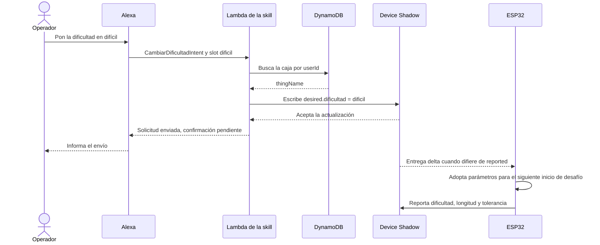
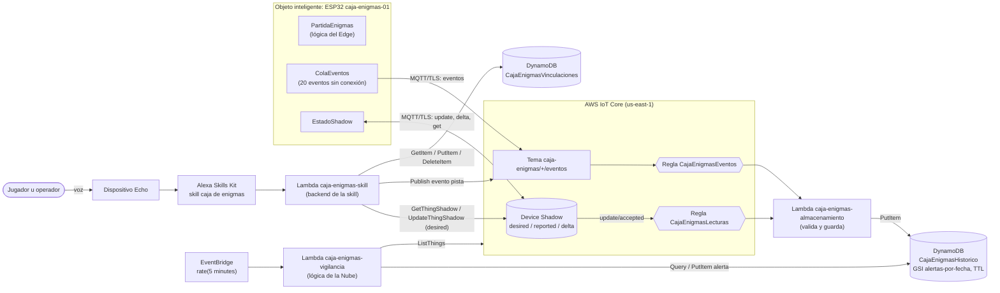
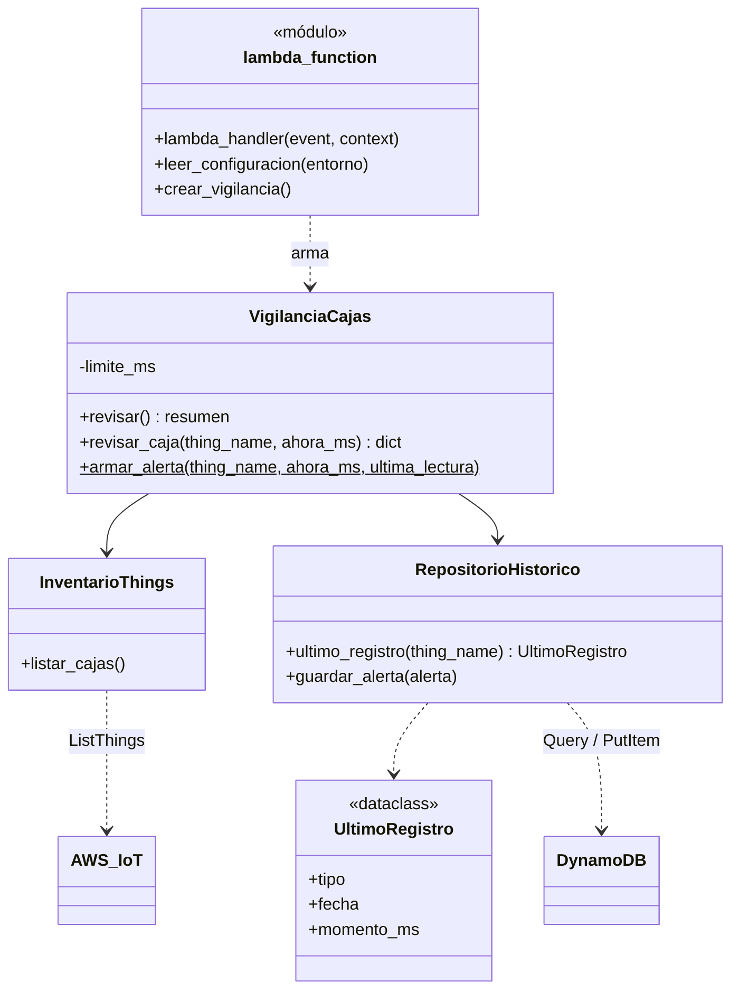
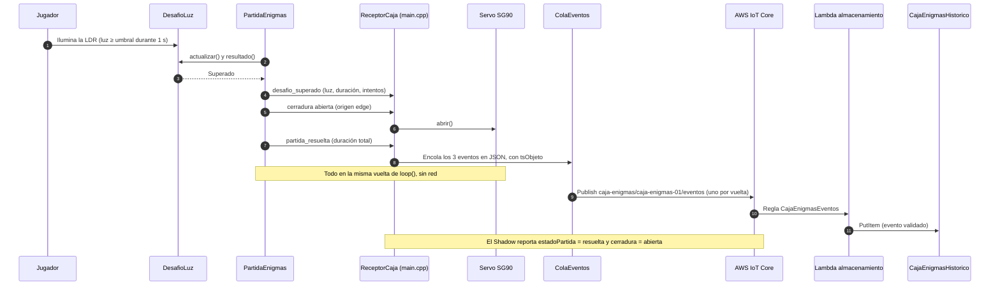
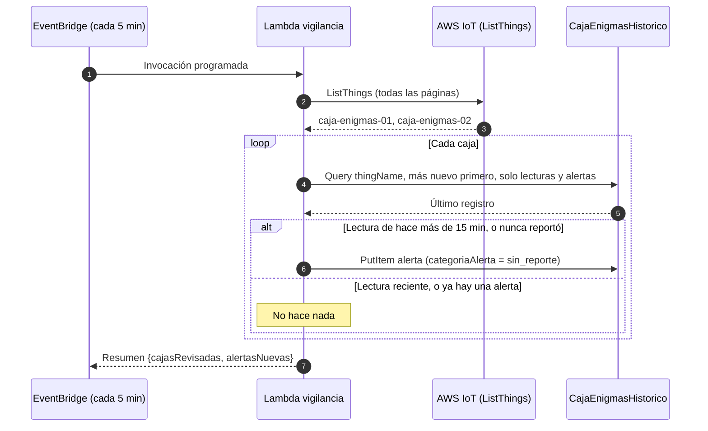
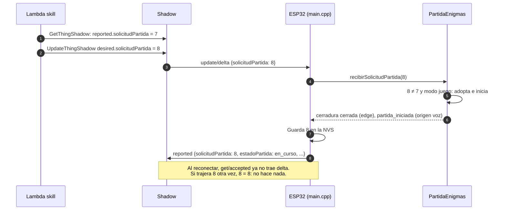
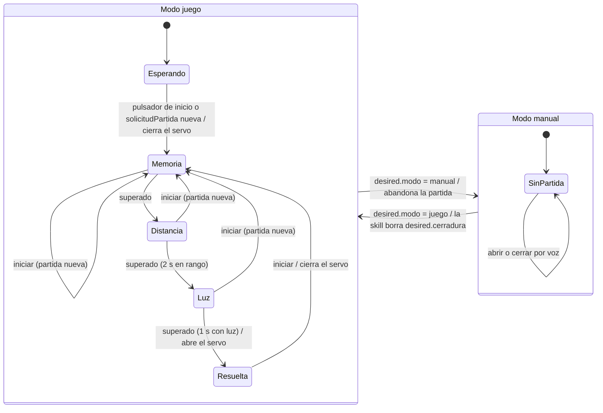

# Informe técnico — Práctica 4. Caja de los Enigmas

SIS-234 · Santiago Torres, Adrián Mercado, Mateo Rojas y Lucía Escobar

## 1. Caso de uso y requerimientos

### 1.1 Caso de uso ampliado

La Caja de los Enigmas es un módulo de escape room con tres desafíos físicos de memoria, distancia y luz. En la Práctica 3, Alexa servía para vincular la caja, consultar su estado y controlar la cerradura. En la Práctica 4, Alexa también inicia partidas, consulta su progreso y ofrece pistas. El ESP32 evalúa los desafíos localmente y libera la cerradura al completar la partida. El operador puede cambiar al modo manual y revisar el historial para identificar desafíos que necesitan ajustes.

### 1.2 Sensores y actuadores

El HC-SR04 mide la distancia de la mano sin contacto y permite verificar que se mantiene dentro del objetivo y su tolerancia. La LDR mide luz relativa para el desafío de iluminación. Los tres LEDs muestran la secuencia de memoria y los tres pulsadores de colores permiten repetirla. Un cuarto pulsador inicia la partida en modo juego. El servo SG90 libera o bloquea la cerradura. Pendiente con Santiago: incorporar los resultados de calibración del montaje.

### 1.3 Requerimientos funcionales y no funcionales

Los criterios de aceptación se basan en la [consigna](docs/consigna/Práctica_4.md) y el [contrato entre componentes](docs/contratos.md). Los resultados se registran en la sección 4.

| ID | Criterio de aceptación |
|---|---|
| RF1 | Medir distancia y luz, y detectar las pulsaciones de colores y de inicio. |
| RF2 | Publicar en `reported` las lecturas válidas y el estado de la cerradura, según la frecuencia acordada. |
| RF3 | Aplicar las órdenes válidas recibidas por `delta` y confirmar el estado efectivo en `reported`. |
| RF4 | Consultar por voz la distancia y la luz medidas de la caja vinculada mediante `ConsultarSensoresIntent`. Informar si una o ambas lecturas de `reported` no están disponibles. |
| RF5 | En modo manual, las órdenes de abrir o cerrar escriben en `desired.cerradura`. En modo juego se rechazan. |
| RF6 | Informar por voz el estado reportado de la cerradura. |
| RF7 | Vincular una caja existente con su código y mantener el vínculo al cambiar de sesión. |
| RF8 | Resolver la caja por el identificador de usuario de Alexa. Si el vínculo falta, explicar cómo crearlo. |
| RF9 | Validar existencia y código antes de vincular, y permitir reemplazar o eliminar la vinculación. |
| RF10 | Disparar el almacenamiento mediante las reglas de AWS IoT para lecturas y eventos. |
| RF11 | Validar los mensajes, descartar entradas inválidas y guardar lecturas con `thingName` y marca de tiempo. |
| RF12 | Guardar los eventos de cerradura con su origen. |
| RF13 | Ejecutar el juego y su control de cerradura en el ESP32, y detectar en la nube cajas que dejan de reportar. |
| RF14 | Consultar y cambiar modo, dificultad y calibración por voz, con confirmación en `reported`. |
| RF15 | Diseñar el panel de reportes y documentar la consulta DynamoDB de cada indicador. |

| Criterio no funcional | Verificación prevista |
|---|---|
| Estabilidad | Al menos 10 minutos de partidas seguidas con cero reinicios. |
| Exactitud y calibración | Diez mediciones del HC-SR04 a 10, 20 y 30 cm contra una regla. Diez lecturas de LDR por condición de luz. Registrar errores, dispersión y umbral elegido. |
| Respuesta del actuador | Medir por separado la latencia de órdenes de voz y del desbloqueo automático del ESP32. Acordar el máximo para la prueba P4 antes de ejecutarla. |
| Reporte | Comprobar publicación por cambio de estado en un máximo de 1 s y reporte completo cada 60 s. |
| Operación sin conexión | Completar una partida al cortar el WiFi. Al volver la red, verificar el envío en orden de los eventos retenidos y la aplicación de `desired`. El contrato conserva hasta 20 eventos y solo reporta la lectura actual al reconectar. |
| Integridad del almacenamiento | Con una ventana declarada, comparar publicaciones válidas únicas con ítems guardados. Objetivo de la rúbrica ≥ 99 %. Enviar también entradas inválidas y comprobar su descarte. |
| Latencia de almacenamiento | Medir desde la publicación del objeto hasta el registro. Usar una marca del objeto sincronizada para medir el recorrido completo. Referencia ≤ 5 s. |
| Vigilancia | La alerta por falta de reportes aparece en un máximo esperado de 20 minutos en condiciones normales, según el umbral de 15 minutos y la regla de 5 minutos. |
| Costo | Estimar el consumo mensual de IoT Core, Lambda y DynamoDB a partir de mediciones del prototipo y contrastarlo con la capa gratuita aplicable. |

## 2. Análisis y diseño

| Sección | Responsable |
|---|---|
| Diagrama de bloques y circuito | Santiago |
| Arquitectura y Shadow actualizado | Adrián |
| Diagrama de clases del ESP32 | Adrián y Santiago |
| Diagramas de clases de las Lambdas | Mateo |
| Secuencias de voz, almacenamiento y reglas automáticas | Lucía, Mateo y Adrián, respectivamente |
| Estados, modos, transiciones y justificación Edge/Nube | Adrián |
| Modelo DynamoDB y patrones de acceso | Mateo |
| Reglas IoT y Lambdas | Mateo y Adrián |
| Modelo de interacción de Alexa | Lucía |
| Mockups de reportes RF15 y consultas de origen | Lucía |

### 2.1 Diseño de la skill

La skill usa `es-US` y responde a «caja de enigmas». Conserva la vinculación de caja y el control de la cerradura en modo manual. Los [intents, slots y frases](config/alexa/modelo-interaccion.es-US.json) se definen en el modelo de interacción. La [matriz de voz](#41-reconocimiento-de-frases) documenta sus efectos esperados. Las consultas se basan en `reported` y las órdenes pasan por `desired`.

### 2.2 Secuencias de voz

**Consulta «¿cómo voy?»**



**Comando «pon la dificultad en difícil»**



### 2.3 Reportes para el operador

El [mockup del panel RF15](docs/mockups/README.md) reúne partidas iniciadas y resueltas, tasa de éxito, tiempo medio, fallos, pistas, historial y alertas. La guía identifica las claves y los filtros que sustentan cada dato.

### 2.4 Diagrama de arquitectura del sistema *(Adrián)*



- **Un dispositivo, tres funciones Lambda y una responsabilidad cada una:**
  - la skill atiende la voz;
  - la de almacenamiento valida y guarda;
  - la de vigilancia ejecuta la regla de la Nube.

  Así cada rol tiene solo los permisos que usa: la de almacenamiento solo escribe, y la de vigilancia no puede tocar los Shadows. Además, cada función se invoca con su propia frecuencia: la de almacenamiento con cada mensaje y la de vigilancia cada 5 min.
- **Alexa y la Nube nunca hablan directo con el ESP32.** La voz cambia `desired` y el ESP32 lo recibe en el `delta`. Lo único que publica fuera del Shadow es el tema de eventos.
- **Dos temas de entrada para el histórico:**
  - las lecturas viajan en el reporte del Shadow (regla `CajaEnigmasLecturas`);
  - los eventos discretos van en un tema propio (regla `CajaEnigmasEventos`), porque no son estado sino cosas que pasaron, como "se superó la memoria en 18 s con 2 intentos".

### 2.5 Especificación del documento Shadow v2 *(Adrián)*

Shadow clásico, sin nombre. La especificación completa, con ejemplos, está en [contratos.md, sección 2](docs/contratos.md#2-documento-shadow-shadow-clásico-sin-nombre).

| Atributo | Sección | Tipo | Valores válidos | Por defecto |
|---|---|---|---|---|
| `cerradura` | `desired` / `reported` | string | `abierta`, `cerrada` | `cerrada` |
| `modo` | `desired` / `reported` | string | `juego`, `manual` | `juego` |
| `dificultad` | `desired` / `reported` | string | `facil`, `normal`, `dificil` | `normal` |
| `distanciaObjetivoCm` | `desired` / `reported` | entero | 10–40 | 20 |
| `umbralLuzPorcentaje` | `desired` / `reported` | entero | 10–95 | 70 |
| `solicitudPartida` | `desired` / `reported` | entero | ≥ 0 | 0 |
| `longitudSecuencia` | `reported` | entero | 3, 4 o 6 (según la dificultad) | 4 |
| `toleranciaCm` | `reported` | entero | 6, 4 o 2 (según la dificultad) | 4 |
| `estadoPartida` | `reported` | string | `esperando`, `en_curso`, `resuelta` | `esperando` |
| `desafioActual` | `reported` | string | `memoria`, `distancia`, `luz`, `ninguno` | `ninguno` |
| `idPartida` | `reported` | entero | ≥ 0 | 0 |
| `distanciaCm` | `reported` | entero | 2–400; se omite sin lectura válida | — |
| `luzPorcentaje` | `reported` | entero | 0–100 | — |
| `codigoVinculacion` | `reported` | string | 4 dígitos | generado en el primer arranque |
| `firmware` | `reported` | string | versión, p. ej. `0.4.0` | — |

**Uso de cada sección:**
- **`desired`** lo escribe solo la Lambda de la skill: la cerradura (en modo manual), el modo, la dificultad, los dos parámetros de calibración y `solicitudPartida`.
- **`reported`** lo escribe solo el ESP32:
  - en cada cambio, en menos de 1 s;
  - cada 60 s como respaldo, con las lecturas de los sensores;
  - en cada cambio de desafío.
- **`delta`** lo calcula AWS. El ESP32 lo recibe por `update/delta` y, al reconectar, en el `get/accepted`. Lee cada atributo por separado, ignora los desconocidos y descarta los valores inválidos, por ejemplo `"20"`, `70.5`, `-1` o `276`. Después reporta su estado real, y así el `delta` desaparece.

**Decisiones de diseño:**
- **`solicitudPartida` es un contador y no un texto como `"iniciar"`.** La skill escribe el valor reportado + 1. El ESP32 inicia una partida solo si recibe un valor distinto del suyo, así que la misma orden repetida (por ejemplo, en el `get` de cada reconexión) no inicia dos partidas.
- **La dificultad fija `longitudSecuencia` y `toleranciaCm`, que solo se reportan.** La distancia objetivo y el umbral de luz son de calibración y se cambian por separado, así no se pisan.
- **El modo, la dificultad, los parámetros y los contadores se guardan en la NVS.** Después de un reinicio sin red, la caja sigue configurada igual y no repite un `idPartida`.

### 2.6 Diagrama de clases del objeto inteligente *(Adrián y Santiago)*


- **Clases de Santiago (hardware):** `Desafio*`, `IndicadorLeds`, `Pulsador`, `SensorDistancia`, `SensorLuz` y `CerraduraServo`.
- **Clases de Adrián:** la partida, el Shadow, la persistencia, los eventos y la conexión.
- `main.cpp` arma todos los objetos y los une en `loop()`, sin lógica de negocio propia.
- **Lógica pura, sin Arduino:** `PartidaEnigmas`, `EstadoShadow`, `ParametrosJuego`/`ConfiguracionJuego`, `EventoJson`, `ColaEventos` y `RelojUtc`. Por eso se prueban en la PC (sección 4).
- **La partida no conoce el hardware:**
  - recibe los tres desafíos como `Desafio&`;
  - avisa lo que pasa a un `ReceptorEventos`, incluido cuándo cerrar o abrir la cerradura;
  - en las pruebas, el receptor es un doble que anota los eventos.

### 2.7 Diagrama de clases de la Lambda de vigilancia *(Adrián)*



`vigilancia.py` tiene la regla y no importa `boto3`: recibe el inventario, el histórico y el reloj ya armados. `lambda_function.py` solo lee las variables de entorno y crea los clientes de AWS.

### 2.8 Diagramas de secuencia de las reglas automáticas *(Adrián)*

**Regla del Edge: superar el último desafío abre la caja.**



**Regla de la Nube: caja sin reportar.**



**Inicio de partida por voz: la orden repetida no inicia dos partidas.**



**Operación sin conexión.**

```mermaid
sequenceDiagram
    participant P as PartidaEnigmas
    participant C as ColaEventos
    participant X as ConexionAwsIot
    participant I as AWS IoT Core
    Note over X,I: WiFi cortado
    P->>C: Eventos de la partida (el juego sigue)
    Note over C: Hasta 20; si se llena, se descarta el más viejo y se cuenta
    Note over X,I: WiFi vuelve: TLS, MQTT y get del Shadow
    X->>I: Reporte completo del Shadow
    loop Uno por vuelta de loop()
        C->>X: primero()
        X->>I: Publish en el tema de eventos (QoS 1)
        I-->>X: PUBACK
        X->>C: quitarPrimero()
    end
```

### 2.9 Modos, estados y ubicación de cada regla *(Adrián)*



**Convivencia de la voz con la lógica automática:**

| | Modo `juego` (por defecto) | Modo `manual` (operador) |
|---|---|---|
| Quién mueve la cerradura | Solo el juego: cierra al iniciar una partida y abre al resolverla. | Solo la voz. |
| "Abre / cierra la caja" | La skill lo rechaza con una explicación, y el ESP32 también ignora `cerradura` en el `delta`. | Se aplica. |
| "Inicia una partida" y pulsador de inicio | Inician una partida. | Se rechaza por voz; el pulsador no hace nada. |

La regla está implementada en los dos lados:
- la skill rechaza la orden;
- el ESP32 ignora `cerradura` en modo juego.

Así, una orden vieja de "abrir" que hubiera quedado en `desired` no puede abrir la caja en medio de una partida. Además, al pasar a modo juego la skill pone `desired.cerradura` en `null`.

**Ubicación de cada regla:**

| Regla | Dónde | Latencia | Sin conexión | Histórico | Costo de mensajes | Mantenimiento |
|---|---|---|---|---|---|---|
| Partida: validar cada desafío, avanzar y abrir el servo | **Edge** | Inmediata: la apertura ocurre en la misma vuelta de `loop()` en que se cumple la condición. | Sigue funcionando: los eventos se encolan. | No lo necesita: depende solo de los sensores locales. | No genera mensajes para decidir. | Los parámetros se cambian por voz sin reprogramar. |
| Caja sin reportar (más de 15 min sin lecturas) | **Nube** | Hasta 15 + 5 = 20 min, suficiente para un aviso de mantenimiento. | Es justamente lo que detecta: el objeto no puede avisar de su propia desconexión. | La necesita: busca la última lectura de cada caja. | 288 invocaciones por día, sin mensajes del objeto. | El límite se cambia con una variable de entorno. |

**Por qué la regla de la Nube no escribe en `desired`:** la consigna pide que la lógica de la Nube actúe sobre el objeto solo a través de `desired`. Esta regla no actúa sobre el objeto, porque el objeto está apagado o sin red. Su acción es dejar una alerta en el histórico para el operador, que la ve en el panel de reportes (patrón de acceso 6). Es el ejemplo que da la consigna: *"Si el Thing no reporta durante 15 min… se implementaría con otra Lambda ejecutada de forma programada"*.

### 2.10 Circuito eléctrico del montaje P4 *(Santiago)*

El [diagrama general del circuito](docs/diagramas/circuito-general-p4.svg) muestra la disposición real: protoboard 2 de sensores, ESP32 y protoboard 1 de LEDs y pulsadores. El SG90 está fuera de las protoboards. El circuito recibe alimentación por micro-USB, con VIN compartido por el HC-SR04 y el SG90, y 3V3 independiente para la LDR.

Los esquemas por componente detallan el cableado: [LEDs](docs/diagramas/circuito-leds.svg), [pulsadores](docs/diagramas/circuito-pulsadores.svg), [HC-SR04 y divisor de ECHO](docs/diagramas/circuito-ultrasonico.svg), [LDR](docs/diagramas/circuito-ldr.svg) y [servomotor SG90](docs/diagramas/circuito-servo.svg). La [guía de montaje](docs/GUIA_MONTAJE.md#montaje-de-la-práctica-4) registra las coordenadas y las diferencias de alimentación y resistencias respecto del diseño de referencia.

## 3. Desarrollo e implementación

El [firmware 0.4.0](firmware/src/main.cpp) integra los tres desafíos, el servo, el inicio por voz y el pulsador. La publicación de eventos sale de una cola de hasta 20 entradas, una por vuelta de `loop()`. Si la cola se llena, se descarta el más antiguo. Si se rechaza el mismo evento tres veces con la caja conectada, se descarta y se contabiliza.

El backend de Mateo registra los ocho intents nuevos. El [almacenamiento](lambda-almacenamiento/README.md) valida lecturas y eventos antes de guardarlos. La [vigilancia](lambda-vigilancia/README.md) consulta la tabla principal y distingue lecturas de eventos al comprobar si la caja sigue reportando. El código de los tres componentes está en la base local. La configuración y las evidencias de despliegue se incorporarán a partir de los registros de cada responsable. El montaje y la calibración finales siguen a cargo de Santiago.

### 3.1 Estructura del código del objeto inteligente *(Adrián y Santiago)*

| Módulo | Responsabilidad | Autor |
|---|---|---|
| [main.cpp](firmware/src/main.cpp) | Arma los objetos y los une en `loop()`. Define `ReceptorCaja`. | Adrián |
| [PartidaEnigmas](firmware/src/PartidaEnigmas.cpp) | Máquina de estados de la partida (regla del Edge). | Adrián |
| [EstadoShadow](firmware/src/EstadoShadow.cpp) | Lee el `delta` y arma el `reported`. | Adrián |
| [ParametrosJuego / ConfiguracionJuego](firmware/src/ParametrosJuego.cpp) | Tabla de dificultades, rangos y configuración por voz. | Adrián |
| [AlmacenParametros](firmware/src/AlmacenParametros.cpp) | Persistencia en la NVS. | Adrián |
| [EventoJson](firmware/src/EventoJson.cpp), [ColaEventos](firmware/src/ColaEventos.cpp), [RelojUtc](firmware/src/RelojUtc.cpp) | Formato, cola sin conexión y hora de los eventos. | Adrián |
| [ConexionWifi](firmware/src/ConexionWifi.cpp), [ConexionAwsIot](firmware/src/ConexionAwsIot.cpp) | Red, TLS mutuo y MQTT. | Adrián |
| `Desafio*`, `IndicadorLeds`, `Pulsador`, `SensorDistancia`, `SensorLuz`, `CerraduraServo` | Hardware y los tres desafíos. | Santiago |

**Fragmentos clave:**
- **`loop()` nunca se bloquea.** Los desafíos miden el tiempo con `millis()`, y `pulseIn` tiene un límite de 25 ms. Además, la cola publica un solo evento por vuelta, porque cada publicación QoS 1 espera el PUBACK.
- **`aplicarOrdenes()` aplica primero la configuración y después la cerradura y la solicitud.** Si un mismo `delta` trae `modo: manual` y `cerradura: abierta`, el modo nuevo es el que decide si se obedece la cerradura.
- **`tomarLecturas()` no mide la distancia mientras corre ese desafío.** `SensorDistancia::actualizar()` entrega cada medición nueva una sola vez, así que otra llamada se la quitaría al desafío.
- **Cada evento se convierte a JSON en el momento en que ocurre.** Así `tsObjeto` es la hora del evento y no la de la publicación, que puede ser minutos después si no había red.
- **`EventoJson` escribe solo los campos de cada tipo.** La Lambda de almacenamiento valida todos los campos que llegan, y un campo de más con un valor fuera de rango (por ejemplo, `intentos: 0`) haría descartar el evento entero.

### 3.2 Configuración de AWS IoT Core *(Adrián)*

| Elemento | Valor |
|---|---|
| Things | `caja-enigmas-01` (la caja) y `caja-enigmas-02` (sin placa, para probar varios usuarios y la alerta). |
| Certificado | X.509 por Thing, emitido por AWS IoT. La clave privada vive solo en `firmware/include/ConfiguracionAws.h`, que está en `.gitignore`. |
| Política | `CajaEnigmasPolitica` v2 ([config/aws/politica-iot.json](config/aws/politica-iot.json)). |

**Permisos de la política, cada uno limitado al Thing de la conexión** con `${iot:Connection.Thing.ThingName}`:

| Sentencia | Permiso | Por qué |
|---|---|---|
| `ConectarSoloComoSuThing` | `iot:Connect` como `client/<su Thing>`, solo si el certificado está asociado al Thing. | Ningún certificado puede conectarse como otra caja. |
| `PublicarYRecibirEnSuShadow` | `iot:Publish` e `iot:Receive` en `$aws/things/<su Thing>/shadow/*`. | Reportar y recibir el `delta` de su propio Shadow. |
| `PublicarSusEventos` | `iot:Publish` en `caja-enigmas/<su Thing>/eventos`. | Nuevo en la v2. Por eso la regla de eventos puede tomar el `thingName` del tema sin confiar en el payload. |
| `SuscribirseASuShadow` | `iot:Subscribe` en `$aws/things/<su Thing>/shadow/*`. | Suscribirse a `update/delta` y `get/accepted`. |

Ya es la política mínima: no usa comodines entre Things, y el objeto no puede suscribirse al tema de eventos ni leerlo.

### 3.3 Configuración de la Lambda de vigilancia y de la regla programada *(Adrián)*

| Elemento | Valor |
|---|---|
| Función | `caja-enigmas-vigilancia`, Python 3.12, 128 MB, *timeout* de 30 s. Código en [lambda-vigilancia/](lambda-vigilancia/README.md). |
| Disparador | Regla de EventBridge `caja-enigmas-vigilancia-cada-5-min`, `rate(5 minutes)` ([config/aws/regla-vigilancia.json](config/aws/regla-vigilancia.json)). |
| Variables | `TABLA_HISTORICO=CajaEnigmasHistorico`, `PREFIJO_THING=caja-enigmas-`, `MINUTOS_SIN_REPORTE=15`. |
| Rol | `caja-enigmas-vigilancia-rol` ([config/aws/politica-rol-vigilancia.json](config/aws/politica-rol-vigilancia.json)). |

**Permisos del rol:**

| Permiso | Recurso | Por qué |
|---|---|---|
| `logs:CreateLogGroup`, `CreateLogStream`, `PutLogEvents` | Su propio grupo de logs | Registrar cada revisión. |
| `iot:ListThings` | `*` | Revisar también las cajas que nunca reportaron. Esta acción no admite permisos por recurso. |
| `dynamodb:Query`, `dynamodb:PutItem` | Solo la tabla `CajaEnigmasHistorico` | Leer la última lectura y guardar la alerta. No puede borrar ni modificar ítems. |

- La regla de EventBridge **no usa un rol IAM**: invoca la función con el permiso basado en recursos que la consola agrega al crear el disparador.
- A diferencia del ejemplo de la consigna, esta Lambda **no necesita `iot:UpdateThingShadow`**, porque no actúa sobre el objeto.
- Los permisos asignados **ya son los mínimos de producción**. La única mejora posible sería reemplazar `ListThings` por un grupo de Things, si hubiera muchas cajas.

### 3.4 Configuración de Alexa

La [guía de Alexa](config/alexa/README.md) documenta la importación y compilación del modelo, la evaluación de las frases y la coordinación del endpoint. [El módulo de pistas](lambda/pistas.py) contiene tres textos por desafío ordenados de menor a mayor ayuda. La selección y su publicación como evento se integran con Mateo en la Lambda.

## 4. Pruebas y validaciones

### 4.1 Reconocimiento de frases

Compilar la versión `es-US` y probar cada frase con Utterance Profiler. Registrar el intent, el valor reconocido y el ID de entidad para los slots propios. En las pruebas de integración, usar el código real de la caja en lugar del ejemplo `0481` y registrar la respuesta de Alexa y el efecto observado. Guardar la evidencia en `docs/evidencias/` sin mostrar códigos ni identificadores de cuentas.

El 23/11/2026 se importó el modelo en el borrador de desarrollo de «Caja de Enigmas». En la primera compilación, 82 de 88 frases resolvieron el intent esperado. Se sustituyeron seis consultas que devolvían `AMAZON.FallbackIntent`. La segunda compilación fue exitosa y **88 de 88 frases de la matriz revisada** resolvieron el intent esperado. Los seis diálogos con datos de vinculación incompletos pidieron los slots faltantes y conservaron el cero inicial del código de ejemplo.

La tabla registra las entradas de texto y los valores de slot que mostró Utterance Profiler. Quedan por comprobar los IDs canónicos en el JSON de solicitud del simulador, las respuestas de Lambda y los efectos sobre el Shadow y el histórico.

El 24/11/2026 se compiló el modelo con RF4. Las seis frases nuevas seleccionaron `ConsultarSensoresIntent`. Se comprobó también que cuatro frases de control conservaban sus intents de progreso, parámetros, cerradura y cambio de distancia.

En la revisión final del 24/11 se añadieron diez frases a sensores y diez a progreso. Las **114 frases de la matriz** seleccionaron el intent esperado en Utterance Profiler. Las consultas que habían seleccionado desvinculación o Fallback se corrigieron y quedaron respaldadas con capturas. Los seis diálogos de vinculación incompletos pidieron los datos faltantes.

El evaluador muestra el texto de los slots. La columna de slots esperados anota su ID canónico según el modelo. «Automático» corresponde a `juego`, «sencillo» a `facil` y «umbral de luz» a `umbralLuzPorcentaje`. Queda pendiente observar los IDs enviados a Lambda en **Skill I/O**.

El prefijo de cada caso indica el intent y el resultado funcional esperado. Para control de cerradura, usar modo manual. Para inicio y pistas, usar modo juego y restaurar el estado de prueba entre casos según corresponda.

| Prefijo | Intent esperado | Respuesta o efecto esperado en el simulador |
|---|---|---|
| VIN | `VincularCajaIntent` | Valida el código y confirma que la caja quedó vinculada. |
| DES | `DesvincularCajaIntent` | Confirma la desvinculación. Volver a vincular antes de la siguiente frase. |
| CER | `ConsultarCerraduraIntent` | Informa la cerradura reportada y avisa si hay una orden pendiente. |
| ABR | `AbrirCerraduraIntent` | En modo manual, solicita abrir la cerradura. Verificar `desired.cerradura = abierta`. |
| CIE | `CerrarCerraduraIntent` | En modo manual, solicita cerrar la cerradura. Verificar `desired.cerradura = cerrada`. |
| INI | `IniciarPartidaIntent` | En modo juego, solicita iniciar la partida. Verificar que aumenta `desired.solicitudPartida`. |
| PIS | `PedirPistaIntent` | Con una partida en curso, da una pista del desafío actual y publica el evento `pista`. |
| PRO | `ConsultarProgresoIntent` | Informa el estado de la partida y el desafío actual si está en curso, según `reported`. |
| MOD | `CambiarModoIntent` | Confirma que envió la solicitud de modo. Verificar el ID indicado en `desired.modo`. |
| CMO | `ConsultarModoIntent` | Informa el modo de `reported.modo`. |
| DIF | `CambiarDificultadIntent` | Confirma que envió la solicitud. Verificar el ID indicado en `desired.dificultad`. |
| PAR | `CambiarParametroIntent` | Confirma que envió la solicitud. Verificar el valor del parámetro indicado en `desired`. |
| CPA | `ConsultarParametrosIntent` | Informa dificultad, longitud de secuencia, tolerancia, distancia objetivo y umbral de luz según `reported`. |
| SEN | `ConsultarSensoresIntent` | Informa la distancia medida en centímetros y la luz medida en porcentaje. Si falta una lectura, informa la disponible. |

| Caso | Frase | Slots esperados | Observado / evidencia |
|---|---|---|---|
| VIN-1 | vincula mi caja dos con el código cero cuatro ocho uno | `numeroCaja = 2`, `codigo = 0481` | `VincularCajaIntent`. Se mostraron `codigo:0481 numeroCaja:2`. |
| VIN-2 | registra la caja dos con el código cero cuatro ocho uno | `numeroCaja = 2`, `codigo = 0481` | `VincularCajaIntent`. Se mostraron `codigo:0481 numeroCaja:2`. |
| VIN-3 | vincula mi caja | solicita los datos faltantes | `VincularCajaIntent`. Solicitó los datos faltantes y terminó con caja 2 y código de ejemplo de cuatro dígitos. |
| VIN-4 | registra mi caja | solicita los datos faltantes | `VincularCajaIntent`. Solicitó los datos faltantes y terminó con caja 2 y código de ejemplo de cuatro dígitos. |
| VIN-5 | vincula la caja dos | `numeroCaja = 2`, solicita los datos faltantes | `VincularCajaIntent`. Solicitó los datos faltantes y terminó con caja 2 y código de ejemplo de cuatro dígitos. |
| VIN-6 | registra la caja dos | `numeroCaja = 2`, solicita los datos faltantes | `VincularCajaIntent`. Solicitó los datos faltantes y terminó con caja 2 y código de ejemplo de cuatro dígitos. |
| VIN-7 | cambia mi caja | solicita los datos faltantes | `VincularCajaIntent`. Solicitó los datos faltantes y terminó con caja 2 y código de ejemplo de cuatro dígitos. |
| VIN-8 | asocia mi caja | solicita los datos faltantes | `VincularCajaIntent`. Solicitó los datos faltantes y terminó con caja 2 y código de ejemplo de cuatro dígitos. |
| DES-1 | desvincula mi caja | — | `DesvincularCajaIntent`. |
| DES-2 | olvida mi caja | — | `DesvincularCajaIntent`. |
| DES-3 | elimina mi vinculación | — | `DesvincularCajaIntent`. |
| DES-4 | quita mi caja | — | `DesvincularCajaIntent`. |
| DES-5 | desasocia mi caja | — | `DesvincularCajaIntent`. |
| DES-6 | borra la vinculación | — | `DesvincularCajaIntent`. |
| DES-7 | quiero desvincular mi caja | — | `DesvincularCajaIntent`. |
| DES-8 | deja de usar mi caja | — | `DesvincularCajaIntent`. |
| CER-1 | cómo está la cerradura | — | `ConsultarCerraduraIntent`. |
| CER-2 | está trabada la caja | — | `ConsultarCerraduraIntent`. |
| CER-3 | está destrabada la caja | — | `ConsultarCerraduraIntent`. |
| CER-4 | la cerradura está abierta | — | `ConsultarCerraduraIntent`. |
| CER-5 | la cerradura está cerrada | — | `ConsultarCerraduraIntent`. |
| CER-6 | consulta la cerradura | — | `ConsultarCerraduraIntent`. |
| CER-7 | dime el estado de la cerradura | — | `ConsultarCerraduraIntent`. |
| CER-8 | está cerrada la cerradura | — | `ConsultarCerraduraIntent`. |
| ABR-1 | abre la cerradura | — | `AbrirCerraduraIntent`. |
| ABR-2 | destraba la caja | — | `AbrirCerraduraIntent`. |
| ABR-3 | abre mi caja | — | `AbrirCerraduraIntent`. |
| ABR-4 | desbloquea la cerradura | — | `AbrirCerraduraIntent`. |
| ABR-5 | quiero abrir la caja | — | `AbrirCerraduraIntent`. |
| ABR-6 | destraba mi caja | — | `AbrirCerraduraIntent`. |
| ABR-7 | abre la caja | — | `AbrirCerraduraIntent`. |
| ABR-8 | desbloquea mi caja | — | `AbrirCerraduraIntent`. |
| CIE-1 | cierra la cerradura | — | `CerrarCerraduraIntent`. |
| CIE-2 | traba la caja | — | `CerrarCerraduraIntent`. |
| CIE-3 | cierra mi caja | — | `CerrarCerraduraIntent`. |
| CIE-4 | bloquea la cerradura | — | `CerrarCerraduraIntent`. |
| CIE-5 | quiero cerrar la caja | — | `CerrarCerraduraIntent`. |
| CIE-6 | traba mi caja | — | `CerrarCerraduraIntent`. |
| CIE-7 | cierra la caja | — | `CerrarCerraduraIntent`. |
| CIE-8 | bloquea mi caja | — | `CerrarCerraduraIntent`. |
| INI-1 | empecemos a jugar | — | `IniciarPartidaIntent`. |
| INI-2 | inicia una partida | — | `IniciarPartidaIntent`. |
| INI-3 | comienza la partida | — | `IniciarPartidaIntent`. |
| INI-4 | quiero jugar | — | `IniciarPartidaIntent`. |
| INI-5 | inicia el juego | — | `IniciarPartidaIntent`. |
| INI-6 | arranca una partida | — | `IniciarPartidaIntent`. |
| PIS-1 | quiero una pista | — | `PedirPistaIntent`. |
| PIS-2 | dame una pista | — | `PedirPistaIntent`. |
| PIS-3 | necesito una pista | — | `PedirPistaIntent`. |
| PIS-4 | dame una sugerencia | — | `PedirPistaIntent`. |
| PIS-5 | pide una pista | — | `PedirPistaIntent`. |
| PIS-6 | dame una pista para este desafío | — | `PedirPistaIntent`. |
| PRO-1 | cómo voy | — | `ConsultarProgresoIntent`. |
| PRO-2 | consulta mi desafío actual | — | `ConsultarProgresoIntent`. |
| PRO-3 | dime mi progreso | — | `ConsultarProgresoIntent`. |
| PRO-4 | cuál es mi progreso | — | `ConsultarProgresoIntent`. |
| PRO-5 | cuál es mi desafío actual | — | `ConsultarProgresoIntent`. |
| PRO-6 | consulta mi progreso | — | `ConsultarProgresoIntent`. |
| PRO-7 | en qué desafío voy | — | `ConsultarProgresoIntent`. [Captura](docs/evidencias/alexa-p4/pro-7.jpg) |
| PRO-8 | en qué desafío va mi caja | — | `ConsultarProgresoIntent`. |
| PRO-9 | dime mi desafío actual | — | `ConsultarProgresoIntent`. |
| PRO-10 | qué desafío está activo en mi caja | — | `ConsultarProgresoIntent`. |
| PRO-11 | cómo voy en la partida | — | `ConsultarProgresoIntent`. |
| PRO-12 | cómo va mi partida | — | `ConsultarProgresoIntent`. |
| PRO-13 | muéstrame mi progreso | — | `ConsultarProgresoIntent`. |
| PRO-14 | dime mi etapa actual | — | `ConsultarProgresoIntent`. |
| PRO-15 | cuál es mi progreso actual | — | `ConsultarProgresoIntent`. |
| PRO-16 | dime el progreso de mi caja | — | `ConsultarProgresoIntent`. |
| MOD-1 | pon la caja en modo manual | `modo → manual` | `CambiarModoIntent`. Se mostraron `modo:manual`. |
| MOD-2 | activa el modo juego | `modo → juego` | `CambiarModoIntent`. Se mostraron `modo:juego`. |
| MOD-3 | cambia el modo a operador | `modo → manual` | `CambiarModoIntent`. Se mostraron `modo:operador`. |
| MOD-4 | usa el modo automático | `modo → juego` | `CambiarModoIntent`. Se mostraron `modo:automatico`. [Captura](docs/evidencias/alexa-p4/mod-4.jpg) |
| MOD-5 | cambia al modo manual | `modo → manual` | `CambiarModoIntent`. Se mostraron `modo:manual`. |
| MOD-6 | configura el modo juego | `modo → juego` | `CambiarModoIntent`. Se mostraron `modo:juego`. |
| CMO-1 | en qué modo está la caja | — | `ConsultarModoIntent`. |
| CMO-2 | cuál es el modo actual | — | `ConsultarModoIntent`. |
| CMO-3 | consulta el modo | — | `ConsultarModoIntent`. |
| CMO-4 | dime el modo de la caja | — | `ConsultarModoIntent`. |
| CMO-5 | dime el modo actual | — | `ConsultarModoIntent`. |
| CMO-6 | consulta el modo de la caja | — | `ConsultarModoIntent`. |
| DIF-1 | pon la dificultad en difícil | `dificultad → dificil` | `CambiarDificultadIntent`. Se mostraron `dificultad:dificil`. |
| DIF-2 | sube la dificultad a complicado | `dificultad → dificil` | `CambiarDificultadIntent`. Se mostraron `dificultad:complicado`. |
| DIF-3 | baja la dificultad a sencillo | `dificultad → facil` | `CambiarDificultadIntent`. Se mostraron `dificultad:sencillo`. [Captura](docs/evidencias/alexa-p4/dif-3.jpg) |
| DIF-4 | ajusta la dificultad a medio | `dificultad → normal` | `CambiarDificultadIntent`. Se mostraron `dificultad:medio`. |
| DIF-5 | configura la dificultad en fácil | `dificultad → facil` | `CambiarDificultadIntent`. Se mostraron `dificultad:facil`. |
| DIF-6 | cambia la dificultad a normal | `dificultad → normal` | `CambiarDificultadIntent`. Se mostraron `dificultad:normal`. |
| PAR-1 | cambia la distancia objetivo a veinte | `parametro → distanciaObjetivoCm`, `valor = 20` | `CambiarParametroIntent`. Se mostraron `parametro:distancia objetivo valor:20`. |
| PAR-2 | ajusta el umbral de luz a setenta | `parametro → umbralLuzPorcentaje`, `valor = 70` | `CambiarParametroIntent`. Se mostraron `parametro:umbral de luz valor:70`. [Captura](docs/evidencias/alexa-p4/par-2.jpg) |
| PAR-3 | configura distancia en veinticinco | `parametro → distanciaObjetivoCm`, `valor = 25` | `CambiarParametroIntent`. Se mostraron `parametro:distancia valor:25`. |
| PAR-4 | pon luz en ochenta | `parametro → umbralLuzPorcentaje`, `valor = 80` | `CambiarParametroIntent`. Se mostraron `parametro:luz valor:80`. |
| PAR-5 | establece distancia objetivo en treinta | `parametro → distanciaObjetivoCm`, `valor = 30` | `CambiarParametroIntent`. Se mostraron `parametro:distancia objetivo valor:30`. |
| PAR-6 | fija umbral de luz en sesenta | `parametro → umbralLuzPorcentaje`, `valor = 60` | `CambiarParametroIntent`. Se mostraron `parametro:umbral de luz valor:60`. |
| CPA-1 | cuáles son los parámetros del juego | — | `ConsultarParametrosIntent`. |
| CPA-2 | consulta los parámetros | — | `ConsultarParametrosIntent`. |
| CPA-3 | dime la configuración del juego | — | `ConsultarParametrosIntent`. |
| CPA-4 | dime los parámetros activos del juego | — | `ConsultarParametrosIntent`. |
| CPA-5 | lee los ajustes del juego | — | `ConsultarParametrosIntent`. |
| CPA-6 | consulta la configuración del juego | — | `ConsultarParametrosIntent`. |
| SEN-1 | consulta las lecturas de los sensores | — | `ConsultarSensoresIntent`. |
| SEN-2 | dime la distancia y la luz | — | `ConsultarSensoresIntent`. |
| SEN-3 | dime la distancia medida | — | `ConsultarSensoresIntent`. |
| SEN-4 | dime cuánta luz mide la caja | — | `ConsultarSensoresIntent`. |
| SEN-5 | consulta las mediciones de la caja | — | `ConsultarSensoresIntent`. |
| SEN-6 | dime las lecturas de distancia y luz | — | `ConsultarSensoresIntent`. |
| SEN-7 | cuánta luz tiene mi caja | — | `ConsultarSensoresIntent`. [Captura](docs/evidencias/alexa-p4/sen-7.jpg) |
| SEN-8 | qué distancia marca mi caja | — | `ConsultarSensoresIntent`. [Captura](docs/evidencias/alexa-p4/sen-8.jpg) |
| SEN-9 | cómo están los sensores de mi caja | — | `ConsultarSensoresIntent`. [Captura](docs/evidencias/alexa-p4/sen-9.jpg) |
| SEN-10 | cómo están los sensores | — | `ConsultarSensoresIntent`. |
| SEN-11 | cuánta luz detecta mi caja | — | `ConsultarSensoresIntent`. |
| SEN-12 | qué distancia mide mi caja | — | `ConsultarSensoresIntent`. |
| SEN-13 | dime las mediciones de mi caja | — | `ConsultarSensoresIntent`. |
| SEN-14 | dime qué marcan los sensores | — | `ConsultarSensoresIntent`. |
| SEN-15 | cuánto mide el sensor de distancia | — | `ConsultarSensoresIntent`. |
| SEN-16 | dime el porcentaje de luz de mi caja | — | `ConsultarSensoresIntent`. |

### 4.2 Integración de voz y rechazos

Con Mateo, vincular `caja-enigmas-02` a la cuenta de prueba y habilitar **Development**. Comparar la respuesta, `desired`, `reported` y los eventos, según el caso. En la caja física, comprobar también que el servo y el juego ejecuten las órdenes.

#### Orden de ejecución con Mateo

1. Confirmar el endpoint de desarrollo, la revisión de Lambda desplegada y el disparador de Alexa. Abrir «caja de enigmas» en el simulador de texto y registrar la respuesta inicial.
2. Usar una cuenta de prueba vinculada a `caja-enigmas-02`. Con el estado de prueba preparado por Mateo, empezar por consultar modo, cerradura, progreso y parámetros. Revisar en **Skill I/O** los IDs canónicos de slots cuando se prueben los comandos.
3. Ejecutar los rechazos por modo y rango. Comparar `desired` antes y después. Después, comprobar los cambios permitidos de modo, dificultad y calibración en la caja de pruebas.
4. Probar la solicitud de pista con un desafío en curso. Registrar la respuesta y buscar en `CajaEnigmasHistorico` el evento `pista` de esa caja con el desafío y `origen = voz`. Repetir sin partida activa y comprobar que la petición no genera un evento.
5. Probar `ConsultarSensoresIntent` con un reporte completo, con una lectura ausente y sin lecturas. Dejar la validación física de `caja-enigmas-01` para cuando un integrante pueda observar el servo.

#### Estados de prueba para caja-enigmas-02

Mateo preparará estos estados en el Shadow de la caja de pruebas. Para cada caso, registrar `reported` y los campos relevantes de `desired` antes y después. Los valores de esta tabla son entradas de prueba propuestas.

| Estado | Campos de `reported` | Qué se comprueba |
|---|---|---|
| Juego en curso | `modo = juego`, `estadoPartida = en_curso`, `desafioActual = memoria`, `idPartida = 1` | «Cómo voy» informa memoria, «quiero una pista» entrega una pista y «abre la caja» conserva `desired.cerradura`. Repetir con distancia y luz para verificar el catálogo. |
| Juego en espera | `modo = juego`, `estadoPartida = esperando`, `desafioActual = ninguno`, `solicitudPartida = 0` | «Quiero una pista» se rechaza y no genera evento. «Inicia una partida» solicita `desired.solicitudPartida = 1`. |
| Modo manual | `modo = manual`, `estadoPartida = esperando`, `desafioActual = ninguno`, `cerradura = cerrada`, `solicitudPartida = 0` | «Inicia una partida» se rechaza y conserva el contador. «Abre la caja» solicita `desired.cerradura = abierta`. |

Para RF4, usar `distanciaCm = 23` y `luzPorcentaje = 68` para verificar la respuesta con ambas lecturas y quitar un campo para repetir la prueba con un reporte parcial. Cuando falten ambos campos, Alexa debe comunicar que las lecturas no están disponibles.

| Caso | Frase o procedimiento | Resultado esperado | Observado / evidencia |
|---|---|---|---|
| INT-01 | «abre caja de enigmas» | La skill abre una sesión en español y presenta las operaciones disponibles. | Pendiente |
| INT-02 | «abre la caja» en modo juego | Explica que la orden corresponde al modo manual. `desired.cerradura` conserva su valor. | Pendiente |
| INT-03 | «inicia una partida» en modo manual | Pide pasar a modo juego. El contador y el estado de la partida conservan su valor. | Pendiente |
| INT-04 | «cambia la distancia objetivo a cincuenta» | Explica el rango de 10 a 40 cm. El parámetro conserva su valor. | Pendiente |
| INT-05 | «cambia el umbral de luz a cinco» | Explica el rango de 10 a 95 %. El parámetro conserva su valor. | Pendiente |
| INT-06 | «quiero una pista» con la caja en espera o la partida resuelta | Explica que no hay partida en curso. No se publica un evento `pista`. | Pendiente |
| INT-07 | Pedir una pista en cada desafío | La pista corresponde al desafío y se registra un evento `pista` con origen `voz`. | Pendiente |
| INT-08 | «pon la caja en modo juego» desde modo manual | `desired.modo = juego` y se elimina cualquier orden pendiente en `desired.cerradura`. | Pendiente |
| INT-09 | «cómo voy» con cuenta sin vínculo | Alexa explica cómo vincular una caja. | Pendiente |
| INT-10 | Vincular con código incorrecto o número inexistente | Rechaza el vínculo y conserva cualquier vínculo anterior. | Pendiente |
| INT-11 | Vincular otra caja válida, cerrar sesión y volver a consultar | La nueva vinculación persiste y la consulta usa el Shadow de la nueva caja. | Pendiente |
| INT-12 | Dos cuentas con cajas distintas | Cada cuenta consulta y controla su propia caja. | Pendiente |
| INT-13 | «cuáles son los parámetros del juego» con reporte parcial | Alexa informa solo los campos disponibles y advierte que el reporte está incompleto. | Pendiente |
| INT-14 | Probar «ayuda», «cancela», «para», «ve al inicio» y una petición fuera de tema | Se resuelven Help, Cancel, Stop, NavigateHome y Fallback. Registrar cada variante por separado. | Pendiente |
| INT-15 | «cambia la distancia objetivo a veinte centímetros» | Verificar que la variante con unidad resuelva `CambiarParametroIntent` con `distanciaObjetivoCm` y valor `20`. | En la compilación final, Utterance Profiler seleccionó `CambiarParametroIntent` y mostró `valor:?`. La frase sin unidad (PAR-1) devolvió `valor:20`. |
| INT-16 | «dime la distancia y la luz» con ambas mediciones, una sola y ninguna | Informa los valores medidos en centímetros y porcentaje e indica las lecturas ausentes. El Shadow conserva sus valores. | Pendiente en el simulador |
| INT-17 | Pedir cuatro pistas seguidas y luego cambiar de desafío, de partida o de sesión | Secuencia 1 → 2 → 3 → 3. Cada contexto nuevo reinicia en 1. Se registra un evento `pista` por respuesta entregada. | Pendiente de conectar el catálogo y comprobar DynamoDB |

### 4.3 Pruebas del dispositivo y del almacenamiento

Adrián registra 89 pruebas nativas de firmware y 20 pruebas de vigilancia aprobadas, además de una compilación para la placa. Faltan las mediciones de hardware, la pérdida y recuperación de conexión con la caja física y la verificación de alertas en AWS. [Registro de Adrián](docs/planificacion/p4-02-adrian-firmware-aws-iot.md#iteración-2--dom-22-terminada-el-lun-23)

En la prueba inicial de recepción, Mateo registró `persistido = false`. En una actualización posterior, Mateo confirmó que guardó eventos y lecturas de `caja-enigmas-02` en DynamoDB y que dispone de evidencias de CloudWatch y DynamoDB. También reportó **119 pruebas locales aprobadas** para el backend P4. Falta incorporar esas evidencias y exportaciones al repositorio, además de las mediciones de integridad y latencia. [Registro inicial de Mateo](docs/planificacion/p4-03-mateo-lambda.md#iteración-0--vie-20)

Mateo informó que desplegó la Lambda P4 y probó RF4 con el Shadow y DynamoDB. Su rama `feat/lambda-p4` documenta **151 pruebas exitosas** en `3dd2319`. El código de la rama incluye el proveedor de pistas progresivas como dependencia opcional. Quedan pendientes conectar el catálogo de Lucía al proveedor de producción y verificar en el simulador los casos de RF4 y la persistencia de eventos de pistas.

### 4.4 Pruebas automatizadas

| Conjunto | Cómo se corre | Casos |
|---|---|---|
| Firmware, lógica pura (Unity, en la PC) | `pio test -e pruebas`, desde `firmware/` | 89: `EstadoShadow` 32, `ParametrosJuego` 18, `PartidaEnigmas` 20, `EventoJson`/`RelojUtc` 11, `ColaEventos` 8 |
| Lambda de vigilancia (`unittest`) | `python -m unittest discover -s tests`, desde `lambda-vigilancia/` | 20 |

Cubren, entre otros:
- la partida completa con la secuencia de eventos del contrato;
- el fallo y el reintento;
- el modo manual;
- la solicitud repetida;
- los valores inválidos del `delta`;
- el formato exacto de `tsObjeto`;
- la cola llena y los eventos rechazados;
- las alertas no repetidas.

### 4.5 Requerimientos no funcionales a cargo de Adrián

| Atributo | Valor declarado | Procedimiento | Resultado |
|---|---|---|---|
| Operación sin conexión | El juego sigue y el servo abre sin red. Los eventos se guardan (hasta 20) y llegan en orden al volver. | Cortar el WiFi en medio de una partida, 3 veces. Contar los eventos impresos por Serial ("Evento: …") y los ítems guardados en DynamoDB. | **Pendiente** |
| Reconexión con `desired` pendiente | Los cambios hechos por voz sin red se aplican solos al reconectar. | Con la placa sin red, cambiar el modo y la dificultad por voz y reconectar. Comprobar el `reported`. | **Pendiente** |
| Tiempo de respuesta de la regla de la Nube | ≤ 20 min (15 + 5). | Apagar la placa y medir desde la última lectura hasta el `tsGuardado` de la alerta, 3 veces. | **Pendiente** |
| Tiempo de respuesta de la regla del Edge | **Pendiente**: se declara con la medición (se espera menos de 100 ms). | Con Santiago: la marca de `millis()` del último desafío contra la de "Cerradura: abierta a los … ms", 10 veces. | **Pendiente** |
| Mensajes por día | Unos 1 440 reportes periódicos más unos 11 mensajes por partida. | Contar las publicaciones durante 10 min con el cliente de pruebas MQTT y extrapolar. | **Pendiente** |

## 5. Resultados

El modelo de desarrollo incluye 14 intents propios y las 114 frases de la compilación final del 24/11 seleccionaron el intent esperado. Se prepararon nueve pistas y el mockup RF15 con datos ilustrativos. Quedan pendientes la integración de las pistas y las pruebas funcionales y físicas. [Estado de Lucía](docs/planificacion/p4-04-lucia-skill-informe.md#estado-al-23112026)

### 5.1 Estimación preliminar de uso

Con el escenario de Adrián de una caja, 20 partidas diarias sin fallos y un mes de 30 días, se estiman 1 440 reportes periódicos diarios y unos 11 mensajes adicionales por partida. Eso da aproximadamente **1 660 publicaciones diarias y 49 800 al mes** de la caja. Cada fallo de memoria aporta un evento adicional y cada pista solicitada agrega un evento de la skill.

La regla de vigilancia cada 5 minutos implica **288 ejecuciones diarias y 8 640 mensuales**, independientemente de cuántas cajas se supervisen. Cada ejecución inicia una consulta por caja y puede leer páginas adicionales. Solo se escribe al crear una alerta nueva. [Supuestos de Adrián](docs/informe-p4-adrian.md)

| Servicio | Escenario mensual para una caja | Comparación |
|---|---|---|
| AWS IoT Core | 49 800 publicaciones de la caja y 43 200 minutos si está conectada todo el mes. Con una regla y una acción por mensaje admitido, aproximadamente 49 800 ejecuciones y acciones. | Las publicaciones equivalen al 10 % de la referencia de 500 000 mensajes. La conexión y las reglas quedan por debajo de las referencias de 2 250 000 minutos y 250 000 reglas y acciones. El total facturable incluye las entregas de mensajes, las operaciones de Shadow y el uso de otras cajas. [Precios de AWS IoT Core](https://aws.amazon.com/iot-core/pricing/) |
| AWS Lambda | Unas 49 800 invocaciones de almacenamiento, suponiendo que cada publicación pasa una de las reglas. La vigilancia suma 8 640. En conjunto, 58 440 invocaciones, más la skill, pistas y reintentos. | Son el 5,84 % de la referencia mensual de un millón de solicitudes. El límite de cómputo es 400 000 GB-s y requiere medir duración y memoria. [Precios de AWS Lambda](https://aws.amazon.com/lambda/pricing/) |
| Amazon DynamoDB | Unas 49 800 escrituras de mensajes válidos más alertas, y al menos 8 640 consultas de vigilancia si se supervisa una caja. A eso se suman las vinculaciones, los reportes y la paginación. | En modo bajo demanda, los 25 RCU y 25 WCU de la capa gratuita se refieren a capacidad aprovisionada. Como referencia, 49 800 escrituras de hasta 1 KB representan unos USD 0,031 a la tarifa de USD 0,625 por millón de unidades de escritura. DynamoDB Standard publica una referencia de 25 GB gratuitos de almacenamiento. [Precios de DynamoDB](https://aws.amazon.com/dynamodb/pricing/) |

Esta estimación refleja el escenario de una caja. Para confirmar el costo real, falta revisar el consumo agregado, las operaciones de Shadow, los ítems y las páginas leídas, y la elegibilidad de la cuenta. AWS publica un programa de créditos para clientes nuevos desde el 15/07/2025. [Programa AWS Free Tier](https://aws.amazon.com/free/)

## 6. Conclusiones

El grupo evaluará el cumplimiento de los requerimientos y los efectos de ejecutar la lógica de partida en el dispositivo y la vigilancia en la nube.

## 7. Recomendaciones

Lucía y el grupo propondrán mejoras a partir de los fallos y limitaciones observados durante las pruebas.

## 8. Anexos

Incluir diagramas, mockups, configuraciones exportadas, fotografías, evidencias de prueba y muestras de los registros almacenados.
