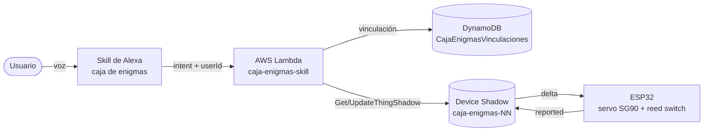

# Caja de los Enigmas — SIS-234, Prácticas 3 y 4

Objeto inteligente con ESP32 integrado con **Alexa** mediante **AWS IoT Core** (Device Shadow), **AWS Lambda** (Python) y **DynamoDB**. Es el primer módulo del proyecto final *Escape Room IoT: La Caja de los Enigmas*.

**Integrantes:** Santiago Torres · Adrián Mercado · Mateo Rojas · Lucía Escobar

## Práctica 4 (entrega del 24/11/2026)

**Informe técnico de la P4: [INFORME_P4.md](INFORME_P4.md).** El informe de la P3 sigue en [INFORME.md](INFORME.md), sin cambios.

La P4 convierte la caja en un juego de tres desafíos (memoria, distancia y luz) que se resuelve en el ESP32 y abre el servo. Alexa hace de *game master*: inicia partidas, da pistas y cambia el modo y los parámetros. Dos reglas de AWS IoT guardan las lecturas y los eventos en DynamoDB, y una Lambda programada detecta las cajas que dejan de reportar.

| Entregable (consigna, §6) | Dónde está |
|---|---|
| Informe técnico en Markdown | [INFORME_P4.md](INFORME_P4.md) |
| Código del objeto inteligente | [firmware/](firmware/) |
| Backend de la skill | [lambda/](lambda/README.md) |
| Procesamiento y almacenamiento | [lambda-almacenamiento/](lambda-almacenamiento/README.md) |
| Lógica de negocio en la Nube | [lambda-vigilancia/](lambda-vigilancia/README.md) |
| Modelo de interacción de la skill | [config/alexa/modelo-interaccion.es-US.json](config/alexa/modelo-interaccion.es-US.json) |
| Política de AWS IoT | [config/aws/politica-iot.json](config/aws/politica-iot.json) |
| Reglas de AWS IoT (SQL y acciones) | [config/aws/reglas/](config/aws/reglas/) y [permiso de invocación](config/aws/permiso-invocacion-almacenamiento.json) |
| Políticas de los roles IAM | [skill](config/aws/politica-rol-lambda.json), [almacenamiento](config/aws/politica-rol-almacenamiento.json) y [vigilancia](config/aws/politica-rol-vigilancia.json) |
| Regla programada de EventBridge | [config/aws/regla-vigilancia.json](config/aws/regla-vigilancia.json) |
| Tablas de DynamoDB | [vinculaciones](config/aws/tabla-vinculaciones.json) e [histórico](config/aws/tabla-historico.json) |
| Plantillas de configuración del objeto, sin secretos | [ConfiguracionAws.ejemplo.h](firmware/include/ConfiguracionAws.ejemplo.h) y [ConfiguracionWifi.ejemplo.h](firmware/include/ConfiguracionWifi.ejemplo.h) |
| Mockups de reportes | [docs/mockups/](docs/mockups/README.md) |
| Anexos: diagramas, fotos y evidencias | [docs/diagramas/](docs/diagramas/), [docs/evidencias/p4/](docs/evidencias/p4/) y la [hoja de pruebas en PDF](docs/evidencias/p4/pruebas/Hoja_Pruebas_P4_Caja_Enigmas.pdf) |
| Consigna | [docs/consigna/Práctica_4.md](docs/consigna/Práctica_4.md) |

## Práctica 3

El prototipo de la P3 es un montaje de mesa: un SG90 representa la cerradura y un reed con imán representa la apertura de la tapa, sin pestillo acoplado. La P4 quitó el reed.



## Estructura

```text
firmware/                Objeto inteligente (PlatformIO, C++ / Arduino)
lambda/                  Backend de la skill (Python 3.12)
lambda-almacenamiento/   Validación y guardado del histórico (P4)
lambda-vigilancia/       Detección de cajas sin reportar (P4)
config/alexa/            Modelo de interacción exportado
config/aws/              Política de IoT, reglas, roles IAM, regla programada y tablas
docs/                    Contratos, planificación, consigna, diagramas, mockups y evidencias
INFORME.md               Informe técnico de la P3
INFORME_P4.md            Informe técnico de la P4
```

- [Informe técnico de la P3](INFORME.md) e [informe técnico de la P4](INFORME_P4.md).
- [Índice de documentación](docs/README.md).
- [Backend de Alexa](lambda/README.md).
- [Contratos entre componentes](docs/contratos.md): Shadow, temas MQTT, vinculación, tabla, intents y pines.
- [Planificación por integrante](docs/planificacion/00-resumen.md).
- [Consigna](docs/consigna/Práctica_3.md).

## Firmware

Requisitos: PlatformIO (extensión de VS Code o `pio` en la terminal).

1. Crear las configuraciones locales, que Git ignora:

   ```powershell
   Copy-Item firmware/include/ConfiguracionWifi.ejemplo.h firmware/include/ConfiguracionWifi.h
   Copy-Item firmware/include/ConfiguracionAws.ejemplo.h firmware/include/ConfiguracionAws.h
   ```

2. Completar el SSID y la contraseña del WiFi (2.4 GHz), el endpoint de AWS IoT, el nombre del Thing y los tres certificados. Las instrucciones están en cada archivo.
3. Compilar, cargar y abrir el monitor desde `firmware/`:

   ```powershell
   cd firmware
   pio run
   pio run -t upload --upload-port COMx
   pio device monitor
   ```

Sin las copias locales, el proyecto compila con las plantillas vacías y no intenta conectarse.

Pruebas en la PC de la lógica del Shadow (`EstadoShadow`), sin placa. Requieren `g++` en el PATH (por ejemplo, MinGW):

```powershell
cd firmware
pio test -e pruebas
```

## Seguridad

- Los certificados, la clave privada del Thing y la contraseña del WiFi **no se versionan**: viven en `firmware/include/Configuracion*.h` o en `certificados-privados/`, ambos excluidos por `.gitignore`.
- No se usan access keys de AWS en ningún componente. La Lambda obtiene sus permisos de su rol IAM y el ESP32 se autentica con su certificado X.509.
- Antes de cada push, revisar `git status` para comprobar que no aparezca ningún secreto.
