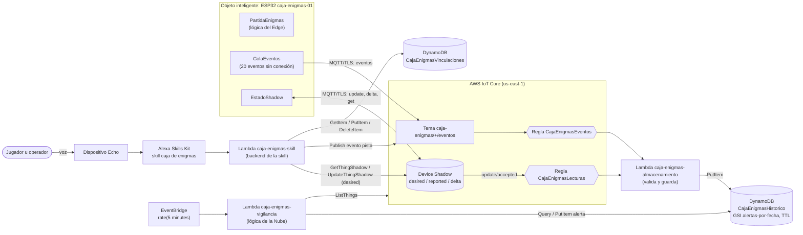
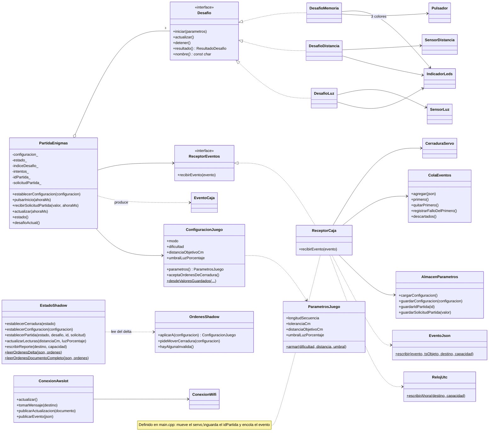
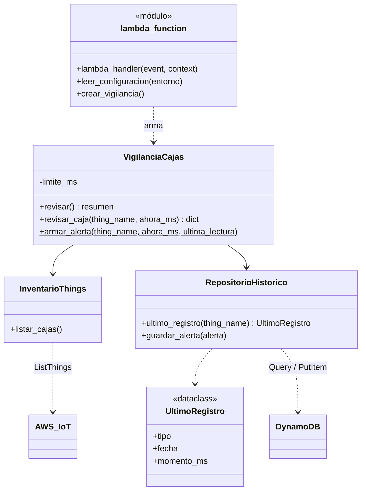
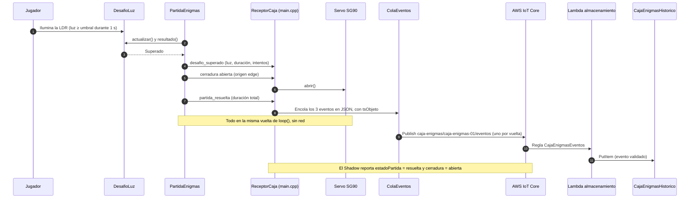
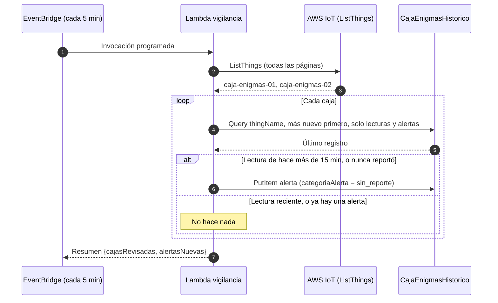
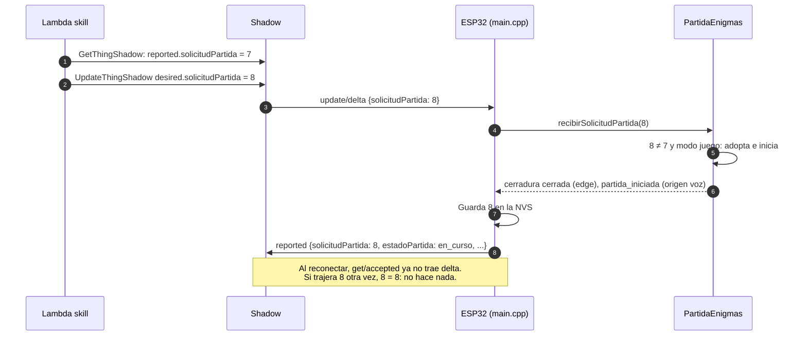
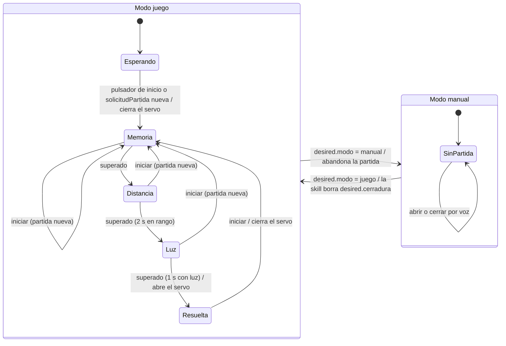

# Informe P4 — secciones de Adrián

Borrador de las secciones a cargo de Adrián, para integrar en `INFORME_P4.md`. La numeración sigue el §4.2 de la [consigna](consigna/Práctica_4.md). Los valores que faltan medir dicen **Pendiente** y se completan con las pruebas de la iteración 3.

---

## 2. Análisis y Diseño

### 2.2 Diagrama de arquitectura del sistema *(Adrián)*



- **Un dispositivo, tres funciones Lambda y una responsabilidad cada una:**
  - la skill atiende la voz;
  - la de almacenamiento valida y guarda;
  - la de vigilancia ejecuta la regla de la Nube.

  Así cada rol tiene solo los permisos que usa: la de almacenamiento solo escribe, y la de vigilancia no puede tocar los Shadows. Además, cada función se invoca con su propia frecuencia: la de almacenamiento con cada mensaje y la de vigilancia cada 5 min.
- **Alexa y la Nube nunca hablan directo con el ESP32.** La voz cambia `desired` y el ESP32 lo recibe en el `delta`. Lo único que publica fuera del Shadow es el tema de eventos.
- **Dos temas de entrada para el histórico:**
  - las lecturas viajan en el reporte del Shadow (regla `CajaEnigmasLecturas`);
  - los eventos discretos van en un tema propio (regla `CajaEnigmasEventos`), porque no son estado sino cosas que pasaron, como "se superó la memoria en 18 s con 2 intentos".

### 2.6 Especificación del documento Shadow v2 *(Adrián)*

Shadow clásico, sin nombre. La especificación completa, con ejemplos, está en [contratos.md, sección 2](contratos.md#2-documento-shadow-shadow-clásico-sin-nombre).

| Atributo | Sección | Tipo | Valores válidos | Por defecto |
|---|---|---|---|---|
| `cerradura` | `desired` / `reported` | string | `abierta`, `cerrada` | `cerrada` |
| `modo` | `desired` / `reported` | string | `juego`, `manual` | `juego` |
| `dificultad` | `desired` / `reported` | string | `facil`, `normal`, `dificil` | `normal` |
| `distanciaObjetivoCm` | `desired` / `reported` | entero | 10–40 | 20 |
| `umbralLuzPorcentaje` | `desired` / `reported` | entero | 10–95 | 70 |
| `solicitudPartida` | `desired` / `reported` | entero | ≥ 0 | 0 |
| `longitudSecuencia` | `reported` | entero | 3, 4 o 6 (según la dificultad) | 4 |
| `toleranciaCm` | `reported` | entero | 6, 4 o 2 (según la dificultad) | 4 |
| `estadoPartida` | `reported` | string | `esperando`, `en_curso`, `resuelta` | `esperando` |
| `desafioActual` | `reported` | string | `memoria`, `distancia`, `luz`, `ninguno` | `ninguno` |
| `idPartida` | `reported` | entero | ≥ 0 | 0 |
| `distanciaCm` | `reported` | entero | 2–400; se omite sin lectura válida | — |
| `luzPorcentaje` | `reported` | entero | 0–100 | — |
| `codigoVinculacion` | `reported` | string | 4 dígitos | generado en el primer arranque |
| `firmware` | `reported` | string | versión, p. ej. `0.4.0` | — |

**Uso de cada sección:**
- **`desired`** lo escribe solo la Lambda de la skill: la cerradura (en modo manual), el modo, la dificultad, los dos parámetros de calibración y `solicitudPartida`.
- **`reported`** lo escribe solo el ESP32:
  - en cada cambio, en menos de 1 s;
  - cada 60 s como respaldo, con las lecturas de los sensores;
  - en cada cambio de desafío.
- **`delta`** lo calcula AWS. El ESP32 lo recibe por `update/delta` y, al reconectar, en el `get/accepted`. Lee cada atributo por separado, ignora los desconocidos y descarta los valores inválidos, por ejemplo `"20"`, `70.5`, `-1` o `276`. Después reporta su estado real, y así el `delta` desaparece.

**Decisiones de diseño:**
- **`solicitudPartida` es un contador y no un texto como `"iniciar"`.** La skill escribe el valor reportado + 1. El ESP32 inicia una partida solo si recibe un valor distinto del suyo, así que la misma orden repetida (por ejemplo, en el `get` de cada reconexión) no inicia dos partidas.
- **La dificultad fija `longitudSecuencia` y `toleranciaCm`, que solo se reportan.** La distancia objetivo y el umbral de luz son de calibración y se cambian por separado, así no se pisan.
- **El modo, la dificultad, los parámetros y los contadores se guardan en la NVS.** Después de un reinicio sin red, la caja sigue configurada igual y no repite un `idPartida`.

### 2.3 Diagrama de clases del objeto inteligente *(Adrián y Santiago)*



- **Clases de Santiago (hardware):** `Desafio*`, `IndicadorLeds`, `Pulsador`, `SensorDistancia`, `SensorLuz` y `CerraduraServo`.
- **Clases de Adrián:** la partida, el Shadow, la persistencia, los eventos y la conexión.
- `main.cpp` arma todos los objetos y los une en `loop()`, sin lógica de negocio propia.
- **Lógica pura, sin Arduino:** `PartidaEnigmas`, `EstadoShadow`, `ParametrosJuego`/`ConfiguracionJuego`, `EventoJson`, `ColaEventos` y `RelojUtc`. Por eso se prueban en la PC (sección 4).
- **La partida no conoce el hardware:**
  - recibe los tres desafíos como `Desafio&`;
  - avisa lo que pasa a un `ReceptorEventos`, incluido cuándo cerrar o abrir la cerradura;
  - en las pruebas, el receptor es un doble que anota los eventos.

### 2.4 Diagrama de clases de la Lambda de vigilancia *(Adrián)*



`vigilancia.py` tiene la regla y no importa `boto3`: recibe el inventario, el histórico y el reloj ya armados. `lambda_function.py` solo lee las variables de entorno y crea los clientes de AWS.

### 2.5 Diagramas de secuencia de las reglas automáticas *(Adrián)*

**Regla del Edge: superar el último desafío abre la caja.**



**Regla de la Nube: caja sin reportar.**



**Inicio de partida por voz: la orden repetida no inicia dos partidas.**



**Operación sin conexión.**

```mermaid
sequenceDiagram
    participant P as PartidaEnigmas
    participant C as ColaEventos
    participant X as ConexionAwsIot
    participant I as AWS IoT Core
    Note over X,I: WiFi cortado
    P->>C: Eventos de la partida (el juego sigue)
    Note over C: Hasta 20; si se llena, se descarta el más viejo y se cuenta
    Note over X,I: WiFi vuelve: TLS, MQTT y get del Shadow
    X->>I: Reporte completo del Shadow
    loop Uno por vuelta de loop()
        C->>X: primero()
        X->>I: Publish en el tema de eventos (QoS 1)
        I-->>X: PUBACK
        X->>C: quitarPrimero()
    end
```

### 2.x Lógica de control: modos, estados y ubicación de cada regla *(Adrián)*



**Convivencia de la voz con la lógica automática:**

| | Modo `juego` (por defecto) | Modo `manual` (operador) |
|---|---|---|
| Quién mueve la cerradura | Solo el juego: cierra al iniciar una partida y abre al resolverla. | Solo la voz. |
| "Abre / cierra la caja" | La skill lo rechaza con una explicación, y el ESP32 también ignora `cerradura` en el `delta`. | Se aplica. |
| "Inicia una partida" y pulsador de inicio | Inician una partida. | Se rechaza por voz; el pulsador no hace nada. |

La regla está implementada en los dos lados:
- la skill rechaza la orden;
- el ESP32 ignora `cerradura` en modo juego.

Así, una orden vieja de "abrir" que hubiera quedado en `desired` no puede abrir la caja en medio de una partida. Además, al pasar a modo juego la skill pone `desired.cerradura` en `null`.

**Ubicación de cada regla:**

| Regla | Dónde | Latencia | Sin conexión | Histórico | Costo de mensajes | Mantenimiento |
|---|---|---|---|---|---|---|
| Partida: validar cada desafío, avanzar y abrir el servo | **Edge** | Inmediata: la apertura ocurre en la misma vuelta de `loop()` en que se cumple la condición. | Sigue funcionando: los eventos se encolan. | No lo necesita: depende solo de los sensores locales. | No genera mensajes para decidir. | Los parámetros se cambian por voz sin reprogramar. |
| Caja sin reportar (más de 15 min sin lecturas) | **Nube** | Hasta 15 + 5 = 20 min, suficiente para un aviso de mantenimiento. | Es justamente lo que detecta: el objeto no puede avisar de su propia desconexión. | La necesita: busca la última lectura de cada caja. | 288 invocaciones por día, sin mensajes del objeto. | El límite se cambia con una variable de entorno. |

**Por qué la regla de la Nube no escribe en `desired`:** la consigna pide que la lógica de la Nube actúe sobre el objeto solo a través de `desired`. Esta regla no actúa sobre el objeto, porque el objeto está apagado o sin red. Su acción es dejar una alerta en el histórico para el operador, que la ve en el panel de reportes (patrón de acceso 6). Es el ejemplo que da la consigna: *"Si el Thing no reporta durante 15 min… se implementaría con otra Lambda ejecutada de forma programada"*.

---

## 3. Desarrollo e Implementación

### 3.1 Estructura del código del objeto inteligente *(Adrián y Santiago)*

| Módulo | Responsabilidad | Autor |
|---|---|---|
| [main.cpp](../firmware/src/main.cpp) | Arma los objetos y los une en `loop()`. Define `ReceptorCaja`. | Adrián |
| [PartidaEnigmas](../firmware/src/PartidaEnigmas.cpp) | Máquina de estados de la partida (regla del Edge). | Adrián |
| [EstadoShadow](../firmware/src/EstadoShadow.cpp) | Lee el `delta` y arma el `reported`. | Adrián |
| [ParametrosJuego / ConfiguracionJuego](../firmware/src/ParametrosJuego.cpp) | Tabla de dificultades, rangos y configuración por voz. | Adrián |
| [AlmacenParametros](../firmware/src/AlmacenParametros.cpp) | Persistencia en la NVS. | Adrián |
| [EventoJson](../firmware/src/EventoJson.cpp), [ColaEventos](../firmware/src/ColaEventos.cpp), [RelojUtc](../firmware/src/RelojUtc.cpp) | Formato, cola sin conexión y hora de los eventos. | Adrián |
| [ConexionWifi](../firmware/src/ConexionWifi.cpp), [ConexionAwsIot](../firmware/src/ConexionAwsIot.cpp) | Red, TLS mutuo y MQTT. | Adrián |
| `Desafio*`, `IndicadorLeds`, `Pulsador`, `SensorDistancia`, `SensorLuz`, `CerraduraServo` | Hardware y los tres desafíos. | Santiago |

**Fragmentos clave:**
- **`loop()` nunca se bloquea.** Los desafíos miden el tiempo con `millis()`, y `pulseIn` tiene un límite de 25 ms. Además, la cola publica un solo evento por vuelta, porque cada publicación QoS 1 espera el PUBACK.
- **`aplicarOrdenes()` aplica primero la configuración y después la cerradura y la solicitud.** Si un mismo `delta` trae `modo: manual` y `cerradura: abierta`, el modo nuevo es el que decide si se obedece la cerradura.
- **`tomarLecturas()` no mide la distancia mientras corre ese desafío.** `SensorDistancia::actualizar()` entrega cada medición nueva una sola vez, así que otra llamada se la quitaría al desafío.
- **Cada evento se convierte a JSON en el momento en que ocurre.** Así `tsObjeto` es la hora del evento y no la de la publicación, que puede ser minutos después si no había red.
- **`EventoJson` escribe solo los campos de cada tipo.** La Lambda de almacenamiento valida todos los campos que llegan, y un campo de más con un valor fuera de rango (por ejemplo, `intentos: 0`) haría descartar el evento entero.

### 3.3 Configuración de AWS IoT Core *(Adrián)*

| Elemento | Valor |
|---|---|
| Things | `caja-enigmas-01` (la caja) y `caja-enigmas-02` (sin placa, para probar varios usuarios y la alerta). |
| Certificado | X.509 por Thing, emitido por AWS IoT. La clave privada vive solo en `firmware/include/ConfiguracionAws.h`, que está en `.gitignore`. |
| Política | `CajaEnigmasPolitica` v2 ([config/aws/politica-iot.json](../config/aws/politica-iot.json)). |

**Permisos de la política, cada uno limitado al Thing de la conexión** con `${iot:Connection.Thing.ThingName}`:

| Sentencia | Permiso | Por qué |
|---|---|---|
| `ConectarSoloComoSuThing` | `iot:Connect` como `client/<su Thing>`, solo si el certificado está asociado al Thing. | Ningún certificado puede conectarse como otra caja. |
| `PublicarYRecibirEnSuShadow` | `iot:Publish` e `iot:Receive` en `$aws/things/<su Thing>/shadow/*`. | Reportar y recibir el `delta` de su propio Shadow. |
| `PublicarSusEventos` | `iot:Publish` en `caja-enigmas/<su Thing>/eventos`. | Nuevo en la v2. Por eso la regla de eventos puede tomar el `thingName` del tema sin confiar en el payload. |
| `SuscribirseASuShadow` | `iot:Subscribe` en `$aws/things/<su Thing>/shadow/*`. | Suscribirse a `update/delta` y `get/accepted`. |

Ya es la política mínima: no usa comodines entre Things, y el objeto no puede suscribirse al tema de eventos ni leerlo.

### 3.4 Configuración de la Lambda de vigilancia y de la regla programada *(Adrián)*

| Elemento | Valor |
|---|---|
| Función | `caja-enigmas-vigilancia`, Python 3.12, 128 MB, *timeout* de 30 s. Código en [lambda-vigilancia/](../lambda-vigilancia/README.md). |
| Disparador | Regla de EventBridge `caja-enigmas-vigilancia-cada-5-min`, `rate(5 minutes)` ([config/aws/regla-vigilancia.json](../config/aws/regla-vigilancia.json)). |
| Variables | `TABLA_HISTORICO=CajaEnigmasHistorico`, `PREFIJO_THING=caja-enigmas-`, `MINUTOS_SIN_REPORTE=15`. |
| Rol | `caja-enigmas-vigilancia-rol` ([config/aws/politica-rol-vigilancia.json](../config/aws/politica-rol-vigilancia.json)). |

**Permisos del rol:**

| Permiso | Recurso | Por qué |
|---|---|---|
| `logs:CreateLogGroup`, `CreateLogStream`, `PutLogEvents` | Su propio grupo de logs | Registrar cada revisión. |
| `iot:ListThings` | `*` | Revisar también las cajas que nunca reportaron. Esta acción no admite permisos por recurso. |
| `dynamodb:Query`, `dynamodb:PutItem` | Solo la tabla `CajaEnigmasHistorico` | Leer la última lectura y guardar la alerta. No puede borrar ni modificar ítems. |

- La regla de EventBridge **no usa un rol IAM**: invoca la función con el permiso basado en recursos que la consola agrega al crear el disparador.
- A diferencia del ejemplo de la consigna, esta Lambda **no necesita `iot:UpdateThingShadow`**, porque no actúa sobre el objeto.
- Los permisos asignados **ya son los mínimos de producción**. La única mejora posible sería reemplazar `ListThings` por un grupo de Things, si hubiera muchas cajas.

---

## 4. Pruebas y Validaciones *(Adrián)*

### 4.x Pruebas automatizadas

| Conjunto | Cómo se corre | Casos |
|---|---|---|
| Firmware, lógica pura (Unity, en la PC) | `pio test -e pruebas`, desde `firmware/` | 89: `EstadoShadow` 32, `ParametrosJuego` 18, `PartidaEnigmas` 20, `EventoJson`/`RelojUtc` 11, `ColaEventos` 8 |
| Lambda de vigilancia (`unittest`) | `python -m unittest discover -s tests`, desde `lambda-vigilancia/` | 20 |

Cubren, entre otros:
- la partida completa con la secuencia de eventos del contrato;
- el fallo y el reintento;
- el modo manual;
- la solicitud repetida;
- los valores inválidos del `delta`;
- el formato exacto de `tsObjeto`;
- la cola llena y los eventos rechazados;
- las alertas no repetidas.

### 4.x Requerimientos no funcionales a cargo de Adrián

| Atributo | Valor declarado | Procedimiento | Resultado |
|---|---|---|---|
| Operación sin conexión | El juego sigue y el servo abre sin red. Los eventos se guardan (hasta 20) y llegan en orden al volver. | Cortar el WiFi en medio de una partida, 3 veces. Contar los eventos impresos por Serial ("Evento: …") y los ítems guardados en DynamoDB. | **Pendiente** |
| Reconexión con `desired` pendiente | Los cambios hechos por voz sin red se aplican solos al reconectar. | Con la placa sin red, cambiar el modo y la dificultad por voz y reconectar. Comprobar el `reported`. | **Pendiente** |
| Tiempo de respuesta de la regla de la Nube | ≤ 20 min (15 + 5). | Apagar la placa y medir desde la última lectura hasta el `tsGuardado` de la alerta, 3 veces. | **Pendiente** |
| Tiempo de respuesta de la regla del Edge | **Pendiente**: se declara con la medición (se espera menos de 100 ms). | Con Santiago: la marca de `millis()` del último desafío contra la de "Cerradura: abierta a los … ms", 10 veces. | **Pendiente** |
| Mensajes por día | Unos 1 440 reportes periódicos más unos 11 mensajes por partida. | Contar las publicaciones durante 10 min con el cliente de pruebas MQTT y extrapolar. | **Pendiente** |

**Estimación de mensajes para el costo (dato para Lucía):**
- **Reportes periódicos del Shadow:** 1 por minuto, o sea 1 440 por día y por caja.
- **Por partida sin fallos:** 7 eventos y unos 4 reportes del Shadow (al iniciar, en cada cambio de desafío y al resolver), o sea unos 11 mensajes.
  - Los 7 eventos son: cerradura, partida_iniciada, 3 × desafio_superado, cerradura y partida_resuelta.
  - Cada fallo en la memoria suma 1 evento.
- **Con 20 partidas por día:** unos 1 700 mensajes por día y por caja, o sea unos 50 000 por mes.
- **Vigilancia:** 288 invocaciones por día, y en cada una una `Query` por caja más un `PutItem` por cada alerta nueva.
