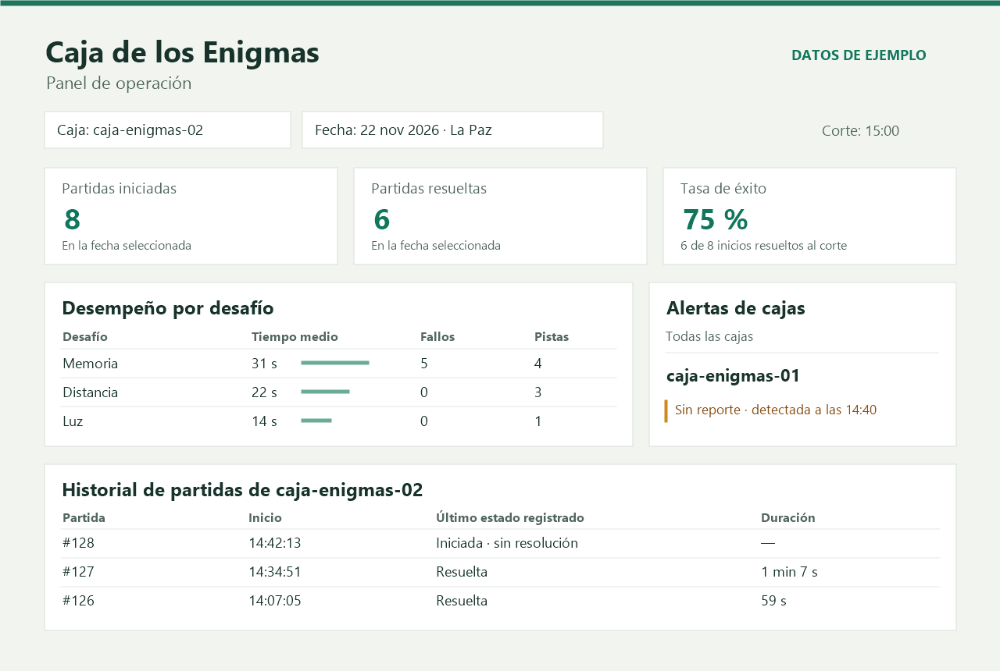

# Panel de operación · RF15

El panel permite elegir una caja y un período. Los indicadores y el historial corresponden a esa selección y las alertas abarcan todas las cajas. Las cifras de la imagen son ilustrativas.

## Consultas de origen

Todas las consultas usan `CajaEnigmasHistorico`, descrita en el [contrato §5.2](../contratos.md#52-cajaenigmashistorico-nueva). Para los patrones 1–4, la tabla se consulta con `thingName` como clave de partición y un rango de `ts` como clave de ordenamiento, sin índice secundario. Para un día de La Paz, se convierten sus límites a UTC. El intervalo se implementa con `BETWEEN` desde el inicio hasta el último milisegundo antes del límite siguiente, incluyendo el sufijo de tipo en el límite superior. Se leen todas las páginas antes de calcular los indicadores.

| Elemento | Patrón | Filtro y cálculo | Decisión del operador |
|---|---|---|---|
| Partidas del día | 2 | Filtrar `tipo = evento` y contar por separado `partida_iniciada` y `partida_resuelta` según su fecha. Para la tasa, emparejar por `idPartida` los inicios del día con sus resoluciones observadas hasta la hora de corte, ampliando el rango de las resoluciones si hace falta. Dividir los inicios con resolución por los inicios del día. Si no hay inicios, mostrar «Sin partidas». | Revisar la dificultad si se inician partidas y pocas se resuelven. |
| Tiempo medio y fallos por desafío | 3 | Filtrar `desafio_superado` y `desafio_fallado`. Para cada `desafio`, promediar `duracionMs` de los eventos superados, convertir a segundos y contar los eventos de fallo. Si el desafío carece de eventos superados, el promedio queda sin datos. | Ajustar la dificultad o recalibrar el desafío más lento. |
| Pistas por desafío | 4 | Filtrar `evento = pista` y contar por `desafio`. El evento de pista carece de `idPartida`, por lo que el conteo pertenece al desafío y al período. | Aclarar las instrucciones del desafío que más pistas necesita. |
| Historial por caja | 1 | Filtrar `tipo = evento` y agrupar los eventos con `idPartida`. Mostrar iniciada o resuelta según los eventos disponibles y usar `duracionMs` de `partida_resuelta` para la duración. Un inicio sin resolución registrada puede ser una partida en curso, abandonada o pendiente de sincronizar. | Localizar una partida para inspeccionar sus eventos. |
| Alertas de cajas | 6 | Consultar el GSI `alertas-por-fecha` con `categoriaAlerta = sin_reporte`, clave de ordenamiento `ts` y `ScanIndexForward = false`. Mostrar `thingName` y la hora de emisión. Si el registro no trae `ultimaLectura`, la caja aún no había reportado al detectarse la alerta. | Identificar qué caja conviene revisar antes de la siguiente sesión. |
